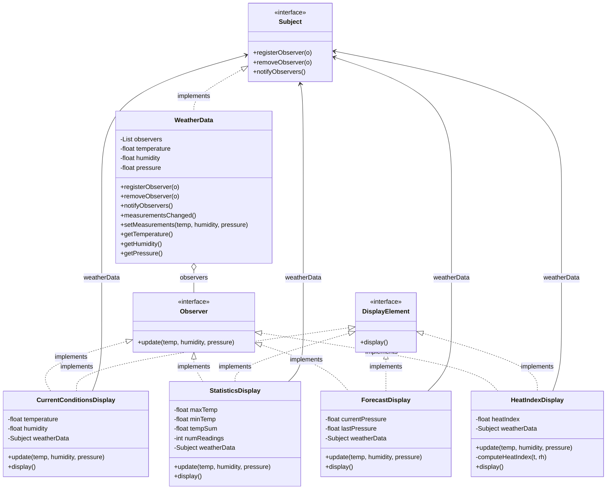

# chapter 2

내용: 옵저버 패턴
작성일: 2026/09/07
중요: No
분야: 디자인패턴 스터디 (https://app.notion.com/p/3c9c9dbbf2a880ceb2f7d88404185c88?pvs=21)
유형: 헤드퍼스트 (https://app.notion.com/p/3c9c9dbbf2a880739f4cc73385614382?pvs=21)

# 옵저버 패턴 - 기상 모니터링 애플리케이션🌦️

---

### 옵저버 패턴 요약

1. 한 객체(주제, Subject)의 상태가 바뀌면 그 객체에 의존하는 다른 객체들(옵저버, Observer)에게 연락이 가고 자동으로 내용이 갱신되는 **1:N(일대다) 의존성**을 정의하는 패턴
2. 객체들 사이에 **느슨한 결합(Loose Coupling)**을 만들어 상호작용하도록 설계하는 방식
3. 실무 및 게임 개발에서 이벤트 리스너, UI 갱신, 알림 시스템 등에 매일 같이 쓰이는 핵심 패턴

### 도서 내 문제 상황

1. 기상 스테이션의 측정값(온도, 습도, 기압)이 바뀔 때마다 세 가지 디스플레이(현재 상태, 기상 통계, 기상 예보)를 갱신해야 한다.
2. **처음 시도했던 잘못된 접근 방식 (나쁜 예시):**
   ```java
   public void measurementsChanged() {
       float temp = getTemperature();
       float humidity = getHumidity();
       float pressure = getPressure();

       // ❌ 구체적인 구현(클래스)에 맞춰서 하드코딩함
       currentConditionsDisplay.update(temp, humidity, pressure);
       statisticsDisplay.update(temp, humidity, pressure);
       forecastDisplay.update(temp, humidity, pressure);
   }
   ```
3. **이 방식이 초래하는 문제점:**
   1. **구체적인 구현에 의존함:** 새로운 디스플레이 화면(예: 체감온도 디스플레이)을 추가하거나 기존 디스플레이를 삭제할 때마다 `WeatherData`의 코드를 직접 수정해야 함 (OCP 위배).
   2. **동적 변경 불가:** 프로그램 실행 중(런타임)에 디스플레이 요소를 추가하거나 제거할 수 없음.
   3. **캡슐화 위반:** 바뀌는 부분(디스플레이 화면 목록)이 제대로 캡슐화되지 않음.

### 문제를 해결한 3대 객체지향 디자인 원칙

1. **상호작용하는 객체 사이에는 가능하면 느슨한 결합(Loose Coupling)을 사용한다.**
   - 주제(Subject)는 옵저버가 특정 인터페이스(`Observer`)를 구현한다는 사실만 알 뿐, 옵저버가 구체적으로 어떤 클래스인지, 내부에서 무슨 일을 하는지 전혀 알 필요가 없다.
   - 새로운 옵저버 클래스가 수십 개 추가되어도 주제 코드는 단 한 줄도 바뀌지 않는다.
2. **구현보다는 인터페이스에 맞춰서 프로그래밍한다.**
   - `Subject`와 `Observer`라는 상위 인터페이스를 정의하고, 구체 클래스들이 서로 직접 참조하는 대신 이 인터페이스를 통해 대화하도록 설계했다.
3. **달라지는 부분을 찾아내고 달라지지 않는 부분과 분리한다.**
   - 항상 달라지는 부분인 '알림을 받는 객체들의 목록(디스플레이)'을 분리하여 `Observer` 인터페이스로 캡슐화하고, 달라지지 않는 부분인 '기상 데이터를 수집하고 통지하는 기본 로직'과 격리했다.

### 구조 다이어그램 및 설계 분석



1. **Subject :** 관찰 대상(주제)의 계약을 정의. 옵저버 등록(`registerObserver`), 제거(`removeObserver`), 알림(`notifyObservers`)을 담당한다.
2. **Observer :** 주제의 데이터가 갱신되었을 때 연락을 받기 위한 인터페이스(`update`)를 정의한다.
3. **DisplayElement :** 화면에 결과를 표시해야 하는 모든 디스플레이 객체가 구현하는 인터페이스(`display`).
4. **WeatherData :** `Subject`를 실제로 구현한 클래스. 관찰자 목록을 유지하며 측정값이 변경되면 등록된 모든 관찰자에게 알림을 보낸다.
5. **각 Display 클래스들 :** `Observer`와 `DisplayElement`를 동시 구현하여, 주제로부터 알림이 오면 데이터를 갱신하고 화면에 출력한다.

### 게임 개발 및 실무 적용 사례

1. **이벤트 전파 및 UI 시스템 (Event-Driven System)**
   - 플레이어의 체력(HP)이 변할 때 Player 클래스가 직접 UI 체력바, 사운드 매니저, 피격 카메라 셰이크, 게임오버 감지기 등을 하나하나 부르지 않고 `OnHealthChanged` 이벤트를 발행하면 각 리스너 객체가 독립적으로 처리한다.
2. **퀘스트 및 업적 시스템**
   - 몬스터 처치, 아이템 획득, 특정 지역 도달 등 인게임 액션이 일어날 때 이벤트를 브로드캐스팅하면 관련 퀘스트 및 도전과제 시스템이 자동으로 진행도를 업데이트한다.
3. **상태 관리 및 메시지 브로커**
   - 웹/앱 프론트엔드의 Redux, Zustand, RxJS 등의 구독(Subscribe) 메커니즘의 근간이 된다.
   - 백엔드의 Kafka, RabbitMQ의 Pub-Sub 아키텍처 또한 옵저버 패턴의 분산 시스템 확장 버전이다.

### 장점과 단점 요약

1. **장점**
   - **느슨한 결합(Loose Coupling):** 주제와 옵저버가 서로의 구체적인 타입을 몰라도 인터페이스만으로 상호작용할 수 있다.
   - **개방 폐쇄 원칙(OCP) 준수:** 새로운 디스플레이나 알림 대상을 추가해도 기존 주제 코드를 한 줄도 수정할 필요가 없다.
   - **런타임 동적 제어:** 프로그램 실행 도중 언제든지 옵저버를 추가하거나 제외할 수 있다.
2. **단점**
   - **알림 순서의 무작위성:** 옵저버들에게 통지가 도달하는 순서는 보장되지 않으므로 순서에 의존하는 설계를 하면 버그가 발생한다.
   - **메모리 누수 위험 (Lapsed Listener Problem):** 다 쓴 옵저버를 등록 해제(removeObserver)하지 않으면 GC가 수거하지 못해 메모리가 낭비된다.
   - **과도한 통지 발생:** 데이터 변경이 잦을 때 매번 모든 옵저버를 호출하면 성능 부하가 생길 수 있다.

<aside>
📌

- **옵저버 패턴 딥다이브 (Deep Dive)**

    ### 1. 푸시(Push) 방식 vs 풀(Pull) 방식

    - **현재 예제 (푸시 방식):**
        - 주제가 `update(temperature, humidity, pressure)` 처럼 자신이 가진 모든 데이터를 옵저버에게 강제로 밀어넣음.
        - **문제점:** 새 데이터(예: 풍속 `windSpeed`)가 생기면 `Observer` 인터페이스의 `update()` 메서드 시그니처를 고쳐야 하고, 이를 구현한 모든 디스플레이 클래스가 컴파일 에러를 뿜게 됨!
    - **풀(Pull) 방식 (권장되는 유연한 방식):**
        - 주제는 "데이터가 변경되었다"는 신호만 주거나 자기 자신(`this`)을 넘겨주고, 옵저버가 필요한 데이터만 getter로 당겨오는 방식.
        
        ```java
        public interface Observer {
            void update(); // 또는 void update(Subject s);
        }
        
        // 옵저버 구현체 내부
        public void update() {
            this.temperature = weatherData.getTemperature(); // 필요한 것만 골라서 가져옴
            display();
        }
        ```
        
        - 새로운 측정값이 수백 개 추가되어도 `Observer` 인터페이스는 단 한 글자도 수정할 필요가 없음.

    ──────

    ### 2. 자바 내장 Observable / Observer가 폐기(Deprecated)된 이유

    과거 자바 기본 라이브러리에 `java.util.Observable`과 `java.util.Observer`가 제공되었으나, **Java 9부터 공식 Deprecated** 되었다.

    | 문제점 | 세부 내용 | 위배된 객체지향 원칙 |
    | --- | --- | --- |
    | **클래스로 설계됨** | `Observable`이 인터페이스가 아닌 '클래스'라서, 이미 다른 부모 클래스를 상속받은 객체는 사용할 수 없음 (자바는 다중상속 불가) | 상속보다는 합성을 활용한다 |
    | **protected 메서드** | 상태 변경 플래그를 켜는 `setChanged()`가 `protected`로 막혀 있어 반드시 상속해야만 쓸 수 있고 외부에서 합성으로 가져다 쓰지 못함 | 구현보다 인터페이스에 맞춘다 |

    - **실무 대안:** 오늘날 실무에서는 직접 인터페이스를 설계하거나, `PropertyChangeListener`, Reactive Streams(`Flow` API), 이벤트 버스를 주로 사용한다.

    ──────

    ### 3. 생성자 안에서 `registerObserver(this)` 호출 시 주의점

    - **장점:** 객체 생성과 동시에 자동으로 구독이 완료되므로 코드가 간결해짐.
    - **실무 주의점 (This Reference Escape):**
        - 생성자가 끝나기 전에 `this`를 다른 객체에 전달하면, 멀티스레드 환경에서 **"아직 필드 초기화가 덜 끝난 불완전한 객체"**에 다른 스레드가 접근할 위험이 존재함.
        - 엄격한 안정성이 요구될 때는 객체를 완전히 생성한 후 외부에서 등록하거나 정적 팩토리 메서드를 쓰는 것이 안전함.

    ──────

    ### 4. 침묵하는 버그: Lapsed Listener (메모리 누수)

    - Subject는 Observer 객체들의 참조를 리스트에 보관한다.
    - 화면을 닫거나 옵저버를 더 이상 안 쓰더라도 `weatherData.removeObserver(display)`를 호출하지 않으면, 가비지 컬렉터(GC)는 Subject가 참조를 쥐고 있으므로 옵저버 객체를 절대 메모리에서 해제하지 않는다.
    - **해결책:** 옵저버의 생명주기가 끝날 때는 반드시 등록 해제(Unsubscribe)를 호출해 주어야 한다!
</aside>

---

### 📂 chapter2 폴더

- **WeatherStation.java**

    ```java
    package chapter2;

    import chapter2.Actor.CurrentConditionsDisplay;
    import chapter2.Actor.ForecastDisplay;
    import chapter2.Actor.HeatIndexDisplay;
    import chapter2.Actor.StatisticsDisplay;
    import chapter2.Actor.WeatherData;

    public class WeatherStation {

        public static void main(String[] args) {
            WeatherData weatherData = new WeatherData();

            CurrentConditionsDisplay currentDisplay = new CurrentConditionsDisplay(weatherData);
            StatisticsDisplay statisticsDisplay = new StatisticsDisplay(weatherData);
            ForecastDisplay forecastDisplay = new ForecastDisplay(weatherData);
            HeatIndexDisplay heatIndexDisplay = new HeatIndexDisplay(weatherData);

            System.out.println("=== 첫 번째 기상 데이터 업데이트 ===");
            weatherData.setMeasurements(80, 65, 30.4f);

            System.out.println("\n=== 두 번째 기상 데이터 업데이트 ===");
            weatherData.setMeasurements(82, 70, 29.2f);

            System.out.println("\n=== 세 번째 기상 데이터 업데이트 (현재 상태 디스플레이 제거 후) ===");
            weatherData.removeObserver(currentDisplay);
            weatherData.setMeasurements(78, 90, 29.2f);
        }
    }
    ```

### 📂 chapter2.Interface.Subject 폴더

- **Subject.java**

    ```java
    package chapter2.Interface.Subject;

    import chapter2.Interface.Observer.Observer;

    public interface Subject {
        void registerObserver(Observer o);
        void removeObserver(Observer o);
        void notifyObservers();
    }
    ```

### 📂 chapter2.Interface.Observer 폴더

- **Observer.java**

    ```java
    package chapter2.Interface.Observer;

    public interface Observer {
        void update(float temp, float humidity, float pressure);
    }
    ```

### 📂 chapter2.Interface.Display 폴더

- **DisplayElement.java**

    ```java
    package chapter2.Interface.Display;

    public interface DisplayElement {
        void display();
    }
    ```

### 📂 chapter2.Actor 폴더

- **WeatherData.java**

    ```java
    package chapter2.Actor;

    import chapter2.Interface.Observer.Observer;
    import chapter2.Interface.Subject.Subject;

    import java.util.ArrayList;
    import java.util.List;

    public class WeatherData implements Subject {
        private List<Observer> observers;
        private float temperature;
        private float humidity;
        private float pressure;

        public WeatherData() {
            observers = new ArrayList<>();
        }

        @Override
        public void registerObserver(Observer o) {
            observers.add(o);
        }

        @Override
        public void removeObserver(Observer o) {
            observers.remove(o);
        }

        @Override
        public void notifyObservers() {
            for (Observer observer : observers) {
                observer.update(temperature, humidity, pressure);
            }
        }

        public void measurementsChanged() {
            notifyObservers();
        }

        public void setMeasurements(float temperature, float humidity, float pressure) {
            this.temperature = temperature;
            this.humidity = humidity;
            this.pressure = pressure;
            measurementsChanged();
        }

        public float getTemperature() {
            return temperature;
        }

        public float getHumidity() {
            return humidity;
        }

        public float getPressure() {
            return pressure;
        }
    }
    ```

- **CurrentConditionsDisplay.java**

    ```java
    package chapter2.Actor;

    import chapter2.Interface.Display.DisplayElement;
    import chapter2.Interface.Observer.Observer;
    import chapter2.Interface.Subject.Subject;

    public class CurrentConditionsDisplay implements Observer, DisplayElement {
        private float temperature;
        private float humidity;
        private Subject weatherData;

        public CurrentConditionsDisplay(Subject weatherData) {
            this.weatherData = weatherData;
            weatherData.registerObserver(this);
        }

        @Override
        public void update(float temperature, float humidity, float pressure) {
            this.temperature = temperature;
            this.humidity = humidity;
            display();
        }

        @Override
        public void display() {
            System.out.println("현재 상태: 온도 " + temperature + "F, 습도 " + humidity + "%");
        }
    }
    ```

- **StatisticsDisplay.java**

    ```java
    package chapter2.Actor;

    import chapter2.Interface.Display.DisplayElement;
    import chapter2.Interface.Observer.Observer;
    import chapter2.Interface.Subject.Subject;

    public class StatisticsDisplay implements Observer, DisplayElement {
        private float maxTemp = 0.0f;
        private float minTemp = 200;
        private float tempSum = 0.0f;
        private int numReadings;
        private Subject weatherData;

        public StatisticsDisplay(Subject weatherData) {
            this.weatherData = weatherData;
            weatherData.registerObserver(this);
        }

        @Override
        public void update(float temp, float humidity, float pressure) {
            tempSum += temp;
            numReadings++;

            if (temp > maxTemp) {
                maxTemp = temp;
            }

            if (temp < minTemp) {
                minTemp = temp;
            }

            display();
        }

        @Override
        public void display() {
            System.out.println("기상 통계: 평균/최고/최저 온도 = " + (tempSum / numReadings) + "/" + maxTemp + "/" + minTemp);
        }
    }
    ```

- **ForecastDisplay.java**

    ```java
    package chapter2.Actor;

    import chapter2.Interface.Display.DisplayElement;
    import chapter2.Interface.Observer.Observer;
    import chapter2.Interface.Subject.Subject;

    public class ForecastDisplay implements Observer, DisplayElement {
        private float currentPressure = 29.92f;
        private float lastPressure;
        private Subject weatherData;

        public ForecastDisplay(Subject weatherData) {
            this.weatherData = weatherData;
            weatherData.registerObserver(this);
        }

        @Override
        public void update(float temp, float humidity, float pressure) {
            lastPressure = currentPressure;
            currentPressure = pressure;

            display();
        }

        @Override
        public void display() {
            System.out.print("기상 예보: ");
            if (currentPressure > lastPressure) {
                System.out.println("날씨가 좋아지고 있습니다!");
            } else if (currentPressure == lastPressure) {
                System.out.println("지금과 비슷한 날씨가 유지됩니다.");
            } else if (currentPressure < lastPressure) {
                System.out.println("쌀쌀하고 비가 오는 날씨에 유의하세요.");
            }
        }
    }
    ```

- **HeatIndexDisplay.java**

    ```java
    package chapter2.Actor;

    import chapter2.Interface.Display.DisplayElement;
    import chapter2.Interface.Observer.Observer;
    import chapter2.Interface.Subject.Subject;

    public class HeatIndexDisplay implements Observer, DisplayElement {
        private float heatIndex = 0.0f;
        private Subject weatherData;

        public HeatIndexDisplay(Subject weatherData) {
            this.weatherData = weatherData;
            weatherData.registerObserver(this);
        }

        @Override
        public void update(float t, float rh, float pressure) {
            heatIndex = computeHeatIndex(t, rh);
            display();
        }

        private float computeHeatIndex(float t, float rh) {
            float index = (float)((16.923 + (0.185212 * t) + (5.37941 * rh) - (0.100254 * t * rh)
                + (0.00941695 * (t * t)) + (0.00728898 * (rh * rh))
                + (0.000345372 * (t * t * rh)) - (0.000814971 * (t * rh * rh))
                + (0.0000102102 * (t * t * rh * rh)) - (0.000038646 * (t * t * t))
                + (0.0000291583 * (rh * rh * rh)) + (0.00000142721 * (t * t * t * rh))
                + (0.00000197483 * (t * rh * rh * rh)) - (0.0000000218429 * (t * t * t * rh * rh))
                + 0.000000000843296 * (t * t * rh * rh * rh))
                - (0.0000000000481975 * (t * t * t * rh * rh * rh)));
            return index;
        }

        @Override
        public void display() {
            System.out.println("체감 온도(불쾌지수): " + heatIndex);
        }
    }
    ```