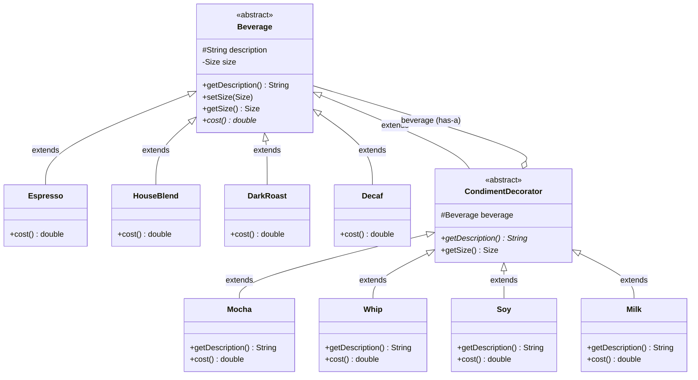

# chapter 3

내용: 데코레이터 패턴
작성일: 2026/09/10
중요: No
분야: 디자인패턴 스터디 (https://app.notion.com/p/3c9c9dbbf2a880ceb2f7d88404185c88?pvs=21)
유형: 헤드퍼스트 (https://app.notion.com/p/3c9c9dbbf2a880739f4cc73385614382?pvs=21)

# 데코레이터 패턴 - 스타버즈 커피점 주문 시스템☕

---

### 데코레이터 패턴 요약

1. 객체에 추가 요소를 **동적으로 유연하게 덧붙이는(Decorate)** 패턴
2. 서브클래스를 만들어 상속하는 방식보다 훨씬 유연하게 기능을 확장할 수 있는 대안
3. 객체를 감싸는(Wrapping) 방식을 통해 기존 코드를 건드리지 않고도 새로운 행동을 추가할 수 있음

### 도서 내 문제 상황

1. 스타버즈 커피점의 음료 주문 시스템을 설계해야 한다.
2. **처음 시도했던 잘못된 접근 방식 (나쁜 예시 1: 서브클래스 폭발):**
   - `Beverage` 슈퍼클래스를 상속받아 모든 메뉴 조합을 개별 클래스로 생성:
     `HouseBlendWithWhipAndMocha`, `DarkRoastWithMilk`, `DecafWithSoyAndWhip` ...
   - **문제점:** 첨가물 종류가 조금만 늘어나도 수십, 수백 개의 클래스가 생겨나는 **클래스 폭발(Class Explosion)** 발생!
3. **두 번째 시도했던 잘못된 접근 방식 (나쁜 예시 2: 슈퍼클래스 몰아넣기):**
   ```java
   public class Beverage {
       private boolean milk;
       private boolean soy;
       private boolean mocha;
       private boolean whip;

       public double cost() {
           double total = 0;
           if (hasMilk()) total += milkCost;
           if (hasSoy()) total += soyCost;
           ...
       }
   }
   ```
4. **이 방식이 초래하는 치명적인 문제점:**
   1. **OCP(개방-폐쇄 원칙) 위배:** 첨가물 가격이 바뀌거나 새 첨가물이 추가될 때마다 `Beverage` 코드를 직접 수정해야 함.
   2. **서브클래스 부적합:** 아이스티나 탄산수처럼 특정 첨가물(우유)이 전혀 어울리지 않는 음료도 쓸데없이 해당 메서드를 상속받음.
   3. **중복 추가 불가:** "모카 시럽 2번 넣어주세요(더블 모카)" 같은 요구사항을 boolean 플래그로는 처리할 수 없음.

### 문제를 해결한 3대 객체지향 디자인 원칙

1. **클래스는 확장에 대해서는 열려 있어야 하지만, 코드 변경에 대해서는 닫혀 있어야 한다 (OCP: Open-Closed Principle).**
   - 기존의 `Beverage`나 구체 음료 클래스 코드를 한 줄도 고치지 않고도, 새로운 음료나 새로운 첨가물(데코레이터)을 무한히 추가 확장할 수 있다.
2. **상속보다는 합성을 활용한다 (Composition over Inheritance).**
   - 상속을 통한 정적 확장이 아닌, 객체 레퍼런스를 포함(합성)하고 감싸는 방식을 사용하여 런타임에 동적으로 행동을 조합한다.
3. **구현보다는 인터페이스(슈퍼타입)에 맞춰서 프로그래밍한다.**
   - 데코레이터(`CondimentDecorator`)와 기본 음료(`Beverage`)가 동일한 슈퍼타입을 상속/구현하므로, 클라이언트는 자신이 다루는 대상이 원본 음료인지 장식된 음료인지 신경 쓸 필요가 없다.

### 구조 다이어그램 및 설계 분석



1. **Component (`Beverage`):** 기본 음료 및 데코레이터가 공통으로 가질 슈퍼타입을 정의하는 추상 클래스.
2. **Concrete Component (`Espresso`, `DarkRoast`, `HouseBlend`, `Decaf`):** 데코레이터에 의해 동적으로 감싸질 기본 객체.
3. **Decorator (`CondimentDecorator`):** 자신이 감쌀 `Component`와 동일한 타입을 상속받으며, 감싸는 객체(`beverage`)를 참조한다.
4. **Concrete Decorator (`Mocha`, `Whip`, `Soy`, `Milk`):** 감싸고 있는 객체의 메서드(`cost()`, `getDescription()`)를 호출한 결과에 자신만의 추가 로직/금액을 덧붙인다.

### 게임 개발 및 실무 적용 사례

1. **게임 장비 인챈트 / 소켓 / 룬 시스템:**
   - 기본 무기 객체(`Sword`)에 화염 인챈트(`FireEnchantmentDecorator`), 치명타 룬(`CriticalRuneDecorator`), 축복 버프(`BlessingDecorator`)를 겹겹이 감싸서 최종 공격력(`getDamage()`) 및 특수 효과를 동적으로 계산.
2. **Java 표준 I/O 스트림 라이브러리:**
   - `FileInputStream` (원본 바이트 소스) $\rightarrow$ `BufferedInputStream` (버퍼링 기능 추가) $\rightarrow$ `LineNumberInputStream` / `LowerCaseInputStream` (데이터 변환 가공).
3. **웹 서버 HTTP 미들웨어 및 서블릿 필터:**
   - `HttpServletRequestWrapper` / `HttpServletResponseWrapper`를 이용해 본체 요청/응답 객체를 래핑하여 GZIP 압축, 인증/보안 헤더 삽입, 요청 파라미터 XSS 필터링 등을 모듈식으로 장식.
4. **Spring Security 및 캐싱/트랜잭션 프록시:**
   - 기본 Service 객체에 트랜잭션 시작/커밋, 캐시 조회/저장, 실행 시간 로깅 데코레이터를 적용.

### 장점과 단점 요약

1. **장점**
   - **OCP 준수 및 높은 유연성:** 기존 코드를 수정하지 않고 새 기능을 런타임에 동적으로 조합할 수 있다.
   - **클래스 폭발 방지:** 모든 조합 경우의 수마다 상속 클래스를 만들 필요가 없다.
   - **단일 책임 원칙(SRP):** 각 데코레이터는 자신이 맡은 한 가지 책임(예: 모카 추가, 휘핑 추가)에만 집중한다.
2. **단점**
   - **자잘한 객체(Small Objects) 증가:** 객체를 여러 겹 감싸면서 작은 단위의 래퍼 객체들이 시스템에 너무 많이 생성된다.
   - **구체적인 타입 의존성 상실:** 데코레이터로 감싸면 겉보기 타입은 최상위 타입(`Beverage`)으로 다뤄지므로, `instanceof Espresso` 같은 구체 클래스 검증 코드가 깨질 수 있다.
   - **조립 및 디버깅 복잡성:** 감싸는 순서에 민감한 로직이 있을 경우 추적이 까다로울 수 있다. (이를 해결하기 위해 실무에서는 팩토리/빌더 패턴과 결합한다.)

<aside>
📌

- **데코레이터 패턴 딥다이브 (Deep Dive)**

    ### 1. 상속(`extends`)을 썼는데 왜 "상속보다 합성"이라고 할까?
    - `CondimentDecorator extends Beverage`로 상속을 쓰는 유일한 이유는 **'타입을 맞추기 위해서(Type-Matching)'**이다.
    - 부모의 행동을 물려받아 재사용하려는 것이 아니라, **"데코레이터도 음료와 완전히 같은 자리에 들어갈 수 있어야 한다"**는 다형성을 만족시키기 위한 상속이다.
    - 실제 행동(`cost()`, `getDescription()`) 확장은 상속이 아니라 감싸고 있는 `beverage` 레퍼런스(**합성, Composition**)에 위임하여 처리한다.

    ──────

    ### 2. `CondimentDecorator`에 `abstract getDescription()`을 다시 선언한 이유
    - `Beverage` 클래스에는 이미 `public String getDescription() { return description; }` 구현이 제공되어 있다.
    - 만약 `CondimentDecorator`에서 이를 다시 선언하지 않는다면, 서브클래스 개발자가 실수로 `getDescription()` 오버라이딩을 빼먹었을 때 부모의 기본 문자열("제목 없음")이 그대로 반환되는 버그가 생긴다.
    - 추상 데코레이터에서 이를 **`public abstract String getDescription();`**으로 다시 선언함으로써, **모든 첨가물 데코레이터가 반드시 자신만의 설명을 덧붙이도록 강제**한 것이다.

    ──────

    ### 3. 음료 사이즈(Size: Tall, Grande, Venti)에 따른 가격 변동 처리
    - 스타버즈 커피에서 톨/그란데/벤티 사이즈별로 첨가물 가격이 달라지는 요구사항이 추가될 수 있다.
    - `Soy` 클래스처럼 `beverage.getSize()`를 확인하여 사이즈별로 가격을 차등 적용(`+0.10`, `+0.15`, `+0.20`)할 수 있다.
    - 데코레이터의 `getSize()`는 자신이 감싸고 있는 원본 음료의 사이즈를 위임받아 반환하도록 설계했다.

    ──────

    ### 4. 자바 I/O 속 데코레이터 패턴과 한계점
    - 자바의 `InputStream` 패밀리는 데코레이터 패턴의 대표적인 구현체이다.
    - `new LowerCaseInputStream(new BufferedInputStream(new FileInputStream("test.txt")))`
    - 데코레이터를 중첩할 때 코드가 장황해지는 단점은 실무에서 **팩토리(Factory) 패턴**이나 **빌더(Builder) 패턴**을 덧붙여 조립 과정을 캡슐화함으로써 깔끔하게 해결한다.
</aside>

---

### 📂 chapter3 폴더

- **StarbuzzCoffee.java**

    ```java
    package chapter3;

    import chapter3.Actor.Beverage;
    import chapter3.Actor.DarkRoast;
    import chapter3.Actor.Espresso;
    import chapter3.Actor.HouseBlend;
    import chapter3.Decorator.Condiment.Milk;
    import chapter3.Decorator.Condiment.Mocha;
    import chapter3.Decorator.Condiment.Soy;
    import chapter3.Decorator.Condiment.Whip;

    public class StarbuzzCoffee {

        public static void main(String[] args) {
            System.out.println("=== 1. 기본 에스프레소 (추가 첨가물 없음) ===");
            Beverage beverage = new Espresso();
            System.out.println(beverage.getDescription() + " $" + String.format("%.2f", beverage.cost()));

            System.out.println("\n=== 2. 다크 로스트 + 더블 모카 + 휘핑크림 ===");
            Beverage beverage2 = new DarkRoast();
            beverage2 = new Mocha(beverage2);
            beverage2 = new Mocha(beverage2);
            beverage2 = new Whip(beverage2);
            System.out.println(beverage2.getDescription() + " $" + String.format("%.2f", beverage2.cost()));

            System.out.println("\n=== 3. 하우스 블렌드 (벤티 사이즈) + 두유 + 모카 + 휘핑크림 ===");
            Beverage beverage3 = new HouseBlend();
            beverage3.setSize(Beverage.Size.VENTI);
            beverage3 = new Soy(beverage3);
            beverage3 = new Mocha(beverage3);
            beverage3 = new Whip(beverage3);
            System.out.println(beverage3.getDescription() + " (" + beverage3.getSize() + ") $" + String.format("%.2f", beverage3.cost()));

            System.out.println("\n=== 4. 에스프레소 + 스팀 우유 (카페 라떼) ===");
            Beverage beverage4 = new Espresso();
            beverage4 = new Milk(beverage4);
            System.out.println(beverage4.getDescription() + " $" + String.format("%.2f", beverage4.cost()));
        }
    }
    ```

### 📂 chapter3.Actor 폴더

- **Beverage.java**

    ```java
    package chapter3.Actor;

    public abstract class Beverage {
        public enum Size { TALL, GRANDE, VENTI }
        private Size size = Size.TALL;
        protected String description = "제목 없음";

        public String getDescription() {
            return description;
        }

        public void setSize(Size size) {
            this.size = size;
        }

        public Size getSize() {
            return this.size;
        }

        public abstract double cost();
    }
    ```

- **Espresso.java**

    ```java
    package chapter3.Actor;

    public class Espresso extends Beverage {

        public Espresso() {
            description = "에스프레소";
        }

        @Override
        public double cost() {
            return 1.99;
        }
    }
    ```

- **HouseBlend.java**

    ```java
    package chapter3.Actor;

    public class HouseBlend extends Beverage {

        public HouseBlend() {
            description = "하우스 블렌드 커피";
        }

        @Override
        public double cost() {
            return 0.89;
        }
    }
    ```

- **DarkRoast.java**

    ```java
    package chapter3.Actor;

    public class DarkRoast extends Beverage {

        public DarkRoast() {
            description = "다크 로스트 커피";
        }

        @Override
        public double cost() {
            return 0.99;
        }
    }
    ```

- **Decaf.java**

    ```java
    package chapter3.Actor;

    public class Decaf extends Beverage {

        public Decaf() {
            description = "디카페인 커피";
        }

        @Override
        public double cost() {
            return 1.05;
        }
    }
    ```

### 📂 chapter3.Decorator.Condiment 폴더

- **CondimentDecorator.java**

    ```java
    package chapter3.Decorator.Condiment;

    import chapter3.Actor.Beverage;

    public abstract class CondimentDecorator extends Beverage {
        protected Beverage beverage;

        @Override
        public abstract String getDescription();

        @Override
        public Size getSize() {
            return beverage.getSize();
        }
    }
    ```

- **Mocha.java**

    ```java
    package chapter3.Decorator.Condiment;

    import chapter3.Actor.Beverage;

    public class Mocha extends CondimentDecorator {

        public Mocha(Beverage beverage) {
            this.beverage = beverage;
        }

        @Override
        public String getDescription() {
            return beverage.getDescription() + ", 모카";
        }

        @Override
        public double cost() {
            return beverage.cost() + 0.20;
        }
    }
    ```

- **Whip.java**

    ```java
    package chapter3.Decorator.Condiment;

    import chapter3.Actor.Beverage;

    public class Whip extends CondimentDecorator {

        public Whip(Beverage beverage) {
            this.beverage = beverage;
        }

        @Override
        public String getDescription() {
            return beverage.getDescription() + ", 휘핑크림";
        }

        @Override
        public double cost() {
            return beverage.cost() + 0.10;
        }
    }
    ```

- **Soy.java**

    ```java
    package chapter3.Decorator.Condiment;

    import chapter3.Actor.Beverage;

    public class Soy extends CondimentDecorator {

        public Soy(Beverage beverage) {
            this.beverage = beverage;
        }

        @Override
        public String getDescription() {
            return beverage.getDescription() + ", 두유";
        }

        @Override
        public double cost() {
            double cost = beverage.cost();
            if (beverage.getSize() == Size.TALL) {
                cost += 0.10;
            } else if (beverage.getSize() == Size.GRANDE) {
                cost += 0.15;
            } else if (beverage.getSize() == Size.VENTI) {
                cost += 0.20;
            }
            return cost;
        }
    }
    ```

- **Milk.java**

    ```java
    package chapter3.Decorator.Condiment;

    import chapter3.Actor.Beverage;

    public class Milk extends CondimentDecorator {

        public Milk(Beverage beverage) {
            this.beverage = beverage;
        }

        @Override
        public String getDescription() {
            return beverage.getDescription() + ", 스팀 우유";
        }

        @Override
        public double cost() {
            return beverage.cost() + 0.10;
        }
    }
    ```

### 📂 chapter3.Decorator.IO 폴더 (Java 표준 I/O 확장)

- **LowerCaseInputStream.java**

    ```java
    package chapter3.Decorator.IO;

    import java.io.FilterInputStream;
    import java.io.IOException;
    import java.io.InputStream;

    public class LowerCaseInputStream extends FilterInputStream {

        public LowerCaseInputStream(InputStream in) {
            super(in);
        }

        @Override
        public int read() throws IOException {
            int c = in.read();
            return (c == -1 ? c : Character.toLowerCase((char) c));
        }

        @Override
        public int read(byte[] b, int offset, int len) throws IOException {
            int result = in.read(b, offset, len);
            if (result != -1) {
                for (int i = offset; i < offset + result; i++) {
                    b[i] = (byte) Character.toLowerCase((char) b[i]);
                }
            }
            return result;
        }
    }
    ```

- **InputTest.java**

    ```java
    package chapter3.Decorator.IO;

    import java.io.BufferedInputStream;
    import java.io.ByteArrayInputStream;
    import java.io.IOException;
    import java.io.InputStream;
    import java.nio.charset.StandardCharsets;

    public class InputTest {

        public static void main(String[] args) throws IOException {
            int c;
            String text = "I'd LOVE to Decorate THIS Text with DECORATOR PATTERN!";

            System.out.println("=== 원본 문자열 ===");
            System.out.println(text);

            System.out.println("\n=== LowerCaseInputStream 데코레이터 적용 후 ===");
            try (InputStream in = new LowerCaseInputStream(
                    new BufferedInputStream(
                            new ByteArrayInputStream(text.getBytes(StandardCharsets.UTF_8))))) {
                while ((c = in.read()) >= 0) {
                    System.out.print((char) c);
                }
                System.out.println();
            }
        }
    }
    ```
