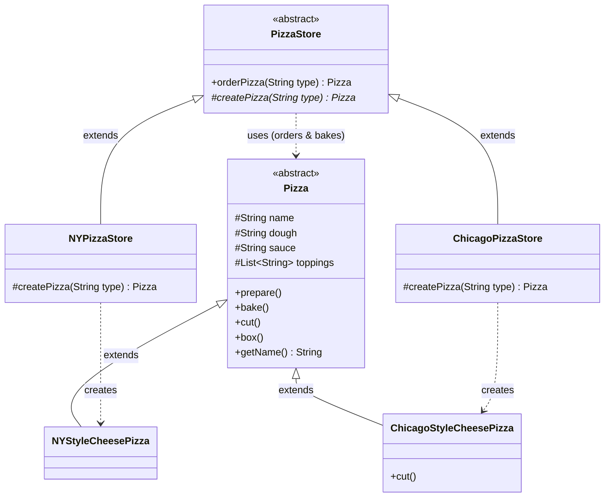
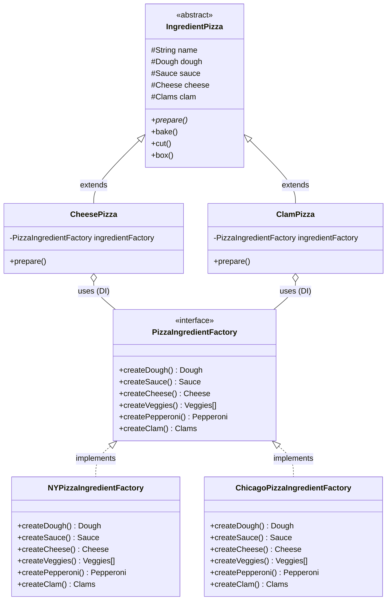

# chapter 4

내용: 팩토리 패턴
작성일: 2026/09/14
중요: No
분야: 디자인패턴 스터디 (https://app.notion.com/p/3c9c9dbbf2a880ceb2f7d88404185c88?pvs=21)
유형: 헤드퍼스트 (https://app.notion.com/p/3c9c9dbbf2a880739f4cc73385614382?pvs=21)

# 팩토리 패턴 - 객체지향 빵 굽기 (최첨단 피자 프레임워크) 🍕🥖

---

### 팩토리 패턴 요약

1. 객체 생성 처리를 서브클래스 또는 전담 팩토리 객체로 **캡슐화(Encapsulate)**하여 구체 클래스와의 결합도를 낮추는 생성 패턴
2. **팩토리 메서드 패턴 (Factory Method Pattern):** 객체를 생성할 때 필요한 인터페이스를 만들고, 어떤 클래스의 인스턴스를 만들지는 서브클래스(`NYPizzaStore`, `ChicagoPizzaStore`)에서 결정하도록 위임함
3. **추상 팩토리 패턴 (Abstract Factory Pattern):** 구체적인 클래스에 의존하지 않고도 서로 연관되거나 의존적인 객체로 이루어진 **제품군(원재료 패밀리: 도우, 소스, 치즈 등)**을 생산하는 인터페이스를 제공함

### 도서 내 문제 상황

1. 피자 가게(`PizzaStore`)에서 피자 주문을 받고 조리(도우 반죽, 토핑, 굽기, 자르기, 포장)하여 판매하는 시스템을 구축해야 한다.
2. **처음 시도했던 잘못된 접근 방식 (나쁜 예시 1: 구체 클래스에 강하게 결합된 코드):**
   ```java
   public Pizza orderPizza(String type) {
       Pizza pizza;

       // ❌ 구체 클래스의 인스턴스를 직접 new 하므로 결합도가 매우 높아짐
       if (type.equals("cheese")) {
           pizza = new CheesePizza();
       } else if (type.equals("greek")) {
           pizza = new GreekPizza();
       } else if (type.equals("pepperoni")) {
           pizza = new PepperoniPizza();
       } else if (type.equals("clam")) {
           pizza = new ClamPizza();
       } else if (type.equals("veggie")) {
           pizza = new VeggiePizza();
       }

       // 변하지 않는 피자 조리(베이킹) 프로세스
       pizza.prepare();
       pizza.bake();
       pizza.cut();
       pizza.box();
       return pizza;
   }
   ```
3. **이 방식이 초래하는 치명적인 문제점:**
   1. **OCP(개방-폐쇄 원칙) 위배:** 새로운 피자 메뉴가 추가되거나 기존 메뉴가 빠질 때마다 `orderPizza()` 코드를 직접 수정해야 함.
   2. **변화의 격리 실패:** 자주 바뀌는 부분(메뉴 생성 로직)과 절대 바뀌지 않는 부분(준비, 굽기, 자르기, 포장 등의 표준 조리 프로세스)이 한곳에 뒤섞여 있음.
4. **프랜차이즈 확장 시 마주한 두 번째 문제 (브랜드 품질 관리 붕괴):**
   - 뉴욕 지점(`NYPizzaStore`), 시카고 지점(`ChicagoPizzaStore`) 등 지역별 지점이 생겨나며 지점마다 독자적인 스타일의 피자를 굽고자 함.
   - 각 지점 서브클래스에 조리 과정을 맡겼더니, 어떤 지점은 피자를 자르지 않거나 다른 박스에 포장하는 등 본사의 **표준 베이킹 절차가 훼손되는 사고** 발생.
   - 또한 각 지점에서 저품질의 싸구려 원재료를 임의로 조달하여 브랜드 피자의 맛과 신뢰도가 하락함.

### 문제를 해결한 3대 객체지향 디자인 원칙

1. **바뀌는 부분을 찾아내서 바뀌지 않는 부분과 분리하고 캡슐화한다.**
   - 변하는 구체 객체 생성 코드를 전담 팩토리 메서드나 원재료 팩토리로 분리 격리하고, 변하지 않는 조리 프레임워크(`orderPizza`)를 보호한다.
2. **구현보다는 인터페이스(슈퍼타입)에 맞춰서 프로그래밍한다.**
   - 클라이언트는 구체 피자 클래스(`NYStyleCheesePizza`)나 구체 팩토리가 아닌 추상 슈퍼클래스 `Pizza`, `PizzaStore`, `PizzaIngredientFactory` 규격에만 의존한다.
3. **추상화된 것에 의존하도록 만들어라. 구상 클래스에 의존하지 않도록 만든다 (의존성 역전 원칙, DIP).**
   - 고수준 모듈(`PizzaStore`)과 저수준 모듈(구체 피자 클래스들)이 모두 추상 인터페이스인 `Pizza`에 의존하도록 설계의 화살표 방향을 역전시킨다.

### 전체 구조 다이어그램 및 설계 분석

#### 1. 전체 시스템 풀 아키텍처 다이어그램 (Full System Class Diagram - 48개 전체 노드)
> 프로젝트에 구현된 **모든 클래스, 인터페이스, 팩토리, 원재료(총 48개 노드)**의 상속/구현/의존/합성 관계를 망라한 종합 아키텍처 다이어그램입니다.

```mermaid
classDiagram
    direction TB

    %% ==========================================
    %% [1] Main Client
    %% ==========================================
    class PizzaTestDrive {
        +main(args)
    }

    %% ==========================================
    %% [2] Simple Factory Pattern
    %% ==========================================
    class SimplePizzaFactory {
        +createPizza(type) Pizza
    }
    class SimplePizzaStore {
        -SimplePizzaFactory factory
        +orderPizza(type) Pizza
    }
    SimplePizzaStore --> SimplePizzaFactory : uses

    %% ==========================================
    %% [3] Factory Method Pattern - Store (Creator)
    %% ==========================================
    class PizzaStore {
        <<abstract>>
        +orderPizza(type) Pizza
        #createPizza(type)* Pizza
    }
    class NYPizzaStore {
        #createPizza(type) Pizza
    }
    class ChicagoPizzaStore {
        #createPizza(type) Pizza
    }
    PizzaStore <|-- NYPizzaStore : extends
    PizzaStore <|-- ChicagoPizzaStore : extends

    %% ==========================================
    %% [4] Factory Method Pattern - Pizza (Product)
    %% ==========================================
    class Pizza {
        <<abstract>>
        #String name
        #String dough
        #String sauce
        #List toppings
        +prepare()
        +bake()
        +cut()
        +box()
        +getName() String
    }
    class NYStyleCheesePizza
    class NYStylePepperoniPizza
    class NYStyleClamPizza
    class NYStyleVeggiePizza
    class ChicagoStyleCheesePizza {
        +cut()
    }
    class ChicagoStylePepperoniPizza {
        +cut()
    }
    class ChicagoStyleClamPizza {
        +cut()
    }
    class ChicagoStyleVeggiePizza {
        +cut()
    }

    Pizza <|-- NYStyleCheesePizza : extends
    Pizza <|-- NYStylePepperoniPizza : extends
    Pizza <|-- NYStyleClamPizza : extends
    Pizza <|-- NYStyleVeggiePizza : extends
    Pizza <|-- ChicagoStyleCheesePizza : extends
    Pizza <|-- ChicagoStylePepperoniPizza : extends
    Pizza <|-- ChicagoStyleClamPizza : extends
    Pizza <|-- ChicagoStyleVeggiePizza : extends

    PizzaStore ..> Pizza : uses (orders)
    NYPizzaStore ..> NYStyleCheesePizza : creates
    NYPizzaStore ..> NYStylePepperoniPizza : creates
    NYPizzaStore ..> NYStyleClamPizza : creates
    NYPizzaStore ..> NYStyleVeggiePizza : creates
    ChicagoPizzaStore ..> ChicagoStyleCheesePizza : creates
    ChicagoPizzaStore ..> ChicagoStylePepperoniPizza : creates
    ChicagoPizzaStore ..> ChicagoStyleClamPizza : creates
    ChicagoPizzaStore ..> ChicagoStyleVeggiePizza : creates

    %% ==========================================
    %% [5] Abstract Factory Pattern - Store (Creator)
    %% ==========================================
    class IngredientPizzaStore {
        <<abstract>>
        +orderPizza(type) IngredientPizza
        #createPizza(item)* IngredientPizza
    }
    class NYIngredientPizzaStore {
        #createPizza(item) IngredientPizza
    }
    class ChicagoIngredientPizzaStore {
        #createPizza(item) IngredientPizza
    }
    IngredientPizzaStore <|-- NYIngredientPizzaStore : extends
    IngredientPizzaStore <|-- ChicagoIngredientPizzaStore : extends

    %% ==========================================
    %% [6] Abstract Factory Pattern - Pizza (Product with DI)
    %% ==========================================
    class IngredientPizza {
        <<abstract>>
        #String name
        #Dough dough
        #Sauce sauce
        #Cheese cheese
        #Veggies[] veggies
        #Pepperoni pepperoni
        #Clams clam
        +prepare()*
        +bake()
        +cut()
        +box()
    }
    class CheesePizza {
        -PizzaIngredientFactory ingredientFactory
        +prepare()
    }
    class ClamPizza {
        -PizzaIngredientFactory ingredientFactory
        +prepare()
    }
    class PepperoniPizza {
        -PizzaIngredientFactory ingredientFactory
        +prepare()
    }
    class VeggiePizza {
        -PizzaIngredientFactory ingredientFactory
        +prepare()
    }

    IngredientPizza <|-- CheesePizza : extends
    IngredientPizza <|-- ClamPizza : extends
    IngredientPizza <|-- PepperoniPizza : extends
    IngredientPizza <|-- VeggiePizza : extends

    IngredientPizzaStore ..> IngredientPizza : uses (orders)
    NYIngredientPizzaStore ..> CheesePizza : creates
    NYIngredientPizzaStore ..> ClamPizza : creates
    NYIngredientPizzaStore ..> PepperoniPizza : creates
    NYIngredientPizzaStore ..> VeggiePizza : creates
    ChicagoIngredientPizzaStore ..> CheesePizza : creates
    ChicagoIngredientPizzaStore ..> ClamPizza : creates
    ChicagoIngredientPizzaStore ..> PepperoniPizza : creates
    ChicagoIngredientPizzaStore ..> VeggiePizza : creates

    %% ==========================================
    %% [7] Abstract Factory - Ingredient Factory
    %% ==========================================
    class PizzaIngredientFactory {
        <<interface>>
        +createDough() Dough
        +createSauce() Sauce
        +createCheese() Cheese
        +createVeggies() Veggies[]
        +createPepperoni() Pepperoni
        +createClam() Clams
    }
    class NYPizzaIngredientFactory {
        +createDough() Dough
        +createSauce() Sauce
        +createCheese() Cheese
        +createVeggies() Veggies[]
        +createPepperoni() Pepperoni
        +createClam() Clams
    }
    class ChicagoPizzaIngredientFactory {
        +createDough() Dough
        +createSauce() Sauce
        +createCheese() Cheese
        +createVeggies() Veggies[]
        +createPepperoni() Pepperoni
        +createClam() Clams
    }
    PizzaIngredientFactory <|.. NYPizzaIngredientFactory : implements
    PizzaIngredientFactory <|.. ChicagoPizzaIngredientFactory : implements

    CheesePizza o-- PizzaIngredientFactory : injects
    ClamPizza o-- PizzaIngredientFactory : injects
    PepperoniPizza o-- PizzaIngredientFactory : injects
    VeggiePizza o-- PizzaIngredientFactory : injects

    NYIngredientPizzaStore ..> NYPizzaIngredientFactory : instantiates
    ChicagoIngredientPizzaStore ..> ChicagoPizzaIngredientFactory : instantiates

    %% ==========================================
    %% [8] Abstract Factory - Ingredient Interfaces
    %% ==========================================
    class Dough {
        <<interface>>
        +getName() String
    }
    class Sauce {
        <<interface>>
        +getName() String
    }
    class Cheese {
        <<interface>>
        +getName() String
    }
    class Veggies {
        <<interface>>
        +getName() String
    }
    class Pepperoni {
        <<interface>>
        +getName() String
    }
    class Clams {
        <<interface>>
        +getName() String
    }

    PizzaIngredientFactory ..> Dough : creates
    PizzaIngredientFactory ..> Sauce : creates
    PizzaIngredientFactory ..> Cheese : creates
    PizzaIngredientFactory ..> Veggies : creates
    PizzaIngredientFactory ..> Pepperoni : creates
    PizzaIngredientFactory ..> Clams : creates

    %% ==========================================
    %% [9] Abstract Factory - Concrete Ingredients
    %% ==========================================
    class ThinCrustDough
    class ThickCrustDough
    Dough <|.. ThinCrustDough : implements
    Dough <|.. ThickCrustDough : implements

    class MarinaraSauce
    class PlumTomatoSauce
    Sauce <|.. MarinaraSauce : implements
    Sauce <|.. PlumTomatoSauce : implements

    class ReggianoCheese
    class MozzarellaCheese
    Cheese <|.. ReggianoCheese : implements
    Cheese <|.. MozzarellaCheese : implements

    class Garlic
    class Onion
    class Mushroom
    class RedPepper
    class BlackOlives
    class Spinach
    class Eggplant
    Veggies <|.. Garlic : implements
    Veggies <|.. Onion : implements
    Veggies <|.. Mushroom : implements
    Veggies <|.. RedPepper : implements
    Veggies <|.. BlackOlives : implements
    Veggies <|.. Spinach : implements
    Veggies <|.. Eggplant : implements

    class SlicedPepperoni
    Pepperoni <|.. SlicedPepperoni : implements

    class FreshClams
    class FrozenClams
    Clams <|.. FreshClams : implements
    Clams <|.. FrozenClams : implements

    NYPizzaIngredientFactory ..> ThinCrustDough : creates
    NYPizzaIngredientFactory ..> MarinaraSauce : creates
    NYPizzaIngredientFactory ..> ReggianoCheese : creates
    NYPizzaIngredientFactory ..> FreshClams : creates

    ChicagoPizzaIngredientFactory ..> ThickCrustDough : creates
    ChicagoPizzaIngredientFactory ..> PlumTomatoSauce : creates
    ChicagoPizzaIngredientFactory ..> MozzarellaCheese : creates
    ChicagoPizzaIngredientFactory ..> FrozenClams : creates

    %% ==========================================
    %% [10] Client Execution Flow
    %% ==========================================
    PizzaTestDrive ..> SimplePizzaStore : tests
    PizzaTestDrive ..> PizzaStore : tests
    PizzaTestDrive ..> IngredientPizzaStore : tests
```



---

#### 2. 핵심 패턴별 상세 설계 다이어그램

##### (1) 팩토리 메서드 패턴 상세 다이어그램 (Factory Method Pattern)
> 상위 클래스 `PizzaStore`가 조리 프로세스(알고리즘 뼈대)를 제공하고, 서브클래스가 구체적인 객체 생성을 결정하는 구조입니다.



##### (2) 추상 팩토리 패턴 상세 다이어그램 (Abstract Factory Pattern)
> 원재료 제품군(`Dough`, `Sauce`, `Cheese`, `Clams`)을 규격화하여 지역별 원재료 공장을 피자 객체에 주입(DI)하는 구조입니다.



1. **Creator (`PizzaStore`):** 피자 조리 및 배달을 관장하는 고수준 프레임워크. `orderPizza()` 내에서 불변의 베이킹 절차(`prepare` -> `bake` -> `cut` -> `box`)를 실행하고, 실제 피자 인스턴스를 찍어내는 책임은 추상 메서드인 `createPizza()`에 일임한다.
2. **Concrete Creator (`NYPizzaStore`, `ChicagoPizzaStore`):** 팩토리 메서드(`createPizza`)를 실제로 오버라이드하여 각 지역에 특화된 구체 피자 객체를 생성해 반환한다.
3. **Product (`Pizza`):** 팩토리가 생산하는 대상의 공통 인터페이스이자 기반 클래스.
4. **Concrete Product (`NYStyleCheesePizza`, `ChicagoStyleCheesePizza` 등 8종):** 실제 생성되는 제품. 필요 시 특정 메서드(예: 시카고 피자의 사각형 자르기 `cut()`)를 재정의한다.
5. **Abstract Factory (`PizzaIngredientFactory`):** 피자를 구성하는 여러 원재료(도우, 소스, 치즈, 조개 등) 제품군 전체를 생산하기 위한 인터페이스 규격을 정의한다.
6. **Concrete Factory (`NYPizzaIngredientFactory`, `ChicagoPizzaIngredientFactory`):** 지역별 원재료 공장으로, 뉴욕산 또는 시카고산 원재료 제품군을 생산한다.
7. **Client / Product with DI (`CheesePizza`, `ClamPizza`):** 추상 팩토리를 합성(Composition)하여 주입받고, `prepare()` 실행 시 팩토리를 통해 표준화된 원재료를 공급받아 조리한다.
8. **Main Test Drive (`PizzaTestDrive`):** 간단한 팩토리, 팩토리 메서드, 추상 팩토리 3단계를 모두 실행하고 검증하는 클라이언트 러너.

### 게임 개발 및 실무 적용 사례

1. **게임 몬스터 / NPC / 오브젝트 스포너 시스템:**
   - 던전 맵 테마(사막 던전, 얼음 던전, 화산 던전)마다 스폰되는 몬스터 종류와 장비가 달라진다.
   - `DungeonSpawner` 추상 클래스가 스폰 사이클(이펙트 생성 -> AI 부착 -> 스탯 초기화)을 통제하고, 서브클래스 `IceDungeonSpawner`가 `IceGolem`, `IceBat` 등의 몬스터 객체를 생성한다.
   - 여기에 추상 팩토리 `MonsterThemeFactory`를 결합하여 스킨, 무기, 사운드 제품군을 세트로 주입할 수 있다.
2. **Spring Framework의 IoC/DI 컨테이너 (`BeanFactory`, `ApplicationContext`):**
   - 스프링의 핵심 심장부인 `BeanFactory`와 `ApplicationContext`는 대표적인 팩토리 패턴의 구현체이다.
   - 클라이언트는 XML이나 자바 설정 파일에 정의된 빈(Bean)의 구체적인 생성 과정을 몰라도 이름이나 타입으로 객체를 공급받는다.
3. **Java JDBC 표준 라이브러리:**
   - `Connection conn = DriverManager.getConnection(url);`
   - `Statement stmt = conn.createStatement();`
   - 클라이언트는 오라클, MySQL, PostgreSQL 등 DBMS 종류에 상관없이 표준 `Connection`, `Statement`, `ResultSet` 제품군 인터페이스로 코딩하며, 실제 객체는 각 벤더 드라이버(구체 팩토리)가 생성한다.
4. **크로스 플랫폼 UI 툴킷 / 렌더러:**
   - 운영체제(Windows, macOS, Linux)에 맞는 버튼, 텍스트박스, 스크롤바 컴포넌트 제품군을 생성하는 `GUIFactory`를 구현하여 일관된 룩앤필을 유지한다.

### 장점과 단점 요약

1. **장점**
   - **느슨한 결합(Loose Coupling):** 고수준 비즈니스 로직과 저수준 구체 생성 코드가 분리되어 코드 수정의 파급 효과가 차단된다.
   - **단일 책임 원칙(SRP):** 객체 생성 코드를 한곳으로 몰아서 관리하므로 유지보수가 매우 수월해진다.
   - **개방-폐쇄 원칙(OCP):** 기존 코드를 일절 수정하지 않고도 새로운 피자 매장, 새로운 피자 메뉴, 새로운 원재료 공장을 자유롭게 확장할 수 있다.
   - **제품군 일관성 보장:** 추상 팩토리를 사용하면 서로 맞지 않는 재료(예: 씬 도우에 어울리지 않는 소스 조합)가 뒤섞이는 것을 원천 차단할 수 있다.
2. **단점**
   - **클래스 개수 폭발(Class Explosion):** 각 생성 제품마다, 그리고 각 팩토리마다 새로운 클래스와 인터페이스를 만들어야 하므로 시스템의 전체 클래스 파일 수가 급증한다.
   - **인터페이스 변경의 어려움 (추상 팩토리):** 원재료 팩토리에 새로운 재료(예: `createBacon()`)를 하나 추가하려면 인터페이스와 이를 구현한 모든 구체 팩토리 클래스를 전부 고쳐야 한다.

<aside>
📌

- **팩토리 패턴 딥다이브 (Deep Dive)**

    ### 1. `new` 연산자는 정말 나쁜 것인가?
    - `new` 자체가 나쁜 것은 아니다. 변하지 않는 데이터 객체(예: `String`, `ArrayList`)를 생성할 때 `new`를 쓰는 것은 아무런 문제가 없다.
    - 진짜 문제는 **'변화할 가능성이 높은 구체 클래스'**를 상위 비즈니스 로직에서 직접 `new`로 결합하는 순간이다.
    - 변화의 소용돌이에 휘말리기 쉬운 인스턴스화 작업은 반드시 팩토리로 격리하여 보호해야 한다.

    ──────

    ### 2. 팩토리 메서드 패턴 vs 템플릿 메서드 패턴 (할리우드 원칙)
    - `PizzaStore.orderPizza()`는 피자를 굽는 표준적인 작업 흐름(알고리즘의 뼈대)을 정의하고, 변하는 단계인 객체 생성(`createPizza`)만 서브클래스에 위임한다.
    - 이는 8장에서 배울 **템플릿 메서드 패턴(Template Method Pattern)**의 형태와 정확히 일치한다.
    - 상위 컴포넌트가 하위 컴포넌트를 호출하되, 하위 컴포넌트는 상위 컴포넌트를 직접 호출하지 않는 **할리우드 원칙("Don't call us, we'll call you")**이 깔끔하게 적용된 구조이다.

    ──────

    ### 3. 의존성 역전 원칙 (DIP: Dependency Inversion Principle) 가이드라인
    1. **어떤 변수에도 구상 클래스의 레퍼런스를 저장하지 않는다:** 레퍼런스 타입은 언제나 인터페이스나 추상 클래스로 선언한다.
    2. **구상 클래스에서 유도된 클래스를 만들지 않는다:** 상속은 추상 클래스나 인터페이스로부터 시작해야 한다. 구상 클래스를 상속하면 구상 클래스에 의존하게 된다.
    3. **베이스 클래스에 이미 구현되어 있는 메서드를 오버라이드하지 않는다:** 베이스 클래스에 구현된 메서드는 모든 서브클래스에서 공유해야 하는 공통 규약이어야 한다. 오버라이드한다는 것은 애초에 추상화가 덜 되었다는 증거다.

    ──────

    ### 4. 팩토리 메서드 vs 추상 팩토리의 결정적 차이
    - **팩토리 메서드:** 상속(Inheritance)을 이용해 객체를 생성한다. 한 번에 **하나의 제품**을 만드는 데 초점을 맞추며, 서브클래스를 통해 생성을 구체화한다.
    - **추상 팩토리:** 객체 구성(Composition)을 이용해 객체를 생성한다. 서로 연관된 **여러 제품군(Family of Products)**을 한꺼번에 일관성 있게 생성하는 데 초점을 맞춘다.
</aside>

---

### 📂 chapter4 폴더

- **PizzaTestDrive.java**

    ```java
    package chapter4;

    import chapter4.Actor.Pizza.Pizza;
    import chapter4.Actor.Store.ChicagoPizzaStore;
    import chapter4.Actor.Store.NYPizzaStore;
    import chapter4.Actor.Store.PizzaStore;
    import chapter4.AbstractFactory.Pizza.IngredientPizza;
    import chapter4.AbstractFactory.Store.ChicagoIngredientPizzaStore;
    import chapter4.AbstractFactory.Store.IngredientPizzaStore;
    import chapter4.AbstractFactory.Store.NYIngredientPizzaStore;
    import chapter4.SimpleFactory.SimplePizzaFactory;
    import chapter4.SimpleFactory.SimplePizzaStore;

    public class PizzaTestDrive {

        public static void main(String[] args) {
            System.out.println("===============================================================");
            System.out.println(" 🍕 헤드퍼스트 디자인 패턴 Chapter 04: 객체지향 빵 굽기 (팩토리 패턴) 🍕");
            System.out.println("===============================================================");

            // ---------------------------------------------------------------------
            // 1. 간단한 팩토리 (Simple Factory) 테스트
            // ---------------------------------------------------------------------
            System.out.println("\n[PART 1. 간단한 팩토리 (Simple Factory 관용구)]");
            SimplePizzaFactory simpleFactory = new SimplePizzaFactory();
            SimplePizzaStore simpleStore = new SimplePizzaStore(simpleFactory);

            Pizza simplePizza = simpleStore.orderPizza("cheese");
            System.out.println("완성된 피자: " + simplePizza.getName());

            // ---------------------------------------------------------------------
            // 2. 팩토리 메서드 패턴 (Factory Method Pattern) 테스트
            // ---------------------------------------------------------------------
            System.out.println("\n===============================================================");
            System.out.println("[PART 2. 팩토리 메서드 패턴 (Factory Method Pattern)]");
            System.out.println("생성 작업을 서브클래스(NYPizzaStore, ChicagoPizzaStore)에 캡슐화");
            System.out.println("===============================================================");

            PizzaStore nyStore = new NYPizzaStore();
            PizzaStore chicagoStore = new ChicagoPizzaStore();

            System.out.println("\n>>> 에단(Ethan)이 뉴욕 스타일 치즈 피자를 주문합니다.");
            Pizza pizza1 = nyStore.orderPizza("cheese");
            System.out.println("에단이 주문한 피자 완성: " + pizza1.getName());

            System.out.println("\n>>> 조엘(Joel)이 시카고 스타일 치즈 피자를 주문합니다.");
            Pizza pizza2 = chicagoStore.orderPizza("cheese");
            System.out.println("조엘이 주문한 피자 완성: " + pizza2.getName());

            System.out.println("\n>>> 추가 주문: 뉴욕 페퍼로니 & 시카고 조개 피자");
            Pizza pizza3 = nyStore.orderPizza("pepperoni");
            System.out.println("피자 준비 완료: " + pizza3.getName());

            Pizza pizza4 = chicagoStore.orderPizza("clam");
            System.out.println("피자 준비 완료: " + pizza4.getName());

            // ---------------------------------------------------------------------
            // 3. 추상 팩토리 패턴 (Abstract Factory Pattern) 테스트
            // ---------------------------------------------------------------------
            System.out.println("\n===============================================================");
            System.out.println("[PART 3. 추상 팩토리 패턴 (Abstract Factory Pattern)]");
            System.out.println("원재료 제품군(PizzaIngredientFactory)을 지역별로 통제 및 품질 관리");
            System.out.println("===============================================================");

            IngredientPizzaStore nyIngredientStore = new NYIngredientPizzaStore();
            IngredientPizzaStore chicagoIngredientStore = new ChicagoIngredientPizzaStore();

            System.out.println("\n>>> 뉴욕 원재료 공장 기반 치즈 피자 제작");
            IngredientPizza afPizza1 = nyIngredientStore.orderPizza("cheese");
            System.out.println("\n[피자 상세 스펙]");
            System.out.print(afPizza1);

            System.out.println("\n>>> 시카고 원재료 공장 기반 조개 피자 제작");
            IngredientPizza afPizza2 = chicagoIngredientStore.orderPizza("clam");
            System.out.println("\n[피자 상세 스펙]");
            System.out.print(afPizza2);

            System.out.println("\n===============================================================");
            System.out.println(" 🎉 팩토리 패턴을 통한 객체지향 빵 굽기 시뮬레이션 성공적 완료! 🎉");
            System.out.println("===============================================================");
        }
    }
    ```

### 📂 chapter4.Actor.Pizza 폴더

- **Pizza.java**

    ```java
    package chapter4.Actor.Pizza;

    import java.util.ArrayList;
    import java.util.List;

    public abstract class Pizza {
        protected String name;
        protected String dough;
        protected String sauce;
        protected List<String> toppings = new ArrayList<>();

        public void prepare() {
            System.out.println("준비 중: " + name);
            System.out.println("도우를 던지는 중...");
            System.out.println("소스 뿌리는 중...");
            System.out.println("토핑 올리는 중: ");
            for (String topping : toppings) {
                System.out.println("   " + topping);
            }
        }

        public void bake() {
            System.out.println("175도에서 25분간 굽기 (Baking...)");
        }

        public void cut() {
            System.out.println("피자를 대각선으로 자르기");
        }

        public void box() {
            System.out.println("상자에 피자 담기");
        }

        public String getName() {
            return name;
        }

        @Override
        public String toString() {
            StringBuilder display = new StringBuilder();
            display.append("---- ").append(name).append(" ----\n");
            display.append(dough).append("\n");
            display.append(sauce).append("\n");
            for (String topping : toppings) {
                display.append(topping).append("\n");
            }
            return display.toString();
        }
    }
    ```

- **NYStyleCheesePizza.java**

    ```java
    package chapter4.Actor.Pizza;

    public class NYStyleCheesePizza extends Pizza {

        public NYStyleCheesePizza() {
            name = "뉴욕 스타일 소스와 치즈 피자";
            dough = "씬 크러스트 도우";
            sauce = "마리나라 소스";

            toppings.add("잘게 썬 레지아노 치즈");
        }
    }
    ```

- **ChicagoStyleCheesePizza.java**

    ```java
    package chapter4.Actor.Pizza;

    public class ChicagoStyleCheesePizza extends Pizza {

        public ChicagoStyleCheesePizza() {
            name = "시카고 스타일 딥 디시 치즈 피자";
            dough = "아주 두꺼운 크러스트 도우";
            sauce = "플럼토마토 소스";

            toppings.add("잘게 조각낸 모차렐라 치즈");
        }

        @Override
        public void cut() {
            System.out.println("네모난 모양으로 피자 자르기");
        }
    }
    ```

### 📂 chapter4.Actor.Store 폴더

- **PizzaStore.java**

    ```java
    package chapter4.Actor.Store;

    import chapter4.Actor.Pizza.Pizza;

    public abstract class PizzaStore {

        public Pizza orderPizza(String type) {
            Pizza pizza = createPizza(type);

            if (pizza == null) {
                System.out.println("죄송합니다. 요청하신 '" + type + "' 종류의 피자는 메뉴에 없습니다.");
                return null;
            }

            System.out.println("\n--- " + pizza.getName() + " 주문 접수 완료 (조리 시작) ---");
            pizza.prepare();
            pizza.bake();
            pizza.cut();
            pizza.box();

            return pizza;
        }

        // 팩토리 메서드 (Factory Method): 객체 생성을 서브클래스에 위임
        protected abstract Pizza createPizza(String type);
    }
    ```

- **NYPizzaStore.java**

    ```java
    package chapter4.Actor.Store;

    import chapter4.Actor.Pizza.NYStyleCheesePizza;
    import chapter4.Actor.Pizza.NYStyleClamPizza;
    import chapter4.Actor.Pizza.NYStylePepperoniPizza;
    import chapter4.Actor.Pizza.NYStyleVeggiePizza;
    import chapter4.Actor.Pizza.Pizza;

    public class NYPizzaStore extends PizzaStore {

        @Override
        protected Pizza createPizza(String item) {
            if (item.equalsIgnoreCase("cheese")) {
                return new NYStyleCheesePizza();
            } else if (item.equalsIgnoreCase("veggie")) {
                return new NYStyleVeggiePizza();
            } else if (item.equalsIgnoreCase("clam")) {
                return new NYStyleClamPizza();
            } else if (item.equalsIgnoreCase("pepperoni")) {
                return new NYStylePepperoniPizza();
            } else {
                return null;
            }
        }
    }
    ```

- **ChicagoPizzaStore.java**

    ```java
    package chapter4.Actor.Store;

    import chapter4.Actor.Pizza.ChicagoStyleCheesePizza;
    import chapter4.Actor.Pizza.ChicagoStyleClamPizza;
    import chapter4.Actor.Pizza.ChicagoStylePepperoniPizza;
    import chapter4.Actor.Pizza.ChicagoStyleVeggiePizza;
    import chapter4.Actor.Pizza.Pizza;

    public class ChicagoPizzaStore extends PizzaStore {

        @Override
        protected Pizza createPizza(String item) {
            if (item.equalsIgnoreCase("cheese")) {
                return new ChicagoStyleCheesePizza();
            } else if (item.equalsIgnoreCase("veggie")) {
                return new ChicagoStyleVeggiePizza();
            } else if (item.equalsIgnoreCase("clam")) {
                return new ChicagoStyleClamPizza();
            } else if (item.equalsIgnoreCase("pepperoni")) {
                return new ChicagoStylePepperoniPizza();
            } else {
                return null;
            }
        }
    }
    ```

### 📂 chapter4.SimpleFactory 폴더

- **SimplePizzaFactory.java**

    ```java
    package chapter4.SimpleFactory;

    import chapter4.Actor.Pizza.NYStyleCheesePizza;
    import chapter4.Actor.Pizza.NYStyleClamPizza;
    import chapter4.Actor.Pizza.NYStylePepperoniPizza;
    import chapter4.Actor.Pizza.NYStyleVeggiePizza;
    import chapter4.Actor.Pizza.Pizza;

    /**
     * 간단한 팩토리 (Simple Factory)
     * 디자인 패턴이라기보다는 객체 생성 책임을 한 곳으로 모으는 프로그래밍 관용구(Idiom)
     */
    public class SimplePizzaFactory {

        public Pizza createPizza(String type) {
            Pizza pizza = null;

            if (type.equalsIgnoreCase("cheese")) {
                pizza = new NYStyleCheesePizza();
            } else if (type.equalsIgnoreCase("pepperoni")) {
                pizza = new NYStylePepperoniPizza();
            } else if (type.equalsIgnoreCase("clam")) {
                pizza = new NYStyleClamPizza();
            } else if (type.equalsIgnoreCase("veggie")) {
                pizza = new NYStyleVeggiePizza();
            }

            return pizza;
        }
    }
    ```

- **SimplePizzaStore.java**

    ```java
    package chapter4.SimpleFactory;

    import chapter4.Actor.Pizza.Pizza;

    public class SimplePizzaStore {
        private SimplePizzaFactory factory;

        public SimplePizzaStore(SimplePizzaFactory factory) {
            this.factory = factory;
        }

        public Pizza orderPizza(String type) {
            Pizza pizza = factory.createPizza(type);

            if (pizza == null) {
                System.out.println("해당 메뉴가 존재하지 않습니다: " + type);
                return null;
            }

            System.out.println("\n--- [Simple Factory] " + pizza.getName() + " 주문 접수 ---");
            pizza.prepare();
            pizza.bake();
            pizza.cut();
            pizza.box();

            return pizza;
        }
    }
    ```

### 📂 chapter4.AbstractFactory.Interface 폴더

- **PizzaIngredientFactory.java**

    ```java
    package chapter4.AbstractFactory.Interface;

    /**
     * 추상 팩토리 인터페이스
     * 서로 연관되거나 의존적인 객체들의 군(원재료 family)을 생성하기 위한 규격 제공
     */
    public interface PizzaIngredientFactory {
        Dough createDough();
        Sauce createSauce();
        Cheese createCheese();
        Veggies[] createVeggies();
        Pepperoni createPepperoni();
        Clams createClam();
    }
    ```

### 📂 chapter4.AbstractFactory.Factory 폴더

- **NYPizzaIngredientFactory.java**

    ```java
    package chapter4.AbstractFactory.Factory;

    import chapter4.AbstractFactory.Ingredient.Cheese.ReggianoCheese;
    import chapter4.AbstractFactory.Ingredient.Clams.FreshClams;
    import chapter4.AbstractFactory.Ingredient.Dough.ThinCrustDough;
    import chapter4.AbstractFactory.Ingredient.Pepperoni.SlicedPepperoni;
    import chapter4.AbstractFactory.Ingredient.Sauce.MarinaraSauce;
    import chapter4.AbstractFactory.Ingredient.Veggies.Garlic;
    import chapter4.AbstractFactory.Ingredient.Veggies.Mushroom;
    import chapter4.AbstractFactory.Ingredient.Veggies.Onion;
    import chapter4.AbstractFactory.Ingredient.Veggies.RedPepper;
    import chapter4.AbstractFactory.Interface.Cheese;
    import chapter4.AbstractFactory.Interface.Clams;
    import chapter4.AbstractFactory.Interface.Dough;
    import chapter4.AbstractFactory.Interface.Pepperoni;
    import chapter4.AbstractFactory.Interface.PizzaIngredientFactory;
    import chapter4.AbstractFactory.Interface.Sauce;
    import chapter4.AbstractFactory.Interface.Veggies;

    public class NYPizzaIngredientFactory implements PizzaIngredientFactory {

        @Override
        public Dough createDough() {
            return new ThinCrustDough();
        }

        @Override
        public Sauce createSauce() {
            return new MarinaraSauce();
        }

        @Override
        public Cheese createCheese() {
            return new ReggianoCheese();
        }

        @Override
        public Veggies[] createVeggies() {
            return new Veggies[] { new Garlic(), new Onion(), new Mushroom(), new RedPepper() };
        }

        @Override
        public Pepperoni createPepperoni() {
            return new SlicedPepperoni();
        }

        @Override
        public Clams createClam() {
            return new FreshClams();
        }
    }
    ```

- **ChicagoPizzaIngredientFactory.java**

    ```java
    package chapter4.AbstractFactory.Factory;

    import chapter4.AbstractFactory.Ingredient.Cheese.MozzarellaCheese;
    import chapter4.AbstractFactory.Ingredient.Clams.FrozenClams;
    import chapter4.AbstractFactory.Ingredient.Dough.ThickCrustDough;
    import chapter4.AbstractFactory.Ingredient.Pepperoni.SlicedPepperoni;
    import chapter4.AbstractFactory.Ingredient.Sauce.PlumTomatoSauce;
    import chapter4.AbstractFactory.Ingredient.Veggies.BlackOlives;
    import chapter4.AbstractFactory.Ingredient.Veggies.Eggplant;
    import chapter4.AbstractFactory.Ingredient.Veggies.Spinach;
    import chapter4.AbstractFactory.Interface.Cheese;
    import chapter4.AbstractFactory.Interface.Clams;
    import chapter4.AbstractFactory.Interface.Dough;
    import chapter4.AbstractFactory.Interface.Pepperoni;
    import chapter4.AbstractFactory.Interface.PizzaIngredientFactory;
    import chapter4.AbstractFactory.Interface.Sauce;
    import chapter4.AbstractFactory.Interface.Veggies;

    public class ChicagoPizzaIngredientFactory implements PizzaIngredientFactory {

        @Override
        public Dough createDough() {
            return new ThickCrustDough();
        }

        @Override
        public Sauce createSauce() {
            return new PlumTomatoSauce();
        }

        @Override
        public Cheese createCheese() {
            return new MozzarellaCheese();
        }

        @Override
        public Veggies[] createVeggies() {
            return new Veggies[] { new BlackOlives(), new Spinach(), new Eggplant() };
        }

        @Override
        public Pepperoni createPepperoni() {
            return new SlicedPepperoni();
        }

        @Override
        public Clams createClam() {
            return new FrozenClams();
        }
    }
    ```

### 📂 chapter4.AbstractFactory.Pizza 폴더

- **IngredientPizza.java**

    ```java
    package chapter4.AbstractFactory.Pizza;

    import chapter4.AbstractFactory.Interface.Cheese;
    import chapter4.AbstractFactory.Interface.Clams;
    import chapter4.AbstractFactory.Interface.Dough;
    import chapter4.AbstractFactory.Interface.Pepperoni;
    import chapter4.AbstractFactory.Interface.Sauce;
    import chapter4.AbstractFactory.Interface.Veggies;

    /**
     * 원재료 팩토리를 주입받아 완성되는 피자 추상 클래스
     * prepare() 메서드가 추상 메서드로서 구체 피자에서 원재료를 조달받음
     */
    public abstract class IngredientPizza {
        protected String name;

        protected Dough dough;
        protected Sauce sauce;
        protected Veggies[] veggies;
        protected Cheese cheese;
        protected Pepperoni pepperoni;
        protected Clams clam;

        // 원재료 공장에서 재료들을 가져와 준비하는 핵심 추상 메서드
        public abstract void prepare();

        public void bake() {
            System.out.println("175도에서 25분간 굽기 (Baking...)");
        }

        public void cut() {
            System.out.println("피자를 대각선으로 자르기");
        }

        public void box() {
            System.out.println("상자에 피자 담기");
        }

        public void setName(String name) {
            this.name = name;
        }

        public String getName() {
            return name;
        }

        @Override
        public String toString() {
            StringBuilder result = new StringBuilder();
            result.append("---- ").append(name).append(" ----\n");
            if (dough != null) {
                result.append("도우: ").append(dough.getName()).append("\n");
            }
            if (sauce != null) {
                result.append("소스: ").append(sauce.getName()).append("\n");
            }
            if (cheese != null) {
                result.append("치즈: ").append(cheese.getName()).append("\n");
            }
            if (veggies != null && veggies.length > 0) {
                result.append("야채 토핑: ");
                for (int i = 0; i < veggies.length; i++) {
                    result.append(veggies[i].getName());
                    if (i < veggies.length - 1) {
                        result.append(", ");
                    }
                }
                result.append("\n");
            }
            if (clam != null) {
                result.append("조개: ").append(clam.getName()).append("\n");
            }
            if (pepperoni != null) {
                result.append("페퍼로니: ").append(pepperoni.getName()).append("\n");
            }
            return result.toString();
        }
    }
    ```

- **CheesePizza.java**

    ```java
    package chapter4.AbstractFactory.Pizza;

    import chapter4.AbstractFactory.Interface.PizzaIngredientFactory;

    public class CheesePizza extends IngredientPizza {
        private PizzaIngredientFactory ingredientFactory;

        public CheesePizza(PizzaIngredientFactory ingredientFactory) {
            this.ingredientFactory = ingredientFactory;
        }

        @Override
        public void prepare() {
            System.out.println("준비 중: " + name);
            dough = ingredientFactory.createDough();
            sauce = ingredientFactory.createSauce();
            cheese = ingredientFactory.createCheese();
            System.out.println("  도우 준비: " + dough.getName());
            System.out.println("  소스 추가: " + sauce.getName());
            System.out.println("  치즈 토핑: " + cheese.getName());
        }
    }
    ```

- **ClamPizza.java**

    ```java
    package chapter4.AbstractFactory.Pizza;

    import chapter4.AbstractFactory.Interface.PizzaIngredientFactory;

    public class ClamPizza extends IngredientPizza {
        private PizzaIngredientFactory ingredientFactory;

        public ClamPizza(PizzaIngredientFactory ingredientFactory) {
            this.ingredientFactory = ingredientFactory;
        }

        @Override
        public void prepare() {
            System.out.println("준비 중: " + name);
            dough = ingredientFactory.createDough();
            sauce = ingredientFactory.createSauce();
            cheese = ingredientFactory.createCheese();
            clam = ingredientFactory.createClam();
            System.out.println("  도우 준비: " + dough.getName());
            System.out.println("  소스 추가: " + sauce.getName());
            System.out.println("  치즈 토핑: " + cheese.getName());
            System.out.println("  조개 토핑: " + clam.getName());
        }
    }
    ```

### 📂 chapter4.AbstractFactory.Store 폴더

- **IngredientPizzaStore.java**

    ```java
    package chapter4.AbstractFactory.Store;

    import chapter4.AbstractFactory.Pizza.IngredientPizza;

    public abstract class IngredientPizzaStore {

        public IngredientPizza orderPizza(String type) {
            IngredientPizza pizza = createPizza(type);

            if (pizza == null) {
                System.out.println("해당 피자 종류가 존재하지 않습니다: " + type);
                return null;
            }

            System.out.println("\n--- [Abstract Factory] " + pizza.getName() + " 주문 접수 ---");
            pizza.prepare();
            pizza.bake();
            pizza.cut();
            pizza.box();

            return pizza;
        }

        protected abstract IngredientPizza createPizza(String item);
    }
    ```

- **NYIngredientPizzaStore.java**

    ```java
    package chapter4.AbstractFactory.Store;

    import chapter4.AbstractFactory.Factory.NYPizzaIngredientFactory;
    import chapter4.AbstractFactory.Interface.PizzaIngredientFactory;
    import chapter4.AbstractFactory.Pizza.CheesePizza;
    import chapter4.AbstractFactory.Pizza.ClamPizza;
    import chapter4.AbstractFactory.Pizza.IngredientPizza;
    import chapter4.AbstractFactory.Pizza.PepperoniPizza;
    import chapter4.AbstractFactory.Pizza.VeggiePizza;

    public class NYIngredientPizzaStore extends IngredientPizzaStore {

        @Override
        protected IngredientPizza createPizza(String item) {
            IngredientPizza pizza = null;
            PizzaIngredientFactory ingredientFactory = new NYPizzaIngredientFactory();

            if (item.equalsIgnoreCase("cheese")) {
                pizza = new CheesePizza(ingredientFactory);
                pizza.setName("뉴욕 스타일 치즈 피자 (엄선된 뉴욕 원재료)");
            } else if (item.equalsIgnoreCase("veggie")) {
                pizza = new VeggiePizza(ingredientFactory);
                pizza.setName("뉴욕 스타일 야채 피자 (엄선된 뉴욕 원재료)");
            } else if (item.equalsIgnoreCase("clam")) {
                pizza = new ClamPizza(ingredientFactory);
                pizza.setName("뉴욕 스타일 조개 피자 (엄선된 뉴욕 원재료)");
            } else if (item.equalsIgnoreCase("pepperoni")) {
                pizza = new PepperoniPizza(ingredientFactory);
                pizza.setName("뉴욕 스타일 페퍼로니 피자 (엄선된 뉴욕 원재료)");
            }

            return pizza;
        }
    }
    ```

- **ChicagoIngredientPizzaStore.java**

    ```java
    package chapter4.AbstractFactory.Store;

    import chapter4.AbstractFactory.Factory.ChicagoPizzaIngredientFactory;
    import chapter4.AbstractFactory.Interface.PizzaIngredientFactory;
    import chapter4.AbstractFactory.Pizza.CheesePizza;
    import chapter4.AbstractFactory.Pizza.ClamPizza;
    import chapter4.AbstractFactory.Pizza.IngredientPizza;
    import chapter4.AbstractFactory.Pizza.PepperoniPizza;
    import chapter4.AbstractFactory.Pizza.VeggiePizza;

    public class ChicagoIngredientPizzaStore extends IngredientPizzaStore {

        @Override
        protected IngredientPizza createPizza(String item) {
            IngredientPizza pizza = null;
            PizzaIngredientFactory ingredientFactory = new ChicagoPizzaIngredientFactory();

            if (item.equalsIgnoreCase("cheese")) {
                pizza = new CheesePizza(ingredientFactory);
                pizza.setName("시카고 스타일 딥 디시 치즈 피자 (엄선된 시카고 원재료)");
            } else if (item.equalsIgnoreCase("veggie")) {
                pizza = new VeggiePizza(ingredientFactory);
                pizza.setName("시카고 스타일 딥 디시 야채 피자 (엄선된 시카고 원재료)");
            } else if (item.equalsIgnoreCase("clam")) {
                pizza = new ClamPizza(ingredientFactory);
                pizza.setName("시카고 스타일 딥 디시 조개 피자 (엄선된 시카고 원재료)");
            } else if (item.equalsIgnoreCase("pepperoni")) {
                pizza = new PepperoniPizza(ingredientFactory);
                pizza.setName("시카고 스타일 딥 디시 페퍼로니 피자 (엄선된 시카고 원재료)");
            }

            return pizza;
        }
    }
    ```
