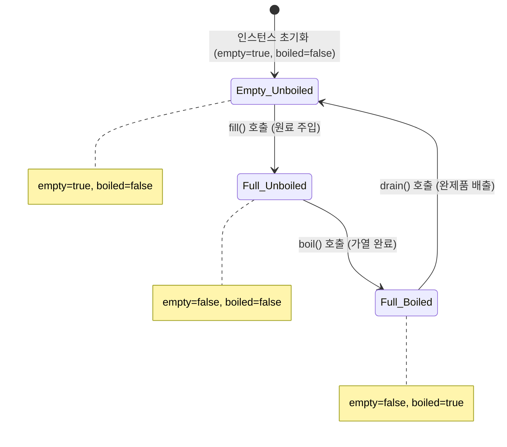
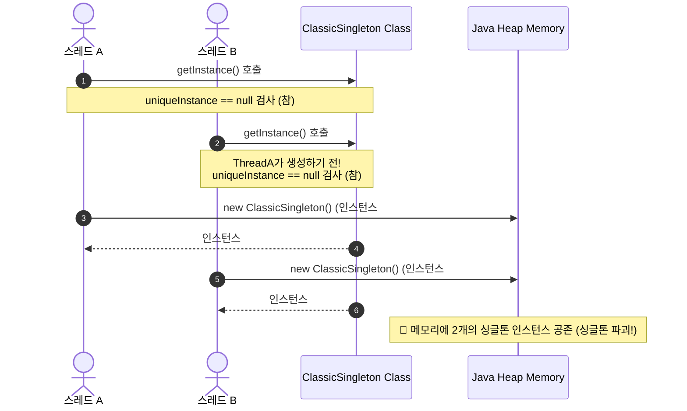
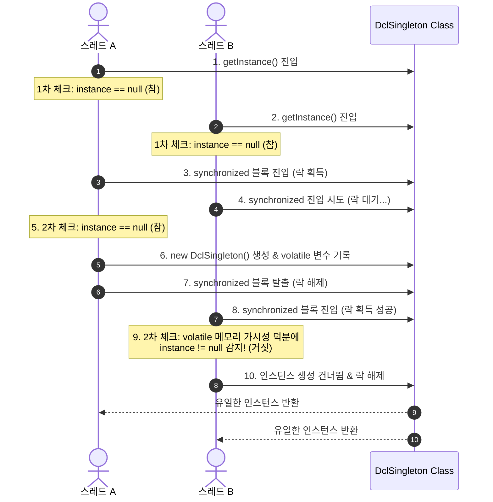

# chapter 5

내용: 싱글톤 패턴
작성일: 2026/10/06
중요: Yes
분야: 디자인패턴 스터디 (https://app.notion.com/p/3c9c9dbbf2a880ceb2f7d88404185c88?pvs=21)
유형: 헤드퍼스트 (https://app.notion.com/p/3c9c9dbbf2a880739f4cc73385614382?pvs=21)

# 싱글톤 패턴 - 하나뿐인 특별한 객체 만들기 (초콜릿 보일러 공장) 🍫🏭

---

### 싱글톤 패턴 요약

1. 클래스의 인스턴스가 오직 **하나만 생성**되도록 보장하며, 이에 대해 어디서든 접근할 수 있는 **전역 접근점(Global Access Point)**을 제공하는 생성 패턴
2. **핵심 해결 과제:** 스레드 풀, 캐시, 대화상자, 레지스트리 설정, 로그 기록기, 디바이스 드라이버 등 시스템 전반에서 정확히 하나만 존재해야 리소스 충돌이나 데이터 불일치가 일어나지 않는 객체를 안전하게 제어함
3. **전역 변수(Global Variable) 대비 우위:**
   - **지연 로딩(Lazy Initialization):** 프로그램 시작 시 무조건 자원을 차지하는 전역 변수와 달리, 실제로 사용될 때까지 인스턴스 생성을 미룰 수 있음
   - **네임스페이스 보호 및 캡슐화:** 전역 네임스페이스를 오염시키지 않으며, 객체의 상태 변경을 캡슐화된 메서드를 통해 엄격히 제어 가능

---

### 도서 내 문제 상황

1. 초콜릿 제조 공장인 **Choc-O-Holic Inc.**에서 초콜릿과 우유 혼합물을 끓여 완제품 초콜릿 바로 만드는 **초콜릿 보일러(ChocolateBoiler)** 제어 시스템을 운영하고 있다.
2. 초콜릿 보일러는 한 번에 500갤런의 혼합물을 채우고, 끓이고, 배출하는 3단계 제조 공정을 엄격히 준수해야 한다:
   - `fill()`: 보일러가 **비어 있을 때만** 원료를 채운다.
   - `boil()`: 보일러가 **차 있고 아직 끓지 않았을 때만** 가열한다.
   - `drain()`: 보일러가 **차 있고 다 끓었을 때만** 다음 성형 공정으로 배출한다.
3. **처음 시도했던 잘못된 접근 방식 (나쁜 예시: 일반적인 공개 생성자):**
   ```java
   public class ChocolateBoiler {
       private boolean empty;
       private boolean boiled;

       // ❌ public 생성자로 인해 누구든지 마음대로 인스턴스를 여러 개 생성할 수 있음!
       public ChocolateBoiler() {
           empty = true;
           boiled = false;
       }

       public void fill() {
           if (isEmpty()) {
               empty = false;
               boiled = false;
               // 우유와 초콜릿 혼합물을 채움
           }
       }
       // boil(), drain() 등 ...
   }
   ```
4. **인스턴스가 2개 이상 생성되었을 때 일어나는 치명적 참사:**
   1. **원료 유출 및 손실 (500갤런 범람):** 보일러 인스턴스 A가 원료를 채웠는데, 다른 곳에서 보일러 인스턴스 B를 새로 만들어 "비어있다"고 판단하고 원료를 또 부어버려 공장 바닥으로 고가의 원료 500갤런이 넘쳐흐름.
   2. **불량품 대량 출하:** 보일러 인스턴스 A가 아직 가열 중인데, 인스턴스 B에서 배출 조건을 오판하여 설익은 원료를 배출해 제품 전량을 폐기 처분해야 함.
   3. **화재 및 폭발 위험:** 비어있는 보일러를 가열하여 기계 파손 및 화재 위험 발생.
5. **멀티스레드 환경에서의 두 번째 재앙 (Race Condition):**
   - 생성자를 `private`으로 막고 고전적인 `getInstance()`를 적용했으나, 멀티스레드 환경에서 두 스레드가 동시에 `if (uniqueInstance == null)` 검사를 통과하면서 **결국 2개의 보일러 객체가 생성되는 동시성 결함**이 발생함.

---

### 문제를 해결한 핵심 객체지향 디자인 원칙

1. **인스턴스 생성 권한의 엄격한 캡슐화**
   - 클래스 외부에서 `new` 키워드를 호출하지 못하도록 생성자의 접근 제어자를 `private`으로 차단하고, 오직 클래스 내부의 정적 팩토리 메서드(`getInstance()`)를 통해서만 객체를 반환하도록 제어한다.
2. **단일 진실 공급원(Single Source of Truth, SSOT) 보장**
   - 초콜릿 보일러의 상태(`empty`, `boiled`)를 공유하는 단 하나의 인스턴스만 힙(Heap) 메모리에 존재하게 함으로써 물리 장비와 소프트웨어 상태의 1:1 완벽한 일치를 보장한다.
3. **지연 로딩(Lazy Initialization)과 자원 최적화**
   - 필요하지 않은 시점에는 무거운 보일러 객체를 메모리에 올리지 않고, 실제로 작업이 요청되는 최초 호출 시점에 인스턴스를 생성하여 메모리와 리소스를 절약한다.

---

### 구조 다이어그램 및 설계 분석

#### 1. 초콜릿 보일러 제조 공정 상태 전이 다이어그램 (State Diagram)
초콜릿 보일러는 엄격한 상태 전이 규칙을 따르며, 인스턴스가 단 하나여야만 상태 불일치 버그를 원천 차단할 수 있다.



#### 2. 프로젝트 종합 클래스 다이어그램 (Class Diagram)
본 프로젝트에 구현된 고전적 싱글톤, 동시성 안전 싱글톤 3종, 현대 자바 권장 싱글톤 2종, 그리고 초콜릿 보일러의 구조이다.

```mermaid
classDiagram
    direction TB

    %% ==========================================
    %% Client & Test Drive
    %% ==========================================
    class SingletonTestDrive {
        +main(args)
        -testThreadSafety(name, supplier)
    }

    %% ==========================================
    %% Chocolate Boiler (Domain Model)
    %% ==========================================
    class ChocolateBoiler {
        -boolean empty
        -boolean boiled
        -ChocolateBoiler uniqueInstance$
        -ChocolateBoiler()
        +getInstance()$ ChocolateBoiler
        +fill()
        +boil()
        +drain()
        +isEmpty() boolean
        +isBoiled() boolean
    }

    class ThreadSafeChocolateBoiler {
        -boolean empty
        -boolean boiled
        -volatile ThreadSafeChocolateBoiler uniqueInstance$
        -ThreadSafeChocolateBoiler()
        +getInstance()$ ThreadSafeChocolateBoiler
        +fill()
        +boil()
        +drain()
    }

    class EnumChocolateBoiler {
        <<enumeration>>
        UNIQUE_INSTANCE
        -boolean empty
        -boolean boiled
        +fill()
        +boil()
        +drain()
    }

    %% ==========================================
    %% Implementation Patterns
    %% ==========================================
    class ClassicSingleton {
        -ClassicSingleton uniqueInstance$
        -ClassicSingleton()
        +getInstance()$ ClassicSingleton
    }

    class SynchronizedSingleton {
        -SynchronizedSingleton uniqueInstance$
        -SynchronizedSingleton()
        +getInstance()$ SynchronizedSingleton
    }

    class EagerSingleton {
        -EagerSingleton UNIQUE_INSTANCE$
        -EagerSingleton()
        +getInstance()$ EagerSingleton
    }

    class DclSingleton {
        -volatile DclSingleton uniqueInstance$
        -DclSingleton()
        +getInstance()$ DclSingleton
    }

    class HolderSingleton {
        -HolderSingleton()
        +getInstance()$ HolderSingleton
    }
    class SingletonHolder {
        -HolderSingleton INSTANCE$
    }
    HolderSingleton +-- SingletonHolder : 내부 정적 클래스

    class EnumSingleton {
        <<enumeration>>
        INSTANCE
        -int value
        +doSomething()
    }

    %% ==========================================
    %% Attack & Defense Demos
    %% ==========================================
    class ReflectionAttackDemo {
        +testReflectionAttack()$
    }
    class SerializationAttackDemo {
        +testSerializationAttack()$
    }

    SingletonTestDrive ..> ChocolateBoiler : uses
    SingletonTestDrive ..> ThreadSafeChocolateBoiler : uses
    SingletonTestDrive ..> EnumChocolateBoiler : uses
    SingletonTestDrive ..> ClassicSingleton : verifies race condition
    SingletonTestDrive ..> DclSingleton : verifies concurrency
    SingletonTestDrive ..> HolderSingleton : verifies concurrency
    SingletonTestDrive ..> EnumSingleton : verifies concurrency
    SingletonTestDrive ..> ReflectionAttackDemo : executes
    SingletonTestDrive ..> SerializationAttackDemo : executes
```

#### 3. 멀티스레드 Race Condition 발생 시퀀스 다이어그램
스레드 A와 B가 동시에 `getInstance()`에 진입할 때 일어나는 동시성 결함의 매커니즘이다.



#### 4. DCL (Double-Checked Locking) 동작 시퀀스 다이어그램
1차 체크로 불필요한 락 획득을 건너뛰고, 2차 체크로 동시 진입한 스레드의 중복 생성을 원천 차단한다.



---

### 싱글톤 구현 패턴의 6단계 진화 과정 비교 분석

| 구현 방식 | 스레드 안전성 | 지연 로딩 (Lazy) | 동기화 성능 | 리플렉션 방어 | 직렬화 안전성 | 권장도 및 평가 |
| :--- | :---: | :---: | :---: | :---: | :---: | :--- |
| **1. Classic** | ❌ 취약 | ✅ 지원 | 빠름 | ❌ 취약 | ❌ 취약 | ⚠️ 실무 사용 절대 금지 (동시성 결함) |
| **2. Synchronized** | ✅ 안전 | ✅ 지원 | ❌ 극심한 저하 | ❌ 취약 | ❌ 취약 | ⚠️ 호출 빈도가 낮을 때만 제한적 사용 |
| **3. Eager** | ✅ 안전 | ❌ 즉시 로딩 | 빠름 | ❌ 취약 | ❌ 취약 | 🆗 가벼운 객체이며 항상 쓰일 때 유효 |
| **4. DCL (volatile)** | ✅ 안전 | ✅ 지원 | 빠름 | ❌ 취약 | ❌ 취약 | 🆗 전통적인 표준 기법 (복잡도 높음) |
| **5. Static Inner Holder** | ✅ 안전 | ✅ 지원 | 🚀 최고 속도 | ❌ 취약 | ❌ 취약 | 🌟 **자바 진영 실무 사실상 표준 (Best)** |
| **6. Enum** | ✅ 안전 | ❌ 즉시 로딩 | 🚀 최고 속도 | 🛡️ **완벽 방어** | 🛡️ **완벽 방어** | 🌟 **조슈아 블로크 추천 가장 안전한 방식** |

---

### 게임 개발 및 실무 적용 사례

#### 1. 게임 개발 (Game Development - Unity / Unreal / Custom Engine)
게임 클라이언트 개발은 싱글톤 패턴이 가장 활발하게 쓰이는 대표적인 분야이다.
1. **GameManager & System Controller:**
   - 게임의 전반적인 상태(게임 시작, 일시정지, 게임오버, 점수, 플레이 타임)를 관리하는 중앙 관리자.
2. **SoundManager / AudioManager:**
   - 배경음악(BGM), 효과음(SFX)의 볼륨 설정 및 채널 풀링을 제어. 씬(Scene)이 바뀌어도 끊기지 않고 음악이 이어져야 하므로 단 하나만 존재해야 함.
3. **UIManager & PoolManager:**
   - 팝업창 스택 관리, 탄환/몬스터 오브젝트 풀링 관리.
4. **Unity의 `MonoBehaviour` 싱글톤 구현 관용구:**
   ```csharp
   public class Singleton<T> : MonoBehaviour where T : MonoBehaviour {
       private static T instance;
       public static T Instance {
           get {
               if (instance == null) {
                   instance = FindObjectOfType<T>();
                   if (instance == null) {
                       GameObject obj = new GameObject(typeof(T).Name);
                       instance = obj.AddComponent<T>();
                   }
               }
               return instance;
           }
       }
       protected virtual void Awake() {
           if (instance == null) {
               instance = this as T;
               DontDestroyOnLoad(gameObject); // 씬 전환 시에도 파괴되지 않음
           } else if (instance != this) {
               Destroy(gameObject); // 중복 생성 시 즉시 파괴
           }
       }
   }
   ```
   > ⚠️ **게임 개발 주의점:** 싱글톤에 모든 시스템이 직접 접근(Coupling)하기 시작하면 씬을 다시 로드할 때 정적 변수 참조가 꼬여 씬 리셋 버그나 메모리 누수가 발생한다. 최근에는 Service Locator나 의존성 주입(VContainer, Zenject)으로 전환하는 추세이다.

#### 2. 백엔드 및 엔터프라이즈 실무 적용
1. **데이터베이스 커넥션 풀 (Connection Pool):**
   - `HikariCP`, `DBCP` 등에서 데이터베이스와의 물리적 소켓 연결 풀을 관리하는 객체. 인스턴스가 여러 개 생기면 DB 커넥션 한도를 초과하여 서버가 마비된다.
2. **스레드 풀 (ThreadPoolExecutor):**
   - 작업 큐를 처리하는 스레드 풀 객체. 전역적으로 CPU 코어 수에 맞추어 하나의 풀을 유지해야 CPU 컨텍스트 스위칭 낭비를 막는다.
3. **설정 관리자 (Configuration/Environment Manager):**
   - `application.yml`이나 시스템 환경 변수를 로딩하여 메모리에 캐싱해두는 객체.

---

### 장점과 단점 요약

#### 1. 장점
1. **자원의 절약 (메모리 및 CPU):** 단 하나의 인스턴스만 힙에 유지하므로 메모리 낭비를 줄이고, 객체 생성/수거(GC) 오버헤드를 없앤다.
2. **데이터 일관성 보장:** 하나의 인스턴스를 공유하므로 전역적인 상태 데이터가 일관되게 유지된다.
3. **전역 접근의 편의성:** 시스템 어느 컴포넌트에서나 손쉽게 접근할 수 있는 단일 창구를 제공한다.
4. **지연 로딩 지원:** 필요할 때 비로소 생성할 수 있어 프로그램 구동 속도를 높일 수 있다.

#### 2. 단점 (안티패턴으로 불리는 이유)
1. **단위 테스트(Unit Test)의 악몽:**
   - `private` 생성자 때문에 Mock 객체로 대체하거나 가짜(Stub) 객체를 주입하기 극히 어렵다.
   - 전역 상태를 공유하므로 테스트 메서드 간에 상태 격리가 깨져 테스트 실행 순서에 따라 결과가 달라지는 간헐적 버그가 발생한다.
2. **높은 결합도와 숨겨진 의존성 (Hidden Dependency):**
   - 파라미터로 의존성을 전달받지 않고 코드 내부에서 `Singleton.getInstance()`를 직접 부르면, 해당 클래스가 싱글톤에 의존한다는 사실이 생성자 시그니처에 드러나지 않는다.
3. **객체지향 원칙 위배:**
   - **SRP(단일 책임 원칙) 위배:** 자신의 본래 비즈니스 로직 외에 "단 하나의 인스턴스 유지"라는 책임까지 짊어진다.
   - **DIP(의존성 역전 원칙) 위배:** 클라이언트가 추상 인터페이스가 아닌 구체 클래스에 직접 결합된다.

---

<aside>
📌

- **싱글톤 패턴 딥다이브 (Deep Dive)**

    ### 1. Java Memory Model (JMM)과 DCL의 진실: 왜 `volatile`이 필수인가?

    DCL(Double-Checked Locking) 코드에서 `volatile` 키워드를 빼먹으면 **간헐적으로 치명적인 NPE(NullPointerException)나 쓰레기 값 참조 버그**가 터진다. 그 원인은 컴파일러와 CPU의 **명령어 재배열(Instruction Reordering)** 최적화 때문이다.

    #### `new Singleton()`의 바이트코드 3단계
    자바에서 객체를 생성하는 연산은 단일 원자적 명령어가 아니며, 바이트코드 레벨에서 다음 세 단계로 분해된다:

    ```
    1. memory = allocate();   // 1. 메모리 공간 할당
    2. ctorSingleton(memory); // 2. 생성자 호출 및 필드 초기화
    3. instance = memory;     // 3. 참조 변수 instance에 메모리 주소 할당
    ```

    #### 컴파일러/CPU의 최적화 (명령어 재배열)
    CPU는 연산 효율을 높이기 위해 종속성이 없는 명령어의 실행 순서를 바꿀 수 있다. 만약 순서가 다음과 같이 재배열된다면:
    ```
    1. memory = allocate();   // 1. 메모리 공간 할당
    3. instance = memory;     // 3. instance 변수에 주소 먼저 연결! (아직 초기화 안 됨!)
    2. ctorSingleton(memory); // 2. 생성자 실행 (뒤늦게 실행)
    ```

    #### 버그 발생 시나리오
    1. 스레드 1이 `synchronized` 블록 안에서 1번(할당)과 3번(주소 연결)까지만 실행한 상태에서 CPU 타임슬라이스가 끝남.
    2. 바로 그 찰나에 스레드 2가 `getInstance()`를 호출하여 **1차 검사 `if (instance == null)`**을 수행함.
    3. 스레드 2의 눈에는 `instance`가 이미 주소를 가지고 있으므로 `null`이 아니라고 판단됨!
    4. 스레드 2는 락도 안 거치고 해당 인스턴스를 즉시 반환받아 메서드를 호출함.
    5. **결과:** 내부 필드 초기화(2번)가 아직 완료되지 않은 **"미완성 껍데기 객체"**를 읽어버려 크래시 발생!

    #### `volatile`의 역할
    1. **메모리 배리어(Memory Barrier / Fence) 삽입:** 2번(생성자 초기화)이 완료되기 전에 3번(주소 할당)이 앞으로 재배열되는 것을 하드웨어 레벨에서 원천 금지함 (`Happens-Before` 보장).
    2. **가시성(Visibility) 보장:** CPU L1/L2 캐시 메모리가 아니라 메인 메모리(Main Memory)에 즉시 읽기/쓰기를 수행하여, 스레드 1이 생성한 완전한 객체를 스레드 2가 즉각 보게 함.

    ──────

    ### 2. Bill Pugh의 Static Inner Holder 패턴의 JVM 동작 원리

    Static Inner Holder 기법은 **`synchronized` 키워드도 없고, `volatile`도 없으며, Eager처럼 쓸데없이 미리 메모리를 먹지도 않는데 완벽한 Lazy Loading과 Thread-Safe를 달성**한다.

    ```java
    public class HolderSingleton {
        private HolderSingleton() {}

        private static class SingletonHolder {
            private static final HolderSingleton INSTANCE = new HolderSingleton();
        }

        public static HolderSingleton getInstance() {
            return SingletonHolder.INSTANCE;
        }
    }
    ```

    #### JVM 클래스 로더 명세(JLS: Java Language Specification)에 기반한 원리
    1. **지연 로딩 (Lazy Loading):**
       - Java 가상 머신(JVM)은 `HolderSingleton` 클래스를 로드할 때 내부 정적 클래스인 `SingletonHolder`를 함께 로드하지 않는다.
       - 클래스는 "해당 클래스의 멤버에 처음 접근할 때" 비로소 로딩 및 초기화(Initialization)된다.
       - 따라서 `HolderSingleton.getInstance()`가 호출되어 내부의 `SingletonHolder.INSTANCE`를 참조하는 바로 그 순간에만 내부 클래스가 로드된다!
    2. **스레드 안전성 (Thread-Safety):**
       - JVM 명세에 따르면 클래스 초기화 단계(Class Initialization Phase)는 **JVM 내부의 전용 초기화 락(Class Initialization Lock)**에 의해 완벽하게 상호 배제(동기화)된다.
       - 여러 스레드가 동시에 `getInstance()`를 호출하더라도, JVM 클래스로더가 내부 클래스를 메모리에 올리고 정적 상수를 초기화하는 과정은 오직 단 하나의 스레드에 의해서만 수행됨을 자바 언어 스펙이 보장한다.
       - 개발자가 복잡한 락 코드를 짤 필요 없이 JVM에게 동기화를 전임하는 가장 우아한 기법이다.

    ──────

    ### 3. 싱글톤을 파괴하는 3대 공격과 철통 방어 기법

    싱글톤 패턴으로 구현된 클래스라도 악의적인 코드나 특수한 프레임워크 환경에서 단일성이 파괴될 수 있다.

    #### 공격 1: 리플렉션 공격 (Reflection Attack)
    `Constructor.setAccessible(true)`를 호출하면 `private` 생성자의 문을 강제로 열고 제2, 제3의 인스턴스를 찍어낼 수 있다.
    ```java
    Constructor<ClassicSingleton> c = ClassicSingleton.class.getDeclaredConstructor();
    c.setAccessible(true); // private 접근 차단 무력화
    ClassicSingleton evilInstance = c.newInstance(); // 새로운 객체 탄생!
    ```
    - **일반 클래스의 방어책:**
      생성자 내부에 플래그를 두어 2회 이상 호출 시 `IllegalStateException`을 던진다.
      ```java
      private static boolean isCreated = false;
      private DefendedSingleton() {
          if (isCreated) {
              throw new IllegalStateException("생성자 재호출 차단!");
          }
          isCreated = true;
      }
      ```
    - **Enum의 궁극적 방어:**
      자바 리플렉션 API인 `Constructor.newInstance()`의 내부 코드를 보면 다음과 같이 하드코딩되어 있다:
      ```java
      if ((clazz.getModifiers() & Modifier.ENUM) != 0)
          throw new IllegalArgumentException("Cannot reflectively create enum objects");
      ```
      즉, 자바 언어 스펙 자체가 리플렉션으로 Enum 객체를 만드는 행위를 문법적으로 금지하고 있다!

    #### 공격 2: 직렬화/역직렬화 공격 (Serialization Attack)
    싱글톤 객체가 `Serializable`을 구현한 경우, 객체를 파일이나 네트워크로 직렬화했다가 역직렬화하면 생성자를 거치지 않고 새로운 객체가 역직렬화 스트림에서 복제 생성된다.
    - **일반 클래스의 방어책:**
      역직렬화 시 호출되는 `readResolve()` 메서드를 정의하여 기존 인스턴스를 반환하도록 강제한다.
      ```java
      protected Object readResolve() {
          return INSTANCE; // 역직렬화된 가짜 객체 대신 기존 싱글톤 반환
      }
      ```
    - **Enum의 궁극적 방어:**
      JVM은 Enum을 직렬화할 때 상수의 "이름(name)"만 저장하고, 역직렬화할 때는 내부적으로 `Enum.valueOf()`를 사용하여 기존 상수를 그대로 찾아오므로 별도의 코드 없이도 100% 안전하다.

    #### 공격 3: 클래스로더 분리 공격 (Multiple ClassLoaders)
    서로 다른 클래스로더가 같은 싱글톤 클래스를 각각 로딩하면, 클래스로더 네임스페이스가 격리되어 메모리에 2개 이상의 클래스 객체와 인스턴스가 생성된다 (WAS나 플러그인 시스템 등에서 빈번).
    - **방어책:** 클래스로더를 명시적으로 단일 루트 클래스로더(System/App ClassLoader)로 고정하거나 IoC 컨테이너를 사용한다.

    ──────

    ### 4. 싱글톤 vs 정적 클래스 (Static Class / Static Methods)

    "그냥 모든 메서드와 필드를 `static`으로 선언한 클래스를 쓰면 싱글톤과 다를 게 없지 않나요?"라는 의문이 자주 든다.

    | 비교 항목 | 싱글톤 패턴 (Singleton) | 순수 정적 클래스 (Static Class) |
    | :--- | :--- | :--- |
    | **인터페이스 구현** | 가능 (`implements MyInterface`) | 불가능 (정적 메서드는 인터페이스 오버라이드 불가) |
    | **다형성 및 상속** | 객체이므로 상속 및 다형성 활용 가능 | 상속 불가능 (정적 메서드는 런타임 다형성 없음) |
    | **지연 로딩 (Lazy Loading)**| 필요할 때 인스턴스화 가능 | 클래스 참조 시 즉시 로딩 |
    | **파라미터 전달** | 객체이므로 메서드 인자로 전달 가능 | 객체가 아니므로 인자로 넘길 수 없음 |
    | **의존성 주입 (DI)** | DI 컨테이너에 빈으로 등록 가능 | 정적 메서드는 DI로 교체 불가능 |

    > **판단 기준:** 상태(State)를 가지지 않고 순수 연산 함수만 제공하는 유틸리티(`java.lang.Math`, `java.util.Collections`)라면 정적 클래스가 적합하고, 상태를 관리하거나 인터페이스 다형성/DI가 필요하다면 싱글톤이 적합하다.

    ──────

    ### 5. GoF 싱글톤 패턴 vs 스프링(Spring) IoC 컨테이너의 싱글톤 빈

    실무 스프링 백엔드 개발에서 `@Service`, `@Repository`, `@Component`는 모두 기본 스코프가 싱글톤(Singleton)이다. 하지만 이는 **GoF 디자인 패턴의 싱글톤과 완전히 다른 개념**이다.

    ```
    [GoF 싱글톤 패턴]
    클래스 내부에 private 생성자와 static 변수를 박아넣어 "코드 레벨에서 단 1개만 생성되도록 강제"
    -> 높은 결합도, 단위 테스트 불가능, OCP/DIP 위배라는 치명적 대가 발생!

    [스프링의 싱글톤 레지스트리 (Singleton Registry)]
    클래스는 평범한 public 생성자를 가진 유연한 POJO로 설계!
    싱글톤 보장은 스프링 컨테이너(ApplicationContext)가 도맡아 1개만 생성해 관리하고 주입(DI)!
    -> 필요할 땐 테스트 코드에서 new Service()로 얼마든지 자유롭게 Mocking 가능!
    ```

    스프링은 "싱글톤 패턴의 객체 단일성이라는 이점"은 취하면서도, "싱글톤 패턴의 안티패턴적 부작용(private 생성자, 강결합, 테스트 불능)"을 **IoC 컨테이너와 의존성 주입(DI)**을 통해 완벽하게 해결했다.
</aside>

---

### 📂 chapter5 폴더

- **SingletonTestDrive.java**

    ```java
    package chapter5;

    import chapter5.Chocolate.ChocolateBoiler;
    import chapter5.Chocolate.ThreadSafeChocolateBoiler;
    import chapter5.Chocolate.EnumChocolateBoiler;
    import chapter5.Classic.ClassicSingleton;
    import chapter5.ThreadSafe.SynchronizedSingleton;
    import chapter5.ThreadSafe.EagerSingleton;
    import chapter5.ThreadSafe.DclSingleton;
    import chapter5.Modern.HolderSingleton;
    import chapter5.Modern.EnumSingleton;
    import chapter5.BreakAttack.ReflectionAttackDemo;
    import chapter5.BreakAttack.SerializationAttackDemo;

    import java.util.Collections;
    import java.util.Set;
    import java.util.concurrent.ConcurrentHashMap;
    import java.util.concurrent.CountDownLatch;
    import java.util.concurrent.ExecutorService;
    import java.util.concurrent.Executors;

    public class SingletonTestDrive {

        public static void main(String[] args) throws InterruptedException {
            System.out.println("==========================================================================");
            System.out.println(" 🍫 헤드퍼스트 디자인 패턴 Chapter 05: 하나뿐인 특별한 객체 만들기 (싱글톤 패턴) 🍫");
            System.out.println("==========================================================================");

            // ---------------------------------------------------------------------
            // PART 1. 헤드퍼스트 초콜릿 보일러 (ChocolateBoiler) 시뮬레이션
            // ---------------------------------------------------------------------
            System.out.println("\n[PART 1. 초콜릿 공장(Choc-O-Holic) 보일러 제어 시뮬레이션]");
            System.out.println("두 개의 참조 변수(boiler1, boiler2)가 동일한 보일러 인스턴스를 제어하는지 확인");

            ChocolateBoiler boiler1 = ChocolateBoiler.getInstance();
            ChocolateBoiler boiler2 = ChocolateBoiler.getInstance();

            System.out.println("boiler1 해시코드: " + System.identityHashCode(boiler1));
            System.out.println("boiler2 해시코드: " + System.identityHashCode(boiler2));
            System.out.println("boiler1과 boiler2는 동일 인스턴스인가? -> " + (boiler1 == boiler2));

            System.out.println("\n>>> [공정 진행 1] boiler1에서 우유와 초콜릿을 채웁니다.");
            boiler1.fill();

            System.out.println(">>> [공정 진행 2] boiler2에서 혼합물을 끓입니다. (boiler1의 상태가 공유됨)");
            boiler2.boil();

            System.out.println(">>> [공정 진행 3] boiler1에서 완성된 초콜릿을 배출합니다.");
            boiler1.drain();

            System.out.println(">>> [오류 방어 테스트] 비어있는 보일러를 끓이려고 시도합니다.");
            boiler2.boil();

            // ---------------------------------------------------------------------
            // PART 2. 멀티스레드 환경에서 Classic Singleton의 Race Condition 검증
            // ---------------------------------------------------------------------
            System.out.println("\n==========================================================================");
            System.out.println("[PART 2. 멀티스레드 환경에서 Classic Singleton의 취약점 재현 (Race Condition)]");
            System.out.println("5개의 스레드가 동시에 ClassicSingleton.getInstance()를 호출합니다.");
            System.out.println("==========================================================================");

            ClassicSingleton.resetForTesting();
            int threadCount = 5;
            ExecutorService executor = Executors.newFixedThreadPool(threadCount);
            CountDownLatch readyLatch = new CountDownLatch(threadCount);
            CountDownLatch startLatch = new CountDownLatch(1);
            Set<Integer> classicHashCodes = Collections.newSetFromMap(new ConcurrentHashMap<>());

            for (int i = 0; i < threadCount; i++) {
                executor.submit(() -> {
                    try {
                        readyLatch.countDown();
                        startLatch.await(); // 모든 스레드가 준비될 때까지 대기 후 동시 발사
                        ClassicSingleton instance = ClassicSingleton.getInstance();
                        classicHashCodes.add(System.identityHashCode(instance));
                    } catch (InterruptedException e) {
                        Thread.currentThread().interrupt();
                    }
                });
            }

            readyLatch.await();
            startLatch.countDown(); // 동시 시작 신호
            Thread.sleep(200); // 작업 완료 대기

            System.out.println("생성된 서로 다른 ClassicSingleton 인스턴스 개수: " + classicHashCodes.size());
            if (classicHashCodes.size() > 1) {
                System.out.println("🚨 [버그 발생!] 싱글톤임에도 불구하고 멀티스레드 경쟁으로 인해 " 
                        + classicHashCodes.size() + "개의 인스턴스가 생성되었습니다!");
            } else {
                System.out.println("운 좋게 단 1개만 생성되었으나, 타이밍에 따라 언제든 깨질 수 있습니다.");
            }

            // ---------------------------------------------------------------------
            // PART 3. 안전한 싱글톤 기법들의 멀티스레드 동시성 검증
            // ---------------------------------------------------------------------
            System.out.println("\n==========================================================================");
            System.out.println("[PART 3. 스레드 안전 싱글톤들의 동시성 검증 (30개 동시 스레드 요청)]");
            System.out.println("==========================================================================");

            testThreadSafety("DCL Singleton", () -> System.identityHashCode(DclSingleton.getInstance()));
            testThreadSafety("Static Inner Holder Singleton", () -> System.identityHashCode(HolderSingleton.getInstance()));
            testThreadSafety("Enum Singleton", () -> System.identityHashCode(EnumSingleton.INSTANCE));

            // ---------------------------------------------------------------------
            // PART 4. 싱글톤 파괴 및 방어 실습 (리플렉션 공격)
            // ---------------------------------------------------------------------
            ReflectionAttackDemo.testReflectionAttack();

            // ---------------------------------------------------------------------
            // PART 5. 싱글톤 파괴 및 방어 실습 (직렬화 공격)
            // ---------------------------------------------------------------------
            SerializationAttackDemo.testSerializationAttack();

            System.out.println("\n==========================================================================");
            System.out.println(" 🎉 Chapter 05 싱글톤 패턴 종합 학습 및 검증 완료!");
            System.out.println("==========================================================================");

            executor.shutdown();
        }

        private static void testThreadSafety(String name, java.util.function.Supplier<Integer> supplier) throws InterruptedException {
            int threads = 30;
            ExecutorService exec = Executors.newFixedThreadPool(threads);
            CountDownLatch ready = new CountDownLatch(threads);
            CountDownLatch start = new CountDownLatch(1);
            Set<Integer> hashCodes = Collections.newSetFromMap(new ConcurrentHashMap<>());

            for (int i = 0; i < threads; i++) {
                exec.submit(() -> {
                    try {
                        ready.countDown();
                        start.await();
                        hashCodes.add(supplier.get());
                    } catch (InterruptedException e) {
                        Thread.currentThread().interrupt();
                    }
                });
            }

            ready.await();
            start.countDown();
            exec.shutdown();
            exec.awaitTermination(2, java.util.concurrent.TimeUnit.SECONDS);

            System.out.println("▶ [" + name + "] 30개 동시 스레드 테스트 결과 생성된 고유 인스턴스 수: " + hashCodes.size()
                    + (hashCodes.size() == 1 ? " (✅ 완벽한 스레드 안전성 보장)" : " (❌ 동시성 실패)"));
        }
    }
    ```

---

### 📂 chapter5.Chocolate 폴더

- **ChocolateBoiler.java**

    ```java
    package chapter5.Chocolate;

    /**
     * [헤드퍼스트 디자인 패턴 Chapter 05]
     * 초콜릿 공장(Choc-O-Holic Inc.)의 초콜릿 보일러 클래스
     * 
     * 보일러가 비어있을 때만 재료를 채우고,
     * 가득 차 있고 끓지 않았을 때만 가열하며,
     * 다 끓었을 때만 배출해야 한다.
     * 인스턴스가 2개 이상 생성되면 심각한 오작동(과열, 원료 유출 등)이 발생할 수 있다.
     */
    public class ChocolateBoiler {

        private boolean empty;
        private boolean boiled;

        // 유일한 인스턴스를 저장하기 위한 정적 변수 (고전적 싱글톤 방식)
        private static ChocolateBoiler uniqueInstance;

        // 생성자를 private으로 선언하여 외부에서 new ChocolateBoiler() 호출 불가
        private ChocolateBoiler() {
            empty = true;
            boiled = false;
        }

        // 인스턴스를 가져오는 전역 접근점 메서드
        public static ChocolateBoiler getInstance() {
            if (uniqueInstance == null) {
                System.out.println("[ChocolateBoiler] 새로운 초콜릿 보일러 인스턴스를 생성합니다.");
                uniqueInstance = new ChocolateBoiler();
            }
            return uniqueInstance;
        }

        // 보일러에 우유와 초콜릿 혼합물을 채움
        public void fill() {
            if (isEmpty()) {
                empty = false;
                boiled = false;
                System.out.println("🍫 [fill] 보일러에 신선한 우유와 초콜릿 혼합물을 가득 채웁니다.");
            } else {
                System.out.println("⚠️ [fill 경고] 보일러가 이미 차 있어 재료를 더 채울 수 없습니다!");
            }
        }

        // 다 끓인 혼합물을 다음 제조 공정으로 배출
        public void drain() {
            if (!isEmpty() && isBoiled()) {
                System.out.println("🍫 [drain] 다 끓인 초콜릿 혼합물을 배출하여 초콜릿 바로 성형합니다.");
                empty = true;
            } else if (isEmpty()) {
                System.out.println("⚠️ [drain 경고] 보일러가 비어있어 배출할 수 없습니다!");
            } else if (!isBoiled()) {
                System.out.println("⚠️ [drain 경고] 아직 끓지 않은 원료는 배출할 수 없습니다!");
            }
        }

        // 혼합물을 끓임
        public void boil() {
            if (!isEmpty() && !isBoiled()) {
                System.out.println("🔥 [boil] 보일러를 가열하여 초콜릿 혼합물을 끓입니다.");
                boiled = true;
            } else if (isEmpty()) {
                System.out.println("⚠️ [boil 경고] 빈 보일러를 가열하면 기계가 손상되거나 화재가 발생합니다!");
            } else if (isBoiled()) {
                System.out.println("⚠️ [boil 경고] 혼합물이 이미 다 끓었습니다!");
            }
        }

        public boolean isEmpty() {
            return empty;
        }

        public boolean isBoiled() {
            return boiled;
        }

        // 테스트를 위해 인스턴스 초기화 메서드 (실제 프로덕션에서는 제공하지 않음)
        public static void resetInstanceForTesting() {
            uniqueInstance = null;
        }
    }
    ```

- **ThreadSafeChocolateBoiler.java**

    ```java
    package chapter5.Chocolate;

    /**
     * [멀티스레드 환경 대응 초콜릿 보일러]
     * DCL (Double-Checked Locking)과 volatile 키워드를 적용하여
     * 멀티스레드 환경에서도 단 하나의 인스턴스만 생성됨을 보장하며,
     * 보일러 작업 메서드(fill, boil, drain)에도 synchronized 처리를 하여
     * 동시 접근 시 상태 불일치(Race Condition)를 방지한다.
     */
    public class ThreadSafeChocolateBoiler {

        private boolean empty;
        private boolean boiled;

        // volatile 키워드: CPU 캐시가 아닌 메인 메모리 동기화 및 명령어 재정렬(Reordering) 방지
        private static volatile ThreadSafeChocolateBoiler uniqueInstance;

        private ThreadSafeChocolateBoiler() {
            empty = true;
            boiled = false;
        }

        public static ThreadSafeChocolateBoiler getInstance() {
            if (uniqueInstance == null) {
                synchronized (ThreadSafeChocolateBoiler.class) {
                    if (uniqueInstance == null) {
                        System.out.println("[ThreadSafeChocolateBoiler] DCL 방식으로 안전하게 인스턴스를 생성합니다.");
                        uniqueInstance = new ThreadSafeChocolateBoiler();
                    }
                }
            }
            return uniqueInstance;
        }

        public synchronized void fill() {
            if (isEmpty()) {
                empty = false;
                boiled = false;
                System.out.println("🍫 [ThreadSafe fill] 보일러에 원료를 안전하게 채웠습니다.");
            } else {
                System.out.println("⚠️ [ThreadSafe fill] 보일러가 이미 차 있습니다.");
            }
        }

        public synchronized void boil() {
            if (!isEmpty() && !isBoiled()) {
                System.out.println("🔥 [ThreadSafe boil] 원료를 안전하게 끓였습니다.");
                boiled = true;
            } else if (isEmpty()) {
                System.out.println("⚠️ [ThreadSafe boil] 빈 보일러 가열 금지!");
            } else {
                System.out.println("⚠️ [ThreadSafe boil] 이미 다 끓었습니다.");
            }
        }

        public synchronized void drain() {
            if (!isEmpty() && isBoiled()) {
                System.out.println("🍫 [ThreadSafe drain] 끓인 초콜릿을 안전하게 배출했습니다.");
                empty = true;
            } else {
                System.out.println("⚠️ [ThreadSafe drain] 배출 조건 미충족 (empty=" + empty + ", boiled=" + boiled + ")");
            }
        }

        public synchronized boolean isEmpty() {
            return empty;
        }

        public synchronized boolean isBoiled() {
            return boiled;
        }
    }
    ```

- **EnumChocolateBoiler.java**

    ```java
    package chapter5.Chocolate;

    /**
     * [Enum 기반 초콜릿 보일러]
     * Joshua Bloch(Effective Java)와 헤드퍼스트 최신 개정판에서
     * 가장 권장하는 싱글톤 구현 기법.
     * 
     * - 직렬화/역직렬화 시 새로운 인스턴스가 생성되는 문제 완벽 해결
     * - 리플렉션 공격(Reflection Attack)을 통한 private 생성자 강제 호출 원천 차단
     * - JVM 언어 명세상 스레드 안전성 100% 보장
     */
    public enum EnumChocolateBoiler {
        UNIQUE_INSTANCE;

        private boolean empty;
        private boolean boiled;

        // enum의 생성자는 private이며 클래스 로드 시 1회만 실행됨
        EnumChocolateBoiler() {
            empty = true;
            boiled = false;
        }

        public synchronized void fill() {
            if (isEmpty()) {
                empty = false;
                boiled = false;
                System.out.println("🍫 [EnumBoiler fill] 원료를 채웠습니다.");
            } else {
                System.out.println("⚠️ [EnumBoiler fill] 보일러가 이미 차 있습니다.");
            }
        }

        public synchronized void boil() {
            if (!isEmpty() && !isBoiled()) {
                System.out.println("🔥 [EnumBoiler boil] 원료를 가열했습니다.");
                boiled = true;
            } else {
                System.out.println("⚠️ [EnumBoiler boil] 가열 조건 불만족 (empty=" + empty + ", boiled=" + boiled + ")");
            }
        }

        public synchronized void drain() {
            if (!isEmpty() && isBoiled()) {
                System.out.println("🍫 [EnumBoiler drain] 초콜릿을 배출했습니다.");
                empty = true;
            } else {
                System.out.println("⚠️ [EnumBoiler drain] 배출 조건 불만족 (empty=" + empty + ", boiled=" + boiled + ")");
            }
        }

        public synchronized boolean isEmpty() {
            return empty;
        }

        public synchronized boolean isBoiled() {
            return boiled;
        }
    }
    ```

---

### 📂 chapter5.Classic 폴더

- **ClassicSingleton.java**

    ```java
    package chapter5.Classic;

    /**
     * [1단계: 고전적 싱글톤 (Classic Singleton)]
     * 
     * 특징:
     * - 게으른 인스턴스화 (Lazy Initialization): 실제로 객체가 필요한 순간(getInstance 호출)까지 인스턴스 생성을 미룬다.
     * - 단점: 멀티스레드 환경에서 안전하지 않음 (Thread-unsafe).
     *   여러 스레드가 동시에 if (uniqueInstance == null) 조건을 평가하면
     *   서로 다른 인스턴스가 2개 이상 생성되는 Race Condition(경쟁 상태)이 발생한다.
     */
    public class ClassicSingleton {

        private static ClassicSingleton uniqueInstance;

        private ClassicSingleton() {
            System.out.println("-> [ClassicSingleton] 인스턴스가 생성되었습니다. (Hash: " + System.identityHashCode(this) + ")");
        }

        public static ClassicSingleton getInstance() {
            if (uniqueInstance == null) {
                // 멀티스레드 환경에서 동시에 여기까지 진입하면 복수의 인스턴스가 생성되는 버그 발생!
                try {
                    // 동시성 문제를 명확히 확인하기 위해 약간의 딜레이 부여
                    Thread.sleep(10);
                } catch (InterruptedException e) {
                    Thread.currentThread().interrupt();
                }
                uniqueInstance = new ClassicSingleton();
            }
            return uniqueInstance;
        }

        public static void resetForTesting() {
            uniqueInstance = null;
        }
    }
    ```

---

### 📂 chapter5.ThreadSafe 폴더

- **SynchronizedSingleton.java**

    ```java
    package chapter5.ThreadSafe;

    /**
     * [2단계: 동기화 메서드 싱글톤 (Synchronized Method Singleton)]
     * 
     * 특징:
     * - getInstance() 메서드에 synchronized 키워드를 붙여 한 번에 하나의 스레드만 진입하도록 강제.
     * - 장점: 스레드 안전성(Thread-Safe)이 보장되며 구현이 매우 단순함.
     * - 단점: 성능 저하 (락 경합 오버헤드).
     *   인스턴스가 이미 생성된 후에도 매번 getInstance()를 호출할 때마다 불필요하게 락을 획득/반환하므로,
     *   빈번하게 호출되는 고성능 시스템에서는 성능이 최대 100배까지 떨어질 수 있다.
     */
    public class SynchronizedSingleton {

        private static SynchronizedSingleton uniqueInstance;

        private SynchronizedSingleton() {
            System.out.println("-> [SynchronizedSingleton] 인스턴스가 생성되었습니다. (Hash: " + System.identityHashCode(this) + ")");
        }

        public static synchronized SynchronizedSingleton getInstance() {
            if (uniqueInstance == null) {
                uniqueInstance = new SynchronizedSingleton();
            }
            return uniqueInstance;
        }
    }
    ```

- **EagerSingleton.java**

    ```java
    package chapter5.ThreadSafe;

    /**
     * [3단계: 즉시 로딩 싱글톤 (Eager Initialization Singleton)]
     * 
     * 특징:
     * - 정적 초기화 블록(static initializer)에서 인스턴스를 즉시 생성한다.
     * - JVM이 클래스를 메모리에 로딩할 때 단 한 번만 생성되므로 완벽히 스레드 안전하다.
     * - 장점: 별도의 동기화(synchronized) 블록이나 복잡한 락 메커니즘이 없어 호출 속도가 매우 빠르고 단순하다.
     * - 단점: 지연 로딩(Lazy Loading) 불가.
     *   해당 클래스가 로딩되는 순간 바로 메모리를 차지하므로, 객체 생성 비용이 매우 크거나(무거운 DB 커넥션 등)
     *   실제 프로그램 실행 중에 사용되지 않는다면 불필요한 메모리 및 리소스 낭비가 발생한다.
     */
    public class EagerSingleton {

        // 클래스가 로딩될 때 즉시 인스턴스를 생성함
        private static final EagerSingleton UNIQUE_INSTANCE = new EagerSingleton();

        private EagerSingleton() {
            System.out.println("-> [EagerSingleton] 클래스 로딩 시 인스턴스가 즉시 생성되었습니다. (Hash: " + System.identityHashCode(this) + ")");
        }

        public static EagerSingleton getInstance() {
            return UNIQUE_INSTANCE;
        }
    }
    ```

- **DclSingleton.java**

    ```java
    package chapter5.ThreadSafe;

    /**
     * [4단계: DCL 싱글톤 (Double-Checked Locking Singleton)]
     * 
     * 특징:
     * - 인스턴스가 생성되어 있는지 먼저 검사하고, 생성되지 않은 경우에만 synchronized 블록에 진입한다.
     * - 블록 안에서 다시 한 번 null 체크를 수행(Double Check)하여 동시 접근 스레드의 중복 생성을 차단한다.
     * - 최초 1회 인스턴스화 시점에만 동기화가 발생하므로 이후 호출에서는 동기화 오버헤드가 거의 없다.
     * 
     * ★ volatile 키워드가 필수적인 이유 (JMM: Java Memory Model):
     * 객체 생성 연산 (new DclSingleton())은 바이트코드 상에서 3단계로 분리된다:
     *   1. 메모리 공간 할당 (allocate)
     *   2. 생성자 호출 및 인스턴스 초기화 (invokespecial <init>)
     *   3. 참조 변수에 할당된 메모리 주소 기록 (putstatic)
     * 
     * 만약 volatile이 없다면 컴파일러/CPU 최적화에 의해 명령어 재배열(Instruction Reordering)이 발생하여
     * 1 -> 3 -> 2 순서로 실행될 수 있다.
     * 이 경우 다른 스레드가 첫 번째 if (uniqueInstance == null)을 확인할 때
     * '주소는 할당되었으나 내부 필드는 초기화되지 않은 껍데기 객체'를 유효한 인스턴스로 오인하고
     * 참조하여 치명적인 런타임 오류가 발생할 수 있다.
     * 
     * volatile 키워드는:
     * 1) 메모리 장벽(Memory Barrier)을 세워 명령어 재배열을 방지한다.
     * 2) CPU 캐시가 아닌 메인 메모리에 즉시 반영하여 메모리 가시성(Visibility)을 보장한다.
     */
    public class DclSingleton {

        // volatile 필수! (Java 5 이상 지원)
        private static volatile DclSingleton uniqueInstance;

        private DclSingleton() {
            System.out.println("-> [DclSingleton] 인스턴스가 DCL로 안전하게 생성되었습니다. (Hash: " + System.identityHashCode(this) + ")");
        }

        public static DclSingleton getInstance() {
            // 1차 체크: 인스턴스가 이미 있으면 락을 걸지 않고 즉시 반환 (성능 최적화)
            if (uniqueInstance == null) {
                synchronized (DclSingleton.class) {
                    // 2차 체크: 락을 획득한 후 다른 스레드가 먼저 만들었는지 다시 확인
                    if (uniqueInstance == null) {
                        uniqueInstance = new DclSingleton();
                    }
                }
            }
            return uniqueInstance;
        }
    }
    ```

---

### 📂 chapter5.Modern 폴더

- **HolderSingleton.java**

    ```java
    package chapter5.Modern;

    /**
     * [5단계: Static Inner Holder 싱글톤 (Bill Pugh Idiom)]
     * 
     * 특징:
     * - 정적 내부 클래스(Static Inner Class)를 활용하여 지연 로딩(Lazy Loading)과
     *   스레드 안전성(Thread-Safety)을 동기화(synchronized) 키워드 없이 완벽하게 달성하는 기법.
     * - 메릴랜드 대학교의 Bill Pugh 교수가 제안한 방식으로, 자바 표준에서 가장 널리 권장되는 싱글톤 관용구.
     * 
     * 동작 원리 (JVM 클래스 로더 메커니즘):
     * 1. HolderSingleton 클래스가 처음 JVM에 로드되더라도, 정적 내부 클래스인 SingletonHolder는 메모리에 로드되지 않는다.
     * 2. 외부에서 HolderSingleton.getInstance()를 최초로 호출하는 순간,
     *    SingletonHolder 클래스에 대한 참조가 발생하며 비로소 로딩 및 초기화가 진행된다.
     * 3. JVM의 클래스 초기화 단계는 Java Language Specification(JLS)에 따라
     *    JVM 내부의 초기화 락(Initialization Lock)에 의해 상호 배제(동기화)가 완벽히 보장된다.
     * 4. 결과적으로 volatile이나 synchronized 없이도 고성능 + 안전한 지연 로딩이 가능하다.
     */
    public class HolderSingleton {

        private HolderSingleton() {
            System.out.println("-> [HolderSingleton] Holder 내부 클래스에 의해 인스턴스가 안전하게 생성되었습니다. (Hash: " + System.identityHashCode(this) + ")");
        }

        // JVM이 getInstance() 호출 전까지 로딩하지 않는 정적 내부 클래스
        private static class SingletonHolder {
            private static final HolderSingleton INSTANCE = new HolderSingleton();
        }

        public static HolderSingleton getInstance() {
            return SingletonHolder.INSTANCE;
        }
    }
    ```

- **EnumSingleton.java**

    ```java
    package chapter5.Modern;

    /**
     * [6단계: 열거 타입 싱글톤 (Enum Singleton)]
     * 
     * 특징:
     * - Joshua Bloch(Effective Java 저자, 전 구글/썬 수석 아키텍트)가 제시하고
     *   헤드퍼스트 디자인 패턴 최신 개정판에서도 극찬하는 가장 진보된 싱글톤 구현 기법.
     * 
     * 장점:
     * 1. 극도의 간결함: 단 몇 줄의 코드로 구현 가능.
     * 2. 완벽한 스레드 안전성: JVM이 enum 상수의 인스턴스화를 언어 레벨에서 보장함.
     * 3. 직렬화(Serialization) 안전성: 기본적으로 직렬화가 가능하며,
     *    역직렬화 시 새로운 인스턴스가 생성되는 현상을 JVM이 자체적으로 방지함.
     * 4. 리플렉션 공격(Reflection Attack) 완벽 방어:
     *    Constructor.newInstance() 내부에서 Enum 타입인 경우 IllegalArgumentException을
     *    던지도록 자바 언어 스펙상 하드코딩되어 있어 악의적인 private 생성자 호출이 불가능함.
     */
    public enum EnumSingleton {
        INSTANCE;

        private int value = 0;

        EnumSingleton() {
            System.out.println("-> [EnumSingleton] 열거형 인스턴스가 초기화되었습니다. (Hash: " + System.identityHashCode(this) + ")");
        }

        public void doSomething() {
            System.out.println("EnumSingleton 비즈니스 로직 수행 (value: " + value + ")");
        }

        public int getValue() {
            return value;
        }

        public void setValue(int value) {
            this.value = value;
        }
    }
    ```

---

### 📂 chapter5.BreakAttack 폴더

- **ReflectionAttackDemo.java**

    ```java
    package chapter5.BreakAttack;

    import java.lang.reflect.Constructor;
    import chapter5.Modern.EnumSingleton;

    /**
     * [싱글톤 깨뜨리기 실습 1: 리플렉션 공격 (Reflection Attack)]
     * 
     * 리플렉션을 사용하면 setAccessible(true)를 통해 private 생성자의 접근 제어를 무력화하고
     * 외부에서 강제로 두 번째 인스턴스를 생성할 수 있다.
     * 
     * 방어 방법:
     * 1. 일반 클래스: 생성자 내부에서 이미 생성된 인스턴스가 있다면 예외(RuntimeException)를 던지도록 방어.
     * 2. Enum 클래스: JVM 명세상 리플렉션으로 Enum 객체를 생성하려 하면
     *    IllegalArgumentException("Cannot reflectively create enum objects")이 발생하여 원천 차단됨.
     */
    public class ReflectionAttackDemo {

        // 1. 공격에 취약한 일반 싱글톤
        public static class VulnerableSingleton {
            private static final VulnerableSingleton INSTANCE = new VulnerableSingleton();
            private VulnerableSingleton() {}
            public static VulnerableSingleton getInstance() { return INSTANCE; }
        }

        // 2. 리플렉션 방어 로직이 적용된 싱글톤
        public static class DefendedSingleton {
            private static final DefendedSingleton INSTANCE = new DefendedSingleton();
            private static boolean isCreated = false;

            private DefendedSingleton() {
                if (isCreated) {
                    throw new IllegalStateException("❌ [보안 경고] 리플렉션을 통한 싱글톤 생성 시도가 감지되어 차단되었습니다!");
                }
                isCreated = true;
            }

            public static DefendedSingleton getInstance() { return INSTANCE; }
        }

        public static void testReflectionAttack() {
            System.out.println("\n-----------------------------------------------------------");
            System.out.println(" 🚨 [실습 1] 리플렉션(Reflection)을 통한 싱글톤 파괴 시도");
            System.out.println("-----------------------------------------------------------");

            // (1) 취약한 싱글톤 공격
            try {
                VulnerableSingleton inst1 = VulnerableSingleton.getInstance();
                Constructor<VulnerableSingleton> constructor = VulnerableSingleton.class.getDeclaredConstructor();
                constructor.setAccessible(true); // private 무력화
                VulnerableSingleton inst2 = constructor.newInstance();

                System.out.println("[취약한 싱글톤] 정상 인스턴스 Hash: " + System.identityHashCode(inst1));
                System.out.println("[취약한 싱글톤] 침투 인스턴스 Hash: " + System.identityHashCode(inst2));
                System.out.println("결과: 두 인스턴스가 동일한가? -> " + (inst1 == inst2) + " (❌ 싱글톤 원칙 파괴됨!)");
            } catch (Exception e) {
                System.out.println("예외 발생: " + e.getMessage());
            }

            // (2) 방어 코드가 적용된 싱글톤 공격
            try {
                DefendedSingleton inst1 = DefendedSingleton.getInstance();
                Constructor<DefendedSingleton> constructor = DefendedSingleton.class.getDeclaredConstructor();
                constructor.setAccessible(true);
                DefendedSingleton inst2 = constructor.newInstance();
            } catch (Exception e) {
                System.out.println("[방어된 싱글톤] 공격 차단 성공: " + e.getCause().getMessage());
            }

            // (3) Enum 싱글톤 공격
            try {
                Constructor<EnumSingleton> constructor = EnumSingleton.class.getDeclaredConstructor(String.class, int.class);
                constructor.setAccessible(true);
                EnumSingleton inst2 = constructor.newInstance("HACKED", 1);
            } catch (Exception e) {
                System.out.println("[Enum 싱글톤] JVM 언어 차원의 공격 차단: " + e.getClass().getSimpleName() + " - " + e.getMessage());
            }
        }
    }
    ```

- **SerializationAttackDemo.java**

    ```java
    package chapter5.BreakAttack;

    import java.io.*;
    import chapter5.Modern.EnumSingleton;

    /**
     * [싱글톤 깨뜨리기 실습 2: 직렬화/역직렬화 공격 (Serialization Attack)]
     * 
     * 싱글톤 클래스가 Serializable을 구현했을 때,
     * 바이트 스트림으로 직렬화(Serialize)한 뒤 역직렬화(Deserialize)하면
     * new 연산자나 생성자 호출 없이도 새로운 인스턴스가 생성되어 싱글톤이 파괴된다.
     * 
     * 방어 방법:
     * 1. 일반 클래스: readResolve() 메서드를 구현하여 역직렬화 시 기존 INSTANCE를 반환하도록 재정의.
     * 2. Enum 클래스: JVM 명세상 Enum의 직렬화는 상수의 이름만 저장하고,
     *    역직렬화 시 Enum.valueOf()를 호출하여 동일 인스턴스를 찾아오므로 추가 작업 없이도 완벽 방어됨.
     */
    public class SerializationAttackDemo {

        // 1. 공격에 취약한 직렬화 가능 싱글톤
        public static class VulnerableSerializableSingleton implements Serializable {
            private static final long serialVersionUID = 1L;
            private static final VulnerableSerializableSingleton INSTANCE = new VulnerableSerializableSingleton();
            private VulnerableSerializableSingleton() {}
            public static VulnerableSerializableSingleton getInstance() { return INSTANCE; }
        }

        // 2. readResolve()로 방어된 싱글톤
        public static class DefendedSerializableSingleton implements Serializable {
            private static final long serialVersionUID = 1L;
            private static final DefendedSerializableSingleton INSTANCE = new DefendedSerializableSingleton();
            private DefendedSerializableSingleton() {}
            public static DefendedSerializableSingleton getInstance() { return INSTANCE; }

            // 역직렬화 시 새 객체 대신 기존 싱글톤 인스턴스를 반환하도록 강제
            protected Object readResolve() {
                return INSTANCE;
            }
        }

        public static void testSerializationAttack() {
            System.out.println("\n-----------------------------------------------------------");
            System.out.println(" 🚨 [실습 2] 직렬화/역직렬화(Serialization)를 통한 싱글톤 파괴 시도");
            System.out.println("-----------------------------------------------------------");

            try {
                // (1) 취약한 싱글톤 직렬화/역직렬화
                VulnerableSerializableSingleton vOrig = VulnerableSerializableSingleton.getInstance();
                byte[] vBytes = serialize(vOrig);
                VulnerableSerializableSingleton vCopy = deserialize(vBytes);

                System.out.println("[취약한 싱글톤] 원본 인스턴스 Hash: " + System.identityHashCode(vOrig));
                System.out.println("[취약한 싱글톤] 역직렬화 인스턴스 Hash: " + System.identityHashCode(vCopy));
                System.out.println("결과: 두 인스턴스가 동일한가? -> " + (vOrig == vCopy) + " (❌ 싱글톤 원칙 파괴됨!)");

                // (2) readResolve() 방어 싱글톤
                DefendedSerializableSingleton dOrig = DefendedSerializableSingleton.getInstance();
                byte[] dBytes = serialize(dOrig);
                DefendedSerializableSingleton dCopy = deserialize(dBytes);

                System.out.println("\n[readResolve 방어 싱글톤] 원본 인스턴스 Hash: " + System.identityHashCode(dOrig));
                System.out.println("[readResolve 방어 싱글톤] 역직렬화 인스턴스 Hash: " + System.identityHashCode(dCopy));
                System.out.println("결과: 두 인스턴스가 동일한가? -> " + (dOrig == dCopy) + " (✅ 방어 성공! 동일 인스턴스 유지)");

                // (3) Enum 싱글톤 직렬화/역직렬화
                EnumSingleton eOrig = EnumSingleton.INSTANCE;
                byte[] eBytes = serialize(eOrig);
                EnumSingleton eCopy = deserialize(eBytes);

                System.out.println("\n[Enum 싱글톤] 원본 인스턴스 Hash: " + System.identityHashCode(eOrig));
                System.out.println("[Enum 싱글톤] 역직렬화 인스턴스 Hash: " + System.identityHashCode(eCopy));
                System.out.println("결과: 두 인스턴스가 동일한가? -> " + (eOrig == eCopy) + " (✅ JVM 언어 스펙상 자동 방어 완료!)");

            } catch (Exception e) {
                e.printStackTrace();
            }
        }

        private static byte[] serialize(Object obj) throws IOException {
            ByteArrayOutputStream baos = new ByteArrayOutputStream();
            try (ObjectOutputStream oos = new ObjectOutputStream(baos)) {
                oos.writeObject(obj);
            }
            return baos.toByteArray();
        }

        @SuppressWarnings("unchecked")
        private static <T> T deserialize(byte[] bytes) throws IOException, ClassNotFoundException {
            ByteArrayInputStream bais = new ByteArrayInputStream(bytes);
            try (ObjectInputStream ois = new ObjectInputStream(bais)) {
                return (T) ois.readObject();
            }
        }
    }
    ```
