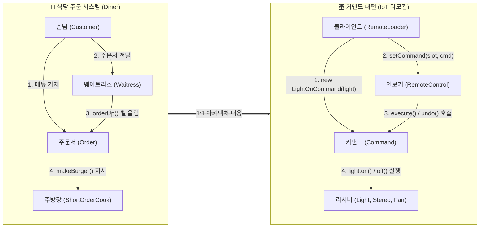
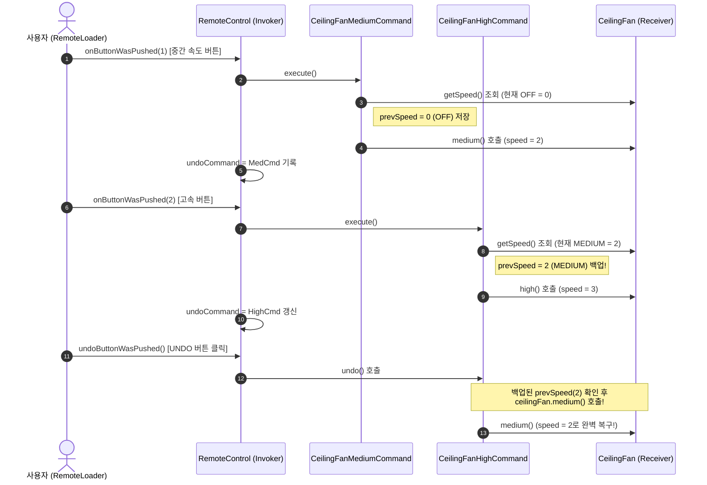

# chapter 6

내용: 커맨드 패턴
작성일: 2026/10/16
중요: Yes
분야: 디자인패턴 스터디 (https://app.notion.com/p/3c9c9dbbf2a880ceb2f7d88404185c88?pvs=21)
유형: 헤드퍼스트 (https://app.notion.com/p/3c9c9dbbf2a880739f4cc73385614382?pvs=21)

# 커맨드 패턴 - 호출 캡슐화하기 (만능 IoT 홈 오토메이션 리모컨) 🎛️🏠

---

### 커맨드 패턴 요약

1. **요구사항(요청/호출)을 객체로 캡슐화**하여, 요청을 하는 객체(**Invoker, 호출자**)와 그 요청을 받아 실제 작업을 수행하는 객체(**Receiver, 수신자**)를 완전히 분리하는 행동(Behavioral) 패턴
2. **핵심 해결 과제:**
   - 서로 다른 인터페이스를 가진 수많은 외부 시스템(조명, TV, 선풍기, 차고 문, 오디오 등)을 **단 하나의 규격화된 인터페이스(`execute()`, `undo()`)**로 제어해야 할 때 호출자와 수신자 간의 강결합을 끊어냄
   - 실행될 작업을 객체화하여 매개변수로 전달하거나, **큐(Queue)에 저장**, **로그(Log)로 기록**, **작업 취소(Undo) 및 재실행(Redo)** 기능을 손쉽게 구현함
3. **식당 주문 시스템 비유 (Diner Order Analogy):**
   - **손님 (`Client`):** 메뉴를 고르고 주문서를 작성함 (`new Order()`)
   - **주문서 (`Command`):** 손님의 요리 요청이 캡슐화된 객체 (`orderUp()`)
   - **웨이트리스 (`Invoker`):** 주문서를 받아 주방 카운터에 전달하고 벨을 울림 (`takeOrder()`, 주문서 내용이나 조리법은 전혀 모름)
   - **주방장 (`Receiver`):** 주문서를 보고 실제로 햄버거와 밀크셰이크를 조리하는 전문가 (`makeBurger()`, `makeShake()`)

---

### 도서 내 문제 상황

1. **주식회사 홈 오토메이션(Home Automation or Bust Inc.)**에서 집안의 모든 가전제품을 제어할 수 있는 **만능 IoT 프로그래밍 리모컨 API**를 설계해야 한다.
2. 리모컨 하드웨어 스펙:
   - 프로그래밍 가능한 **7개의 슬롯(Slot 0 ~ 6)**이 존재하며, 각 슬롯마다 `ON` 버튼과 `OFF` 버튼이 있다.
   - 마지막에 수행한 동작을 취소하는 전역 **`UNDO(실행 취소)` 버튼**이 하나 있다.
3. 협력 가전업체들이 납품한 제어 클래스(Vendor Classes)들의 인터페이스가 **제각각이고 통일성이 전혀 없다**:
   - `Light`: `on()`, `off()`, `dim(int)`
   - `GarageDoor`: `up()`, `down()`, `stop()`, `lightOn()`, `lightOff()`
   - `CeilingFan`: `high()`, `medium()`, `low()`, `off()`, `getSpeed()`
   - `Stereo`: `on()`, `off()`, `setCd()`, `setDvd()`, `setRadio()`, `setVolume(int)`
   - `Hottub`: `on()`, `off()`, `circulate()`, `jetsOn()`, `jetsOff()`, `setTemperature(int)`
4. **처음 시도했던 잘못된 접근 방식 (나쁜 예시: 리모컨 내부에 구체 가전 클래스를 직접 하드코딩):**
   ```java
   public class BadRemoteControl {
       // ❌ 리모컨이 모든 구체적인 가전제품 클래스에 직접 결합됨!
       public void onButtonWasPushed(int slot, String deviceType) {
           if (deviceType.equals("Light")) {
               light.on();
           } else if (deviceType.equals("Stereo")) {
               stereo.on();
               stereo.setCd();
               stereo.setVolume(11);
           } else if (deviceType.equals("GarageDoor")) {
               garageDoor.up();
           } else if (deviceType.equals("Hottub")) {
               hottub.on();
               hottub.setTemperature(40);
               hottub.jetsOn();
           }
           // 새로운 가전제품이 출시될 때마다 리모컨 펌웨어 코드를 끝없이 수정해야 함!
       }
   }
   ```
5. **이 방식이 초래하는 치명적인 문제점:**
   1. **OCP(개방-폐쇄 원칙) 심각한 위배:** 앞으로 출시될 로봇청소기, 스마트 커튼, 에어컨 등이 추가될 때마다 리모컨(`RemoteControl`)의 코드를 뜯어고쳐야 한다.
   2. **동적 슬롯 할당 불가:** 사용자가 런타임에 1번 슬롯을 '주방 조명'에서 '안방 선풍기'로 바꾸어 프로그래밍할 수 없다.
   3. **작업 취소(Undo) 및 매크로 구현 불가능:** 각 기기마다 이전 상태를 되돌리는 방법이 다르고(`off()`, `down()`, 이전 속도 복원 등), 이를 리모컨 내부의 `if-else` 분기문으로 관리하면 코드가 유지보수 불능 상태에 빠진다.

---

### 문제를 해결한 핵심 객체지향 디자인 원칙

1. **호출자(Invoker)와 수신자(Receiver)의 완전한 분리 (Decoupling)**
   - 리모컨(`RemoteControl`)은 자신이 어떤 가전제품을 켜고 끄는지 절대 알 필요가 없다. 단지 버튼을 누르면 연결된 `Command` 객체의 `execute()`만 호출할 뿐이다.
2. **요청(메서드 호출) 자체를 일급 객체(First-Class Object)로 캡슐화**
   - "거실 오디오를 켜고 CD를 넣고 볼륨을 11로 맞춘다"는 일련의 작업 요청을 `StereoOnWithCDCommand`라는 독립된 객체로 포장하여 슬롯에 끼웠다 뺐다 할 수 있게 만든다.
3. **개방-폐쇄 원칙 (OCP: Open-Closed Principle)**
   - 새로운 가전제품이 백 개 추가되더라도 새로운 `Command` 구현체만 작성해 슬롯에 주입하면 되므로, 리모컨(`RemoteControl`) 코드는 단 한 줄도 수정할 필요가 없다.
4. **널 객체 패턴 (Null Object Pattern)을 통한 안전한 기본값 처리**
   - 아무 일도 하지 않는 `NoCommand` 객체를 만들어 초기 슬롯에 채워 넣음으로써, 클라이언트의 지저분한 `if (command != null)` 방어 코드를 제거하고 NPE(NullPointerException)를 원천 차단한다.

---

### 구조 다이어그램 및 설계 분석

#### 1. 식당 주문 시스템과 커맨드 패턴 역할 매핑 다이어그램 (Flowchart)
헤드퍼스트에서 커맨드 패턴의 흐름을 설명하는 가장 직관적인 아키텍처 비유이다.



#### 2. 프로젝트 종합 클래스 다이어그램 (Full Class Diagram)
본 프로젝트(`chapter6`)에 구현된 인터페이스, 3종의 인보커(리모컨), 6종의 가전 리시버, 그리고 15종의 구상 커맨드 클래스 전체 구조이다.

```mermaid
classDiagram
    direction TB

    %% ==========================================
    %% Client
    %% ==========================================
    class RemoteLoader {
        +main(args)$
    }

    %% ==========================================
    %% Command Interface
    %% ==========================================
    class Command {
        <<interface>>
        +execute()
        +undo()
    }

    %% ==========================================
    %% Invokers (Remote Controls)
    %% ==========================================
    class SimpleRemoteControl {
        -Command slot
        +setCommand(Command)
        +buttonWasPressed()
    }

    class RemoteControl {
        -Command[] onCommands
        -Command[] offCommands
        -Command undoCommand
        -Deque~Command~ historyStack
        +setCommand(int, Command, Command)
        +onButtonWasPushed(int)
        +offButtonWasPushed(int)
        +undoButtonWasPushed()
        +undoFromHistoryStack()
    }

    class LambdaRemoteControl {
        -Runnable[] onCommands
        -Runnable[] offCommands
        +setCommand(int, Runnable, Runnable)
        +onButtonWasPushed(int)
        +offButtonWasPushed(int)
    }

    SimpleRemoteControl --> Command : invokes
    RemoteControl o--> Command : holds 7 slots & history

    %% ==========================================
    %% Special Commands (Null Object & Macro)
    %% ==========================================
    class NoCommand {
        +execute()
        +undo()
    }

    class MacroCommand {
        -Command[] commands
        +execute()
        +undo()
    }

    Command <|.. NoCommand : implements
    Command <|.. MacroCommand : implements
    MacroCommand o--> Command : aggregates multiple

    %% ==========================================
    %% Concrete Commands - Light, Garage, Stereo
    %% ==========================================
    class LightOnCommand {
        -Light light
        +execute()
        +undo()
    }
    class LightOffCommand {
        -Light light
        +execute()
        +undo()
    }
    class LightDimCommand {
        -Light light
        -int targetLevel
        -int prevLevel
        +execute()
        +undo()
    }
    class GarageDoorUpCommand {
        -GarageDoor garageDoor
        +execute()
        +undo()
    }
    class GarageDoorDownCommand {
        -GarageDoor garageDoor
        +execute()
        +undo()
    }
    class StereoOnWithCDCommand {
        -Stereo stereo
        +execute()
        +undo()
    }
    class StereoOffCommand {
        -Stereo stereo
        +execute()
        +undo()
    }

    Command <|.. LightOnCommand
    Command <|.. LightOffCommand
    Command <|.. LightDimCommand
    Command <|.. GarageDoorUpCommand
    Command <|.. GarageDoorDownCommand
    Command <|.. StereoOnWithCDCommand
    Command <|.. StereoOffCommand

    %% ==========================================
    %% Concrete Commands - CeilingFan (Stateful Undo)
    %% ==========================================
    class CeilingFanHighCommand {
        -CeilingFan ceilingFan
        -int prevSpeed
        +execute()
        +undo()
    }
    class CeilingFanMediumCommand {
        -CeilingFan ceilingFan
        -int prevSpeed
        +execute()
        +undo()
    }
    class CeilingFanLowCommand {
        -CeilingFan ceilingFan
        -int prevSpeed
        +execute()
        +undo()
    }
    class CeilingFanOffCommand {
        -CeilingFan ceilingFan
        -int prevSpeed
        +execute()
        +undo()
    }

    Command <|.. CeilingFanHighCommand
    Command <|.. CeilingFanMediumCommand
    Command <|.. CeilingFanLowCommand
    Command <|.. CeilingFanOffCommand

    %% ==========================================
    %% Concrete Commands - Party (TV & Hottub)
    %% ==========================================
    class TVOnCommand {
        -TV tv
        +execute()
        +undo()
    }
    class TVOffCommand {
        -TV tv
        +execute()
        +undo()
    }
    class HottubOnCommand {
        -Hottub hottub
        +execute()
        +undo()
    }
    class HottubOffCommand {
        -Hottub hottub
        +execute()
        +undo()
    }

    Command <|.. TVOnCommand
    Command <|.. TVOffCommand
    Command <|.. HottubOnCommand
    Command <|.. HottubOffCommand

    %% ==========================================
    %% Receivers (Vendor Classes)
    %% ==========================================
    class Light {
        -String location
        -int level
        +on()
        +off()
        +dim(int)
    }
    class GarageDoor {
        -String location
        +up()
        +down()
        +stop()
    }
    class Stereo {
        -String location
        -int volume
        +on()
        +off()
        +setCd()
        +setVolume(int)
    }
    class CeilingFan {
        +int HIGH$
        +int MEDIUM$
        +int LOW$
        +int OFF$
        -int speed
        +high()
        +medium()
        +low()
        +off()
        +getSpeed() int
    }
    class TV {
        -String location
        +on()
        +off()
        +setInputChannel()
    }
    class Hottub {
        -boolean on
        -int temperature
        +on()
        +off()
        +circulate()
        +jetsOn()
        +setTemperature(int)
    }

    LightOnCommand --> Light : controls
    LightOffCommand --> Light : controls
    LightDimCommand --> Light : controls
    GarageDoorUpCommand --> GarageDoor : controls
    GarageDoorDownCommand --> GarageDoor : controls
    StereoOnWithCDCommand --> Stereo : controls
    StereoOffCommand --> Stereo : controls
    CeilingFanHighCommand --> CeilingFan : controls
    CeilingFanMediumCommand --> CeilingFan : controls
    CeilingFanLowCommand --> CeilingFan : controls
    CeilingFanOffCommand --> CeilingFan : controls
    TVOnCommand --> TV : controls
    TVOffCommand --> TV : controls
    HottubOnCommand --> Hottub : controls
    HottubOffCommand --> Hottub : controls
```



#### 3. 상태 기반 작업 취소 (Stateful Undo - CeilingFan) 시퀀스 다이어그램
천장 선풍기(`CeilingFan`)의 속도를 `MEDIUM(2단)`에서 `HIGH(3단)`로 바꾼 뒤 `UNDO` 버튼을 눌렀을 때, 이전 상태(`prevSpeed`)를 기억해 정확히 복원하는 실행 흐름이다.



---

### 커맨드 패턴의 4대 핵심 구성 요소 정리

| 구성 요소 | 프로젝트 매핑 클래스 | 핵심 역할 및 책임 |
| :--- | :--- | :--- |
| **1. Client (클라이언트)** | `RemoteLoader` | 구체적인 커맨드 객체(`ConcreteCommand`)를 생성하고, 그 안에 적절한 리시버(`Receiver`)를 주입하여 인보커에 세팅함 |
| **2. Command (커맨드 인터페이스)** | `Command` | 모든 커맨드 객체가 구현해야 하는 단일 실행 규약(`execute()`, `undo()`)을 정의함 |
| **3. ConcreteCommand (구상 커맨드)** | `LightOnCommand`, `StereoOnWithCDCommand`, `CeilingFanHighCommand`, `MacroCommand` 등 | 특정 리시버와 행동(Action)을 바인딩함. 인보커가 `execute()`를 부르면 리시버의 메서드들을 조합해 호출하고, 취소용 상태(`prevSpeed`)를 관리함 |
| **4. Invoker (호출자 / 인보커)** | `SimpleRemoteControl`, `RemoteControl`, `LambdaRemoteControl` | 커맨드 객체들을 슬롯에 보관하고 있다가 사용자의 요청(버튼 클릭) 시점에 `command.execute()` 또는 `command.undo()`를 호출함 |
| **5. Receiver (수신자 / 리시버)** | `Light`, `Stereo`, `CeilingFan`, `GarageDoor`, `TV`, `Hottub` | 요구사항을 수행하기 위해 어떤 실제 비즈니스 로직을 처리해야 하는지 알고 있는 실무 객체 |

---

### 게임 개발 및 실무 적용 사례

#### 1. 게임 개발 (Game Development - 키 바인딩, 리플레이, 턴제 전투, 에디터)
게임 프로그래밍 아키텍처(특히 로버트 나이스트롬의 *Game Programming Patterns*)에서 커맨드 패턴은 가장 핵심적인 1순위 패턴으로 꼽힌다.

1. **사용자 키 설정 변경 (Input Key Rebinding System):**
   - 키보드 `Space` 키에 `jump()`를 직접 호출하는 대신, `JumpCommand`, `FireCommand`, `SwapWeaponCommand` 객체를 슬롯에 매핑한다.
   - 유저가 환경설정에서 점프 키를 `Space`에서 `W`로 바꾸면 단순히 키 슬롯에 꽂힌 `Command` 참조만 교체하면 끝난다.
2. **실시간 전략 게임(RTS)의 유닛 명령 큐 & 리플레이(Replay) 시스템:**
   - 스타크래프트나 롤(LoL)에서 `Shift + 우클릭`으로 이동/공격/순찰 명령을 예약하면 `CommandQueue`에 커맨드 객체가 차곡차곡 쌓여 순차 실행된다.
   - **리플레이 기능:** 매 프레임마다 화면 전체 픽셀이나 모든 유닛의 좌표를 녹화하면 용량이 수 기가바이트가 되지만, 유저가 발생시킨 **`Command` 객체와 타임스탬프(Tick)만 직렬화하여 저장**하면 단 몇백 KB만으로 1시간짜리 경기를 완벽하게 재현(Replay)할 수 있다!
3. **턴제 RPG 및 전략 게임의 행동 취소 (Undo/Redo) & 레벨 에디터:**
   - 문명(Civilization), 슈퍼로봇대전, 체스 같은 게임에서 유닛 이동 후 "이동 취소"를 누르면 `MoveUnitCommand.undo()`가 호출되어 이전 타일 좌표로 복귀한다.
   - Unity / Unreal 엔진 에디터에서 오브젝트를 배치하고 `Ctrl + Z` / `Ctrl + Y`를 누르는 모든 행위가 커맨드 히스토리 스택으로 구현되어 있다.

#### 2. 백엔드 및 엔터프라이즈 실무 적용
1. **Java 표준 스레드 풀과 작업 큐 (`java.lang.Runnable` & `ExecutorService`):**
   - `Runnable` 인터페이스의 `run()`은 사실상 `Command` 인터페이스의 `execute()`와 완전히 동일한 구조이다.
   - 웹 서버나 배치 시스템에서 무거운 작업(이메일 발송, 이미지 리사이징, 알림 전송)을 커맨드 객체로 포장해 작업 큐(`BlockingQueue` / `Kafka` / `RabbitMQ`)에 넣으면, 워커 스레드(Invoker)들은 큐에서 커맨드를 하나씩 꺼내 `execute()`만 호출한다.
2. **데이터베이스 트랜잭션 로그 및 크래시 복구 (Transaction Logging & Crash Recovery):**
   - 모든 데이터 변경 작업을 커맨드 객체로 만들고 `store()` 메서드로 디스크(WAL: Write-Ahead Log)에 기록해 두면, 서버가 정전으로 다운되더라도 재부팅 시 마지막 체크포인트 이후의 커맨드들을 `load()`하여 순차적으로 `execute()`함으로써 완벽한 상태 복구가 가능하다.

---

### 장점과 단점 요약

#### 1. 장점
1. **완벽한 결합도 분리 (Decoupling):** 작업을 요청하는 객체(리모컨/UI 버튼)와 작업을 실제로 수행하는 객체(가전기기/도메인 서비스)가 서로의 존재를 몰라도 된다.
2. **뛰어난 확장성 (OCP 준수):** 기존 호출자(`RemoteControl`) 코드를 전혀 건드리지 않고도 새로운 커맨드 클래스를 무한히 추가할 수 있다.
3. **작업 취소(Undo/Redo) 및 히스토리 관리 용이:** 각 커맨드 내부에 직전 상태를 캡슐화하고 인보커에 스택(`Deque<Command>`)을 두어 정교한 다단계 취소/재실행을 구현할 수 있다.
4. **복합 명령 조립 (MacroCommand):** 여러 개의 단위 커맨드를 묶어 원클릭 일괄 실행 및 역순 일괄 취소 기능을 손쉽게 조립할 수 있다.

#### 2. 단점
1. **클래스 수 증가 (Class Explosion):** 리시버의 각 동작마다 개별 구상 커맨드 클래스(`LightOnCommand`, `LightOffCommand`, `TVOnCommand`...)를 일일이 생성해야 하므로 클래스 파일 개수가 급격히 늘어날 수 있다.
2. **설계 복잡도 상승:** 단순한 메서드 호출 하나로 끝날 작업도 `Invoker -> Command -> Receiver`의 간접 레이어를 거치게 되어 초기 학습 및 디버깅 단계가 길어질 수 있다. (단순 작업은 자바 8+ 람다 표현식으로 완화 가능)

---

<aside>
📌

- **커맨드 패턴 딥다이브 (Deep Dive)**

    ### 1. 널 객체 패턴 (Null Object Pattern): 왜 `NoCommand`는 일급 디자인 패턴인가?

    리모컨의 7개 슬롯 중 사용자가 아직 기능을 할당하지 않은 빈 슬롯(예: 5번, 6번 슬롯)이 있을 때, 초보 개발자는 보통 다음과 같이 `null` 체크 코드를 작성한다:

    ```java
    public void onButtonWasPushed(int slot) {
        // ❌ 버튼을 누르는 모든 메서드마다 null 체크가 강제됨!
        if (onCommands[slot] != null) {
            onCommands[slot].execute();
        }
    }
    ```

    만약 곳간마다 `null` 체크를 하나라도 깜빡하면 런타임에 즉시 `NullPointerException(NPE)`이 터진다.
    이를 해결하기 위해 도입된 **`NoCommand`는 '아무 일도 하지 않는 객체(Do-Nothing Object)'를 주입하는 널 객체 패턴(Null Object Pattern)**의 교과서적인 사례다.

    ```java
    public class NoCommand implements Command {
        @Override public void execute() { /* 아무것도 안 함 */ }
        @Override public void undo()    { /* 아무것도 안 함 */ }
    }
    ```

    - **핵심 효과:**
      1. 생성자에서 모든 슬롯과 `undoCommand`를 `new NoCommand()`로 초기화해 두면, 리모컨 내부의 모든 메서드에서 `if (cmd != null)` 분기문이 완전히 사라진다.
      2. 클라이언트와 인보커는 "비어있는 상태"조차 동일한 `Command` 인터페이스의 다형성으로 일관되게 처리할 수 있다.

    ──────

    ### 2. 작업 취소(Undo)의 3단계 설계 전략과 매크로 역순 취소의 법칙

    실무에서 `undo()`를 구현할 때는 도메인의 복잡도에 따라 다음 3가지 전략 중 하나를 선택한다:

    1. **제1전략 - 역연산 호출 (Inverse Operation):**
       - 상태가 단순한 이진(Binary: ON/OFF, UP/DOWN) 구조일 때 사용한다.
       - 예: `LightOnCommand.undo()`는 단순히 반대 동작인 `light.off()`를 호출한다.
    2. **제2전략 - 직전 상태 스냅샷 저장 (Stateful Undo / Memento 결합):**
       - `CeilingFan`처럼 상태가 여러 개(`HIGH=3`, `MEDIUM=2`, `LOW=1`, `OFF=0`)이거나 `LightDimCommand`처럼 연속적인 수치(밝기 `0~100%`)를 가질 때 사용한다.
       - `execute()`가 상태를 바꾸기 직전에 `prevSpeed = ceilingFan.getSpeed()`로 이전 상태를 커맨드 객체 내부 필드에 저장해 두었다가 `undo()` 시 복원한다.
       - ⚠️ **주의점 (다단계 History Stack 사용 시):** 동일한 커맨드 인스턴스를 여러 번 재사용하여 스택에 `push`하면 마지막 실행 시점의 `prevSpeed`가 이전 기록을 덮어써버릴 수 있다! 따라서 다단계 Undo 스택을 완벽히 구현하려면 버튼을 누를 때마다 커맨드 객체를 새로 생성(또는 복제 `clone()`)하거나 상태 스택을 별도로 관리해야 한다.
    3. **제3전략 - 매크로 커맨드(`MacroCommand`)의 역순(LIFO) 취소 법칙:**
       - `MacroCommand`에서 `execute()`는 `0 -> 1 -> 2 -> ... -> N-1` 순서로 실행하지만, **`undo()`는 반드시 역순(`N-1 -> ... -> 1 -> 0`)으로 실행**해야 한다!
       - **이유:** 예를 들어 매크로가 `[1. 거실 조명 켜기(100%), 2. 거실 조명 20%로 디밍하기]` 순서로 실행되었다고 하자.
         - 만약 정방향(`1 -> 2`)으로 Undo를 실행하면: 1번이 조명을 끄고(0%), 2번이 이전 밝기(100%)로 복원하여 **결과적으로 조명이 100%로 켜져 버리는 치명적 버그**가 발생한다!
         - 역방향(`2 -> 1`)으로 Undo를 실행하면: 2번이 조명을 100%로 되돌린 뒤, 1번이 조명을 완전히 꺼서(0%) **실행 전 초기 상태(OFF)로 완벽하게 복구**된다.

    ──────

    ### 3. 자바 8+ 람다 표현식(Lambda)은 커맨드 패턴을 대체했는가?

    헤드퍼스트 디자인 패턴 개정판에서는 자바 8의 람다 표현식(`() -> light.on()`)과 메서드 레퍼런스(`light::on`)를 사용해 수많은 구상 커맨드 클래스를 제거하는 기법을 소개한다.

    | 구분 | 람다 / 함수형 인터페이스 방식 (`LambdaRemoteControl`) | 전통적 구상 커맨드 클래스 방식 (`RemoteControl`) |
    | :--- | :--- | :--- |
    | **코드 간결성** | 🚀 **압도적 간결함** (별도 클래스 파일 불필요) | ⚠️ 기능마다 클래스 파일 생성 필요 |
    | **인터페이스 조건** | 추상 메서드가 **오직 1개(SAM)**일 때만 가능 (`execute()`만 존재) | `execute()`, `undo()`, `store()`, `load()` 등 **다수 메서드 정의 가능** |
    | **상태(State) 저장** | ❌ 내부 필드(`prevSpeed` 등)를 가질 수 없음 | ✅ 직전 상태(`prevSpeed`, `prevLevel`)를 필드에 안전하게 보관 가능 |
    | **직렬화 / 로깅** | ⚠️ 람다 직렬화는 까다롭고 디버깅 시 클래스명 식별이 어려움 | ✅ 명확한 클래스 타입(`LightOnCommand`)으로 직렬화 및 감사 로깅 용이 |

    > **결론:** `undo()`나 상태 저장이 필요 없는 단순 실행(Fire-and-Forget) 작업이나 이벤트 리스너, 스레드 풀 작업(`Runnable`)에서는 **람다 표현식**이 훨씬 우수하다. 반면, **다단계 Undo/Redo, 이전 상태 백업, 매크로 조합, 디스크 직렬화 로깅**이 필요한 도메인에서는 여전히 **명시적인 구상 커맨드 클래스**가 필수적이다.

    ──────

    ### 4. 실무 아키텍처 확장: 작업 큐(Job Queue)와 크래시 복구 로깅(Crash Recovery)

    커맨드 패턴의 진가는 리모컨 같은 하드웨어 제어를 넘어 **비동기 분산 처리와 트랜잭션 복구 시스템**에서 발휘된다.

    #### (1) 작업 큐 (Job Queue & Worker Thread Pool)
    ```
    [생산자 스레드들]                     [작업 큐 (BlockingQueue)]           [워커 스레드 풀 (Invoker)]
    화상 회의 스트리밍 압축 Command ──┐
    결제 영수증 이메일 발송 Command ──┼──> [ Cmd1 | Cmd2 | Cmd3 ... ] ──> Worker 1: cmd.execute()
    DB 백업 스냅샷 생성 Command    ──┘                                   Worker 2: cmd.execute()
    ```
    - 워커 스레드(Invoker)는 자신이 실행하는 객체가 이메일 발송인지 동영상 인코딩인지 전혀 알지 못한다. 단지 큐에서 `Command`를 꺼내 `execute()`를 호출하고 완료되면 다음 작업으로 넘어갈 뿐이다. 이를 통해 **요청 발생 시점과 실제 실행 시점을 시간적/공간적으로 완전히 분리(Asynchronous Decoupling)**할 수 있다.

    #### (2) 트랜잭션 로깅 및 시스템 크래시 복구 (Transaction Logging)
    ```mermaid
    sequenceDiagram
        participant App as 애플리케이션
        participant Cmd as Command (store/load)
        participant Disk as 디스크 로그 (WAL)
        participant DB as 메모리 / 데이터베이스

        Note over App,DB: [정상 운영 시] 작업 실행과 동시에 디스크에 커맨드 기록
        App->>Cmd: execute()
        Cmd->>DB: 데이터 변경 반영
        App->>Cmd: store()
        Cmd->>Disk: 직렬화된 Command 객체 append 기록

        Note over App,DB: ⚡ 갑작스러운 서버 전원 차단 (System Crash!) 및 재부팅
        Disk->>Cmd: load() (마지막 체크포인트 이후 커맨드 역직렬화 로드)
        Cmd->>DB: execute() 재실행 (Redo Recovery)
        Note over DB: 장애 직전 상태로 100% 무손실 복구 완료!
    ```
    - 거대한 데이터베이스 전체를 매초마다 백업하는 것은 불가능하다. 대신 체크포인트 이후 실행된 **`Command` 객체들의 이력(`store()`)만 디스크 로그에 가볍게 기록**해 두면, 시스템 장애 복구 시 `load()` 후 `execute()`를 순차 재생하는 것만으로 완벽한 트랜잭션 복구를 달성할 수 있다.
</aside>

---

### 📂 chapter6 폴더

- **RemoteLoader.java**

    ```java
    package chapter6;

    import chapter6.Command.CeilingFan.CeilingFanHighCommand;
    import chapter6.Command.CeilingFan.CeilingFanLowCommand;
    import chapter6.Command.CeilingFan.CeilingFanMediumCommand;
    import chapter6.Command.CeilingFan.CeilingFanOffCommand;
    import chapter6.Command.Garage.GarageDoorDownCommand;
    import chapter6.Command.Garage.GarageDoorUpCommand;
    import chapter6.Command.Light.LightDimCommand;
    import chapter6.Command.Light.LightOffCommand;
    import chapter6.Command.Light.LightOnCommand;
    import chapter6.Command.MacroCommand;
    import chapter6.Command.Party.HottubOffCommand;
    import chapter6.Command.Party.HottubOnCommand;
    import chapter6.Command.Party.TVOffCommand;
    import chapter6.Command.Party.TVOnCommand;
    import chapter6.Command.Stereo.StereoOffCommand;
    import chapter6.Command.Stereo.StereoOnWithCDCommand;
    import chapter6.Interface.Command;
    import chapter6.Invoker.LambdaRemoteControl;
    import chapter6.Invoker.RemoteControl;
    import chapter6.Invoker.SimpleRemoteControl;
    import chapter6.Receiver.CeilingFan;
    import chapter6.Receiver.GarageDoor;
    import chapter6.Receiver.Hottub;
    import chapter6.Receiver.Light;
    import chapter6.Receiver.Stereo;
    import chapter6.Receiver.TV;

    public class RemoteLoader {

        public static void main(String[] args) {
            System.out.println("==========================================================================");
            System.out.println(" 🎛️ 헤드퍼스트 디자인 패턴 Chapter 06: 호출 캡슐화하기 (커맨드 패턴) 🎛️");
            System.out.println("==========================================================================");

            // ---------------------------------------------------------------------
            // PART 1. SimpleRemoteControl (슬롯 1개짜리 미니 리모컨 기초 테스트)
            // ---------------------------------------------------------------------
            System.out.println("\n[PART 1. 미니 리모컨 (SimpleRemoteControl) - 첫 번째 커맨드 객체 테스트]");
            SimpleRemoteControl simpleRemote = new SimpleRemoteControl();

            Light kitchenLight = new Light("주방");
            GarageDoor mainGarage = new GarageDoor("본채");

            LightOnCommand kitchenLightOn = new LightOnCommand(kitchenLight);
            GarageDoorUpCommand garageOpen = new GarageDoorUpCommand(mainGarage);

            System.out.println(">>> 슬롯에 '주방 조명 켜기' 커맨드를 장착하고 버튼을 누릅니다.");
            simpleRemote.setCommand(kitchenLightOn);
            simpleRemote.buttonWasPressed();

            System.out.println(">>> 동일한 슬롯에 '차고 문 열기' 커맨드로 동적 교체 후 버튼을 누릅니다.");
            simpleRemote.setCommand(garageOpen);
            simpleRemote.buttonWasPressed();

            // ---------------------------------------------------------------------
            // PART 2. 7개 슬롯 만능 리모컨 (RemoteControl) & NoCommand 널 객체 패턴
            // ---------------------------------------------------------------------
            System.out.println("\n==========================================================================");
            System.out.println("[PART 2. 7개 슬롯 만능 IoT 리모컨 & NoCommand(널 객체 패턴) 검증]");
            System.out.println("==========================================================================");

            RemoteControl remoteControl = new RemoteControl();

            // 가전제품(Receivers) 생성
            Light livingRoomLight = new Light("거실");
            CeilingFan livingRoomFan = new CeilingFan("거실");
            GarageDoor garageDoor = new GarageDoor("차고");
            Stereo stereo = new Stereo("거실");

            // 커맨드 객체(ConcreteCommands) 생성
            LightOnCommand livingRoomLightOn = new LightOnCommand(livingRoomLight);
            LightOffCommand livingRoomLightOff = new LightOffCommand(livingRoomLight);
            LightOnCommand kitchenLightOffCmd = new LightOnCommand(kitchenLight);
            LightOffCommand kitchenLightOff = new LightOffCommand(kitchenLight);

            CeilingFanHighCommand ceilingFanHigh = new CeilingFanHighCommand(livingRoomFan);
            CeilingFanOffCommand ceilingFanOff = new CeilingFanOffCommand(livingRoomFan);

            GarageDoorUpCommand garageDoorUp = new GarageDoorUpCommand(garageDoor);
            GarageDoorDownCommand garageDoorDown = new GarageDoorDownCommand(garageDoor);

            StereoOnWithCDCommand stereoOnWithCD = new StereoOnWithCDCommand(stereo);
            StereoOffCommand stereoOff = new StereoOffCommand(stereo);

            // 리모컨 슬롯(0~4번)에 커맨드 로드 (5, 6번 슬롯은 비워둠 -> NoCommand 유지)
            remoteControl.setCommand(0, livingRoomLightOn, livingRoomLightOff);
            remoteControl.setCommand(1, kitchenLightOffCmd, kitchenLightOff);
            remoteControl.setCommand(2, ceilingFanHigh, ceilingFanOff);
            remoteControl.setCommand(3, stereoOnWithCD, stereoOff);
            remoteControl.setCommand(4, garageDoorUp, garageDoorDown);

            // 리모컨 슬롯 설정 출력
            System.out.println(remoteControl);

            // 각 슬롯 ON / OFF 버튼 순차 클릭
            for (int i = 0; i <= 4; i++) {
                System.out.println("\n>>> [슬롯 " + i + "] ON 버튼 클릭 -> OFF 버튼 클릭");
                remoteControl.onButtonWasPushed(i);
                remoteControl.offButtonWasPushed(i);
            }

            System.out.println("\n>>> [빈 슬롯 6번 클릭 테스트] NoCommand 덕분에 null 체크 없이도 NPE가 발생하지 않습니다.");
            remoteControl.onButtonWasPushed(6);
            remoteControl.offButtonWasPushed(6);
            System.out.println("-> (아무 동작도 일어나지 않고 안전하게 통과!)");

            // ---------------------------------------------------------------------
            // PART 3. 상태 기반 작업 취소 (Stateful Undo - 천장 선풍기 속도 복원 & 다단계 스택)
            // ---------------------------------------------------------------------
            System.out.println("\n==========================================================================");
            System.out.println("[PART 3. 상태 기반 UNDO (CeilingFan 속도 복원) 및 다단계 History 스택 검증]");
            System.out.println("==========================================================================");

            RemoteControl undoRemote = new RemoteControl();
            CeilingFan bedroomFan = new CeilingFan("안방");

            CeilingFanLowCommand fanLow = new CeilingFanLowCommand(bedroomFan);
            CeilingFanMediumCommand fanMedium = new CeilingFanMediumCommand(bedroomFan);
            CeilingFanHighCommand fanHigh = new CeilingFanHighCommand(bedroomFan);
            CeilingFanOffCommand fanOff = new CeilingFanOffCommand(bedroomFan);

            undoRemote.setCommand(0, fanLow, fanOff);
            undoRemote.setCommand(1, fanMedium, fanOff);
            undoRemote.setCommand(2, fanHigh, fanOff);

            System.out.println("\n1) 선풍기를 '중(MEDIUM, 2단)'으로 켭니다.");
            undoRemote.onButtonWasPushed(1);
            System.out.println("2) 선풍기를 '강(HIGH, 3단)'으로 변경합니다. (내부에 prevSpeed = MEDIUM 저장됨)");
            undoRemote.onButtonWasPushed(2);
            System.out.println("3) UNDO 버튼을 눌러 이전 속도('중')로 되돌아가는지 확인합니다.");
            undoRemote.undoButtonWasPushed();

            System.out.println("\n--- [심화: History Stack을 이용한 연속 다단계 UNDO 테스트] ---");
            Light studyLight = new Light("서재");
            undoRemote.setCommand(3, new LightOnCommand(studyLight), new LightOffCommand(studyLight));
            undoRemote.setCommand(4, new LightDimCommand(studyLight, 30), new LightOffCommand(studyLight));

            System.out.println(">>> 서재 조명 켜기(100%) -> 서재 조명 디밍(30%) -> 안방 선풍기 끄기(OFF) 연속 실행:");
            undoRemote.onButtonWasPushed(3); // 서재 조명 100%
            undoRemote.onButtonWasPushed(4); // 서재 조명 30% (prevLevel=100 저장)
            undoRemote.offButtonWasPushed(1); // 안방 선풍기 OFF (prevSpeed=MEDIUM 저장)

            System.out.println("\n>>> History Stack에서 최근 작업 3개를 역순(LIFO)으로 연속 취소합니다:");
            undoRemote.undoFromHistoryStack(); // 1. 안방 선풍기 다시 MEDIUM으로 복구
            undoRemote.undoFromHistoryStack(); // 2. 서재 조명 다시 100%로 복구
            undoRemote.undoFromHistoryStack(); // 3. 서재 조명 OFF로 복구

            // ---------------------------------------------------------------------
            // PART 4. 매크로 커맨드 (MacroCommand - 원클릭 파티 모드!)
            // ---------------------------------------------------------------------
            System.out.println("\n==========================================================================");
            System.out.println("[PART 4. 매크로 커맨드 (MacroCommand) - 원클릭 파티 모드 ON / OFF / UNDO]");
            System.out.println("==========================================================================");

            TV livingRoomTV = new TV("거실");
            Hottub hottub = new Hottub();

            LightDimCommand partyLightDim = new LightDimCommand(livingRoomLight, 20);
            TVOnCommand tvOn = new TVOnCommand(livingRoomTV);
            HottubOnCommand hottubOn = new HottubOnCommand(hottub);

            TVOffCommand tvOff = new TVOffCommand(livingRoomTV);
            HottubOffCommand hottubOff = new HottubOffCommand(hottub);

            // 파티 ON 매크로 묶음 & 파티 OFF 매크로 묶음 생성
            Command[] partyOn = { livingRoomLightOn, partyLightDim, stereoOnWithCD, tvOn, hottubOn };
            Command[] partyOff = { livingRoomLightOff, stereoOff, tvOff, hottubOff };

            MacroCommand partyOnMacro = new MacroCommand(partyOn);
            MacroCommand partyOffMacro = new MacroCommand(partyOff);

            remoteControl.setCommand(5, partyOnMacro, partyOffMacro);

            System.out.println("\n🎉 >>> [슬롯 5] 파티 모드 ON 버튼을 누릅니다! (5개 작업 일괄 실행)");
            remoteControl.onButtonWasPushed(5);

            System.out.println("\n↩️ >>> 파티 모드 UNDO 버튼을 누릅니다! (역순으로 안전하게 원상 복구)");
            remoteControl.undoButtonWasPushed();

            // ---------------------------------------------------------------------
            // PART 5. 자바 8+ 람다 표현식과 메서드 레퍼런스를 활용한 리모컨 간소화
            // ---------------------------------------------------------------------
            System.out.println("\n==========================================================================");
            System.out.println("[PART 5. 자바 8+ 람다 표현식 & 메서드 레퍼런스 (LambdaRemoteControl)]");
            System.out.println("구상 Command 클래스 생성 없이 메서드 레퍼런스(light::on)와 람다식으로 직결");
            System.out.println("==========================================================================");

            LambdaRemoteControl lambdaRemote = new LambdaRemoteControl();

            // 메서드 레퍼런스(Method Reference)와 람다 표현식(Lambda Expression) 주입
            lambdaRemote.setCommand(0, livingRoomLight::on, livingRoomLight::off);
            lambdaRemote.setCommand(1,
                    () -> {
                        stereo.on();
                        stereo.setCd();
                        stereo.setVolume(11);
                    },
                    stereo::off
            );

            System.out.println("\n>>> [람다 슬롯 0] 거실 조명 ON / OFF (메서드 레퍼런스 호출)");
            lambdaRemote.onButtonWasPushed(0);
            lambdaRemote.offButtonWasPushed(0);

            System.out.println("\n>>> [람다 슬롯 1] 거실 오디오 복합 ON / OFF (람다 블록 호출)");
            lambdaRemote.onButtonWasPushed(1);
            lambdaRemote.offButtonWasPushed(1);

            System.out.println("\n==========================================================================");
            System.out.println(" 🎉 Chapter 06 커맨드 패턴 종합 실습 및 검증 완료!");
            System.out.println("==========================================================================");
        }
    }
    ```

---

### 📂 chapter6.Interface 폴더

- **Command.java**

    ```java
    package chapter6.Interface;

    /**
     * [헤드퍼스트 디자인 패턴 Chapter 06: 커맨드 패턴 (Command Pattern)]
     * 
     * 모든 커맨드 객체가 구현해야 하는 핵심 인터페이스.
     * 요청(호출) 자체를 캡슐화하여 호출자(Invoker: 리모컨)와 수신자(Receiver: 가전제품)를 완전히 분리한다.
     * 
     * - execute(): 캡슐화된 리시버의 행동을 실행한다.
     * - undo(): 직전에 실행한 작업을 이전 상태로 되돌린다(실행 취소).
     */
    public interface Command {
        void execute();
        void undo();
    }
    ```

---

### 📂 chapter6.Invoker 폴더

- **SimpleRemoteControl.java**

    ```java
    package chapter6.Invoker;

    import chapter6.Interface.Command;

    /**
     * [Invoker 1: 슬롯 1개짜리 미니 리모컨 (SimpleRemoteControl)]
     * 
     * 커맨드 패턴의 기본 동작 원리를 확인하기 위한 가장 단순한 호출자(Invoker).
     * 리모컨은 자신이 어떤 가전제품(조명, 차고 문 등)을 제어하는지 전혀 모르며,
     * 오직 Command 인터페이스의 execute()만 호출한다.
     */
    public class SimpleRemoteControl {
        private Command slot;

        public SimpleRemoteControl() {}

        public void setCommand(Command command) {
            this.slot = command;
        }

        public void buttonWasPressed() {
            if (slot != null) {
                slot.execute();
            }
        }
    }
    ```

- **RemoteControl.java**

    ```java
    package chapter6.Invoker;

    import chapter6.Command.NoCommand;
    import chapter6.Interface.Command;

    import java.util.ArrayDeque;
    import java.util.Deque;

    /**
     * [Invoker 2: 7개 슬롯 + Undo/History 스택을 갖춘 만능 IoT 리모컨 (RemoteControl)]
     * 
     * 헤드퍼스트 디자인 패턴 Chapter 06의 핵심 호출자(Invoker) 클래스.
     * 1. 7개의 프로그래밍 가능한 슬롯(onCommands[7], offCommands[7])을 제공한다.
     * 2. 생성자에서 모든 슬롯과 undoCommand를 NoCommand(Null Object)로 초기화하여
     *    버튼 클릭 시 불필요한 null 체크 분기문을 완전히 제거한다.
     * 3. 직전 작업 1단계 취소(undoButtonWasPushed)뿐만 아니라,
     *    Deque(Stack) 기반 히스토리를 통해 다단계 연속 작업 취소(undoHistoryStack)까지 지원한다.
     */
    public class RemoteControl {
        private static final int SLOT_COUNT = 7;

        private final Command[] onCommands;
        private final Command[] offCommands;
        private Command undoCommand;
        private final Deque<Command> historyStack;

        public RemoteControl() {
            onCommands = new Command[SLOT_COUNT];
            offCommands = new Command[SLOT_COUNT];
            historyStack = new ArrayDeque<>();

            Command noCommand = new NoCommand();
            for (int i = 0; i < SLOT_COUNT; i++) {
                onCommands[i] = noCommand;
                offCommands[i] = noCommand;
            }
            undoCommand = noCommand;
        }

        public void setCommand(int slot, Command onCommand, Command offCommand) {
            if (slot < 0 || slot >= SLOT_COUNT) {
                throw new IllegalArgumentException("슬롯 번호는 0부터 " + (SLOT_COUNT - 1) + " 사이여야 합니다.");
            }
            onCommands[slot] = onCommand;
            offCommands[slot] = offCommand;
        }

        public void onButtonWasPushed(int slot) {
            onCommands[slot].execute();
            undoCommand = onCommands[slot];
            historyStack.push(onCommands[slot]);
        }

        public void offButtonWasPushed(int slot) {
            offCommands[slot].execute();
            undoCommand = offCommands[slot];
            historyStack.push(offCommands[slot]);
        }

        /**
         * 헤드퍼스트 기본 사양: 마지막에 실행된 단일 커맨드를 취소한다.
         */
        public void undoButtonWasPushed() {
            System.out.print("↩️ [UNDO 버튼 클릭] ");
            undoCommand.undo();
            if (!historyStack.isEmpty()) {
                historyStack.pop();
            }
        }

        /**
         * 심화 확장: 스택(Stack)에 기록된 히스토리를 역순(LIFO)으로 꺼내며 다단계 Undo를 수행한다.
         */
        public void undoFromHistoryStack() {
            if (historyStack.isEmpty()) {
                System.out.println("↩️ [History UNDO] 더 이상 취소할 작업 이력이 없습니다.");
                return;
            }
            Command lastCommand = historyStack.pop();
            System.out.print("↩️ [History UNDO (" + lastCommand.getClass().getSimpleName() + ")] ");
            lastCommand.undo();
            undoCommand = historyStack.isEmpty() ? new NoCommand() : historyStack.peek();
        }

        @Override
        public String toString() {
            StringBuilder sb = new StringBuilder();
            sb.append("\n------ 🎛️ 만능 IoT 리모컨 슬롯 설정 상태 ------\n");
            for (int i = 0; i < onCommands.length; i++) {
                sb.append(String.format("[슬롯 %d] %-28s | %-28s%n",
                        i,
                        onCommands[i].getClass().getSimpleName(),
                        offCommands[i].getClass().getSimpleName()));
            }
            sb.append(String.format("[UNDO]   %s (히스토리 스택 크기: %d)%n",
                    undoCommand.getClass().getSimpleName(),
                    historyStack.size()));
            sb.append("-----------------------------------------------");
            return sb.toString();
        }
    }
    ```

- **LambdaRemoteControl.java**

    ```java
    package chapter6.Invoker;

    /**
     * [Invoker 3: 자바 8+ 람다 표현식 및 메서드 레퍼런스 전용 리모컨 (LambdaRemoteControl)]
     * 
     * 헤드퍼스트 디자인 패턴 최신 개정판에서 다루는 함수형 인터페이스 기반 리모컨.
     * 추상 메서드가 딱 하나뿐인 함수형 인터페이스(Runnable 또는 단일 메서드 Command)를 사용하면,
     * 수많은 구상 커맨드 클래스(LightOnCommand, LightOffCommand 등)를 일일이 파일로 만들지 않고도
     * 람다 표현식(() -> light.on())이나 메서드 레퍼런스(light::on)로 간결하게 주입할 수 있다.
     * 
     * ⚠️ 한계점: 추상 메서드가 2개(execute, undo)이거나 내부 상태(prevSpeed)를 저장해야 하는 경우에는
     * 단일 람다식만으로 표현할 수 없으며, 전통적인 구상 Command 클래스나 별도의 상태 클로저가 필요하다.
     */
    public class LambdaRemoteControl {
        private static final int SLOT_COUNT = 7;

        private final Runnable[] onCommands;
        private final Runnable[] offCommands;

        public LambdaRemoteControl() {
            onCommands = new Runnable[SLOT_COUNT];
            offCommands = new Runnable[SLOT_COUNT];

            // Null Object Pattern을 람다식 () -> {} 한 줄로 대체!
            Runnable noCommand = () -> {};
            for (int i = 0; i < SLOT_COUNT; i++) {
                onCommands[i] = noCommand;
                offCommands[i] = noCommand;
            }
        }

        public void setCommand(int slot, Runnable onCommand, Runnable offCommand) {
            onCommands[slot] = onCommand;
            offCommands[slot] = offCommand;
        }

        public void onButtonWasPushed(int slot) {
            onCommands[slot].run();
        }

        public void offButtonWasPushed(int slot) {
            offCommands[slot].run();
        }
    }
    ```

---

### 📂 chapter6.Receiver 폴더

- **Light.java**

    ```java
    package chapter6.Receiver;

    /**
     * [Receiver: 조명 제어 클래스]
     * 가전제품 제조사에서 제공한 조명 하드웨어 제어 클래스.
     * 켜기(on), 끄기(off), 밝기 조절(dim) 기능을 제공한다.
     */
    public class Light {
        private final String location;
        private int level;

        public Light(String location) {
            this.location = location;
            this.level = 0;
        }

        public void on() {
            level = 100;
            System.out.println("💡 [" + location + " 조명] 조명이 켜졌습니다. (밝기: 100%)");
        }

        public void off() {
            level = 0;
            System.out.println("🌑 [" + location + " 조명] 조명이 꺼졌습니다. (밝기: 0%)");
        }

        public void dim(int level) {
            this.level = level;
            if (level == 0) {
                off();
            } else {
                System.out.println("✨ [" + location + " 조명] 조명 밝기가 " + level + "%로 조절되었습니다.");
            }
        }

        public int getLevel() {
            return level;
        }

        public String getLocation() {
            return location;
        }
    }
    ```

- **GarageDoor.java**

    ```java
    package chapter6.Receiver;

    /**
     * [Receiver: 차고 문 제어 클래스]
     * 차고 문 개폐기 제조사에서 제공한 제어 클래스.
     * 문 올리기(up), 내리기(down), 정지(stop), 차고 조명 제어 기능을 가진다.
     */
    public class GarageDoor {
        private final String location;

        public GarageDoor(String location) {
            this.location = location;
        }

        public void up() {
            System.out.println("🚗 [" + location + " 차고 문] 차고 문이 열립니다 (Up).");
        }

        public void down() {
            System.out.println("🔒 [" + location + " 차고 문] 차고 문이 닫힙니다 (Down).");
        }

        public void stop() {
            System.out.println("⏸️ [" + location + " 차고 문] 차고 문 작동이 멈췄습니다.");
        }

        public void lightOn() {
            System.out.println("💡 [" + location + " 차고 문] 차고 내부 조명이 켜졌습니다.");
        }

        public void lightOff() {
            System.out.println("🌑 [" + location + " 차고 문] 차고 내부 조명이 꺼졌습니다.");
        }
    }
    ```

- **Stereo.java**

    ```java
    package chapter6.Receiver;

    /**
     * [Receiver: 오디오(Stereo) 제어 클래스]
     * 전원 제어뿐만 아니라 CD/DVD/라디오 모드 설정 및 볼륨 조절 등
     * 복합적인 초기화 절차가 필요한 가전제품 클래스.
     */
    public class Stereo {
        private final String location;
        private int volume;

        public Stereo(String location) {
            this.location = location;
            this.volume = 0;
        }

        public void on() {
            System.out.println("🎵 [" + location + " 오디오] 전원이 켜졌습니다.");
        }

        public void off() {
            System.out.println("🔇 [" + location + " 오디오] 전원이 꺼졌습니다.");
        }

        public void setCd() {
            System.out.println("💿 [" + location + " 오디오] CD 재생 모드로 설정되었습니다.");
        }

        public void setDvd() {
            System.out.println("📀 [" + location + " 오디오] DVD 재생 모드로 설정되었습니다.");
        }

        public void setRadio() {
            System.out.println("📻 [" + location + " 오디오] 라디오 모드로 설정되었습니다.");
        }

        public void setVolume(int volume) {
            this.volume = volume;
            System.out.println("🔊 [" + location + " 오디오] 볼륨이 " + volume + "(으)로 설정되었습니다.");
        }

        public int getVolume() {
            return volume;
        }
    }
    ```

- **CeilingFan.java**

    ```java
    package chapter6.Receiver;

    /**
     * [Receiver: 천장 선풍기(CeilingFan) 제어 클래스]
     * 단순 ON/OFF가 아니라 여러 단계의 속도 상태(HIGH, MEDIUM, LOW, OFF)를 가지는 리시버.
     * 커맨드 패턴에서 '상태 기반 작업 취소(Stateful Undo)'를 구현할 때 핵심적으로 사용된다.
     */
    public class CeilingFan {
        public static final int HIGH = 3;
        public static final int MEDIUM = 2;
        public static final int LOW = 1;
        public static final int OFF = 0;

        private final String location;
        private int speed;

        public CeilingFan(String location) {
            this.location = location;
            this.speed = OFF;
        }

        public void high() {
            speed = HIGH;
            System.out.println("🌪️ [" + location + " 천장 선풍기] 속도가 '강(HIGH, 3단)'으로 설정되었습니다.");
        }

        public void medium() {
            speed = MEDIUM;
            System.out.println("💨 [" + location + " 천장 선풍기] 속도가 '중(MEDIUM, 2단)'으로 설정되었습니다.");
        }

        public void low() {
            speed = LOW;
            System.out.println("🍃 [" + location + " 천장 선풍기] 속도가 '약(LOW, 1단)'으로 설정되었습니다.");
        }

        public void off() {
            speed = OFF;
            System.out.println("🛑 [" + location + " 천장 선풍기] 작동이 멈췄습니다 (OFF, 0단).");
        }

        public int getSpeed() {
            return speed;
        }

        public String getLocation() {
            return location;
        }
    }
    ```

- **TV.java**

    ```java
    package chapter6.Receiver;

    /**
     * [Receiver: TV 제어 클래스]
     * 매크로 커맨드(파티 모드) 시나리오에서 함께 제어되는 TV 가전 클래스.
     */
    public class TV {
        private final String location;
        private int channel;

        public TV(String location) {
            this.location = location;
        }

        public void on() {
            System.out.println("📺 [" + location + " TV] 전원이 켜졌습니다.");
        }

        public void off() {
            System.out.println("⬛ [" + location + " TV] 전원이 꺼졌습니다.");
        }

        public void setInputChannel() {
            this.channel = 3;
            System.out.println("📡 [" + location + " TV] 입력 채널이 DVD(3번)로 설정되었습니다.");
        }

        public int getChannel() {
            return channel;
        }
    }
    ```

- **Hottub.java**

    ```java
    package chapter6.Receiver;

    /**
     * [Receiver: 온수 욕조(Hottub) 제어 클래스]
     * 매크로 커맨드(파티 모드) 시나리오에서 물 데우기, 거품 분사, 순환 등을 수행하는 고급 가전 클래스.
     */
    public class Hottub {
        private boolean on;
        private int temperature;

        public Hottub() {
            this.on = false;
            this.temperature = 36;
        }

        public void on() {
            on = true;
        }

        public void off() {
            on = false;
        }

        public void circulate() {
            if (on) {
                System.out.println("🫧 [온수 욕조] 물 순환 및 버블 기능이 작동 중입니다!");
            }
        }

        public void jetsOn() {
            if (on) {
                System.out.println("🌊 [온수 욕조] 마사지 제트 물줄기가 켜졌습니다.");
            }
        }

        public void jetsOff() {
            if (on) {
                System.out.println("💤 [온수 욕조] 마사지 제트 물줄기가 꺼졌습니다.");
            }
        }

        public void setTemperature(int targetTemp) {
            if (targetTemp > temperature) {
                System.out.println("🔥 [온수 욕조] 물 온도를 " + temperature + "°C에서 " + targetTemp + "°C로 가열합니다.");
            } else if (targetTemp < temperature) {
                System.out.println("❄️ [온수 욕조] 물 온도를 " + temperature + "°C에서 " + targetTemp + "°C로 식힙니다.");
            }
            this.temperature = targetTemp;
        }
    }
    ```

---

### 📂 chapter6.Command 폴더

- **NoCommand.java**

    ```java
    package chapter6.Command;

    import chapter6.Interface.Command;

    /**
     * [Null Object Pattern: NoCommand]
     * 
     * 아무 일도 하지 않는 빈(Null) 커맨드 객체.
     * 리모컨(RemoteControl)의 모든 슬롯을 초기 생성 시점에 NoCommand 인스턴스로 채워두면,
     * 버튼을 누를 때마다 if (onCommands[slot] != null) 같은 지저분한 null 체크 분기문을
     * 작성할 필요가 없어지고 NullPointerException(NPE)을 원천 차단할 수 있다.
     */
    public class NoCommand implements Command {

        @Override
        public void execute() {
            // 아무 작업도 수행하지 않음 (Do Nothing)
        }

        @Override
        public void undo() {
            // 아무 작업도 취소하지 않음 (Do Nothing)
        }
    }
    ```

- **MacroCommand.java**

    ```java
    package chapter6.Command;

    import chapter6.Interface.Command;

    /**
     * [Composite + Command: MacroCommand (매크로 커맨드)]
     * 
     * 여러 개의 커맨드 배열을 내부에 보관하고 있다가,
     * 한 번의 버튼 클릭(execute)으로 소속된 모든 커맨드를 순차적으로 일괄 실행한다.
     * 
     * ★ 핵심 포인트: undo() 실행 시에는 작업 간의 선후 의존성 충돌을 막기 위해
     * 반드시 실행 순서의 '역순(Reverse Order: 마지막 인덱스 -> 0번 인덱스)'으로 취소해야 한다!
     */
    public class MacroCommand implements Command {
        private final Command[] commands;

        public MacroCommand(Command[] commands) {
            this.commands = commands;
        }

        @Override
        public void execute() {
            for (int i = 0; i < commands.length; i++) {
                commands[i].execute();
            }
        }

        @Override
        public void undo() {
            // 역순(LIFO)으로 실행 취소하여 상태 복원 무결성 보장
            for (int i = commands.length - 1; i >= 0; i--) {
                commands[i].undo();
            }
        }
    }
    ```

---

### 📂 chapter6.Command.Light 폴더

- **LightOnCommand.java**

    ```java
    package chapter6.Command.Light;

    import chapter6.Interface.Command;
    import chapter6.Receiver.Light;

    /**
     * [ConcreteCommand: 조명 켜기 커맨드]
     * Light 리시버를 합성(Composition)으로 보유하며,
     * execute() 시 조명을 켜고, undo() 시 조명을 끈다.
     */
    public class LightOnCommand implements Command {
        private final Light light;

        public LightOnCommand(Light light) {
            this.light = light;
        }

        @Override
        public void execute() {
            light.on();
        }

        @Override
        public void undo() {
            light.off();
        }
    }
    ```

- **LightOffCommand.java**

    ```java
    package chapter6.Command.Light;

    import chapter6.Interface.Command;
    import chapter6.Receiver.Light;

    /**
     * [ConcreteCommand: 조명 끄기 커맨드]
     * execute() 시 조명을 끄고, undo() 시 조명을 다시 켠다.
     */
    public class LightOffCommand implements Command {
        private final Light light;

        public LightOffCommand(Light light) {
            this.light = light;
        }

        @Override
        public void execute() {
            light.off();
        }

        @Override
        public void undo() {
            light.on();
        }
    }
    ```

- **LightDimCommand.java**

    ```java
    package chapter6.Command.Light;

    import chapter6.Interface.Command;
    import chapter6.Receiver.Light;

    /**
     * [ConcreteCommand: 조명 밝기 조절(Dimming) 커맨드]
     * 변경 전 밝기(prevLevel)를 저장해 두었다가 undo() 시 원래 밝기로 복원하는 상태 기반 커맨드.
     */
    public class LightDimCommand implements Command {
        private final Light light;
        private final int targetLevel;
        private int prevLevel;

        public LightDimCommand(Light light, int targetLevel) {
            this.light = light;
            this.targetLevel = targetLevel;
        }

        @Override
        public void execute() {
            prevLevel = light.getLevel();
            light.dim(targetLevel);
        }

        @Override
        public void undo() {
            light.dim(prevLevel);
        }
    }
    ```

---

### 📂 chapter6.Command.Garage 폴더

- **GarageDoorUpCommand.java**

    ```java
    package chapter6.Command.Garage;

    import chapter6.Interface.Command;
    import chapter6.Receiver.GarageDoor;

    /**
     * [ConcreteCommand: 차고 문 열기 커맨드]
     */
    public class GarageDoorUpCommand implements Command {
        private final GarageDoor garageDoor;

        public GarageDoorUpCommand(GarageDoor garageDoor) {
            this.garageDoor = garageDoor;
        }

        @Override
        public void execute() {
            garageDoor.up();
        }

        @Override
        public void undo() {
            garageDoor.down();
        }
    }
    ```

- **GarageDoorDownCommand.java**

    ```java
    package chapter6.Command.Garage;

    import chapter6.Interface.Command;
    import chapter6.Receiver.GarageDoor;

    /**
     * [ConcreteCommand: 차고 문 닫기 커맨드]
     */
    public class GarageDoorDownCommand implements Command {
        private final GarageDoor garageDoor;

        public GarageDoorDownCommand(GarageDoor garageDoor) {
            this.garageDoor = garageDoor;
        }

        @Override
        public void execute() {
            garageDoor.down();
        }

        @Override
        public void undo() {
            garageDoor.up();
        }
    }
    ```

---

### 📂 chapter6.Command.Stereo 폴더

- **StereoOnWithCDCommand.java**

    ```java
    package chapter6.Command.Stereo;

    import chapter6.Interface.Command;
    import chapter6.Receiver.Stereo;

    /**
     * [ConcreteCommand: 오디오 켜기 및 CD 재생 자동화 커맨드]
     * 
     * 단순히 메서드 하나만 부르는 것이 아니라,
     * 1) 오디오 전원 켜기 (stereo.on())
     * 2) CD 재생 모드 설정 (stereo.setCd())
     * 3) 볼륨을 11로 맞추기 (stereo.setVolume(11))
     * 라는 일련의 복합 동작을 하나의 execute() 안에 캡슐화한다.
     */
    public class StereoOnWithCDCommand implements Command {
        private final Stereo stereo;

        public StereoOnWithCDCommand(Stereo stereo) {
            this.stereo = stereo;
        }

        @Override
        public void execute() {
            stereo.on();
            stereo.setCd();
            stereo.setVolume(11);
        }

        @Override
        public void undo() {
            stereo.off();
        }
    }
    ```

- **StereoOffCommand.java**

    ```java
    package chapter6.Command.Stereo;

    import chapter6.Interface.Command;
    import chapter6.Receiver.Stereo;

    /**
     * [ConcreteCommand: 오디오 끄기 커맨드]
     */
    public class StereoOffCommand implements Command {
        private final Stereo stereo;

        public StereoOffCommand(Stereo stereo) {
            this.stereo = stereo;
        }

        @Override
        public void execute() {
            stereo.off();
        }

        @Override
        public void undo() {
            stereo.on();
            stereo.setCd();
            stereo.setVolume(11);
        }
    }
    ```

---

### 📂 chapter6.Command.CeilingFan 폴더

- **CeilingFanHighCommand.java**

    ```java
    package chapter6.Command.CeilingFan;

    import chapter6.Interface.Command;
    import chapter6.Receiver.CeilingFan;

    /**
     * [ConcreteCommand: 천장 선풍기 '강(HIGH)' 설정 커맨드]
     * 
     * ★ 상태를 활용한 작업 취소(Stateful Undo) 구현:
     * execute()에서 속도를 변경하기 직전에 ceilingFan.getSpeed()를 호출하여
     * 이전 속도(prevSpeed)를 내부 필드에 백업해 두고,
     * undo()가 호출되면 백업된 prevSpeed 값에 따라 이전 속도 상태로 정확히 복원한다.
     */
    public class CeilingFanHighCommand implements Command {
        private final CeilingFan ceilingFan;
        private int prevSpeed;

        public CeilingFanHighCommand(CeilingFan ceilingFan) {
            this.ceilingFan = ceilingFan;
        }

        @Override
        public void execute() {
            prevSpeed = ceilingFan.getSpeed(); // 상태 변경 전 직전 속도 저장
            ceilingFan.high();
        }

        @Override
        public void undo() {
            if (prevSpeed == CeilingFan.HIGH) {
                ceilingFan.high();
            } else if (prevSpeed == CeilingFan.MEDIUM) {
                ceilingFan.medium();
            } else if (prevSpeed == CeilingFan.LOW) {
                ceilingFan.low();
            } else if (prevSpeed == CeilingFan.OFF) {
                ceilingFan.off();
            }
        }
    }
    ```

- **CeilingFanMediumCommand.java**

    ```java
    package chapter6.Command.CeilingFan;

    import chapter6.Interface.Command;
    import chapter6.Receiver.CeilingFan;

    /**
     * [ConcreteCommand: 천장 선풍기 '중(MEDIUM)' 설정 커맨드]
     * 이전 속도 상태(prevSpeed)를 기억하여 undo() 시 정확히 복구한다.
     */
    public class CeilingFanMediumCommand implements Command {
        private final CeilingFan ceilingFan;
        private int prevSpeed;

        public CeilingFanMediumCommand(CeilingFan ceilingFan) {
            this.ceilingFan = ceilingFan;
        }

        @Override
        public void execute() {
            prevSpeed = ceilingFan.getSpeed();
            ceilingFan.medium();
        }

        @Override
        public void undo() {
            if (prevSpeed == CeilingFan.HIGH) {
                ceilingFan.high();
            } else if (prevSpeed == CeilingFan.MEDIUM) {
                ceilingFan.medium();
            } else if (prevSpeed == CeilingFan.LOW) {
                ceilingFan.low();
            } else if (prevSpeed == CeilingFan.OFF) {
                ceilingFan.off();
            }
        }
    }
    ```

- **CeilingFanLowCommand.java**

    ```java
    package chapter6.Command.CeilingFan;

    import chapter6.Interface.Command;
    import chapter6.Receiver.CeilingFan;

    /**
     * [ConcreteCommand: 천장 선풍기 '약(LOW)' 설정 커맨드]
     * 이전 속도 상태(prevSpeed)를 기억하여 undo() 시 정확히 복구한다.
     */
    public class CeilingFanLowCommand implements Command {
        private final CeilingFan ceilingFan;
        private int prevSpeed;

        public CeilingFanLowCommand(CeilingFan ceilingFan) {
            this.ceilingFan = ceilingFan;
        }

        @Override
        public void execute() {
            prevSpeed = ceilingFan.getSpeed();
            ceilingFan.low();
        }

        @Override
        public void undo() {
            if (prevSpeed == CeilingFan.HIGH) {
                ceilingFan.high();
            } else if (prevSpeed == CeilingFan.MEDIUM) {
                ceilingFan.medium();
            } else if (prevSpeed == CeilingFan.LOW) {
                ceilingFan.low();
            } else if (prevSpeed == CeilingFan.OFF) {
                ceilingFan.off();
            }
        }
    }
    ```

- **CeilingFanOffCommand.java**

    ```java
    package chapter6.Command.CeilingFan;

    import chapter6.Interface.Command;
    import chapter6.Receiver.CeilingFan;

    /**
     * [ConcreteCommand: 천장 선풍기 끄기(OFF) 커맨드]
     * 선풍기를 끄기 전 속도 상태(prevSpeed)를 기억하여 undo() 시 원래 회전 속도로 복구한다.
     */
    public class CeilingFanOffCommand implements Command {
        private final CeilingFan ceilingFan;
        private int prevSpeed;

        public CeilingFanOffCommand(CeilingFan ceilingFan) {
            this.ceilingFan = ceilingFan;
        }

        @Override
        public void execute() {
            prevSpeed = ceilingFan.getSpeed();
            ceilingFan.off();
        }

        @Override
        public void undo() {
            if (prevSpeed == CeilingFan.HIGH) {
                ceilingFan.high();
            } else if (prevSpeed == CeilingFan.MEDIUM) {
                ceilingFan.medium();
            } else if (prevSpeed == CeilingFan.LOW) {
                ceilingFan.low();
            } else if (prevSpeed == CeilingFan.OFF) {
                ceilingFan.off();
            }
        }
    }
    ```

---

### 📂 chapter6.Command.Party 폴더

- **TVOnCommand.java**

    ```java
    package chapter6.Command.Party;

    import chapter6.Interface.Command;
    import chapter6.Receiver.TV;

    /**
     * [ConcreteCommand: TV 켜기 및 DVD 채널 설정 커맨드]
     */
    public class TVOnCommand implements Command {
        private final TV tv;

        public TVOnCommand(TV tv) {
            this.tv = tv;
        }

        @Override
        public void execute() {
            tv.on();
            tv.setInputChannel();
        }

        @Override
        public void undo() {
            tv.off();
        }
    }
    ```

- **TVOffCommand.java**

    ```java
    package chapter6.Command.Party;

    import chapter6.Interface.Command;
    import chapter6.Receiver.TV;

    /**
     * [ConcreteCommand: TV 끄기 커맨드]
     */
    public class TVOffCommand implements Command {
        private final TV tv;

        public TVOffCommand(TV tv) {
            this.tv = tv;
        }

        @Override
        public void execute() {
            tv.off();
        }

        @Override
        public void undo() {
            tv.on();
            tv.setInputChannel();
        }
    }
    ```

- **HottubOnCommand.java**

    ```java
    package chapter6.Command.Party;

    import chapter6.Interface.Command;
    import chapter6.Receiver.Hottub;

    /**
     * [ConcreteCommand: 온수 욕조 가동 커맨드]
     * 파티 모드 실행 시 온수 욕조 온도를 40도로 올리고 버블 순환 및 제트를 가동한다.
     */
    public class HottubOnCommand implements Command {
        private final Hottub hottub;

        public HottubOnCommand(Hottub hottub) {
            this.hottub = hottub;
        }

        @Override
        public void execute() {
            hottub.on();
            hottub.setTemperature(40);
            hottub.circulate();
            hottub.jetsOn();
        }

        @Override
        public void undo() {
            hottub.jetsOff();
            hottub.setTemperature(36);
            hottub.off();
        }
    }
    ```

- **HottubOffCommand.java**

    ```java
    package chapter6.Command.Party;

    import chapter6.Interface.Command;
    import chapter6.Receiver.Hottub;

    /**
     * [ConcreteCommand: 온수 욕조 종료 커맨드]
     */
    public class HottubOffCommand implements Command {
        private final Hottub hottub;

        public HottubOffCommand(Hottub hottub) {
            this.hottub = hottub;
        }

        @Override
        public void execute() {
            hottub.jetsOff();
            hottub.setTemperature(36);
            hottub.off();
        }

        @Override
        public void undo() {
            hottub.on();
            hottub.setTemperature(40);
            hottub.circulate();
            hottub.jetsOn();
        }
    }
    ```
